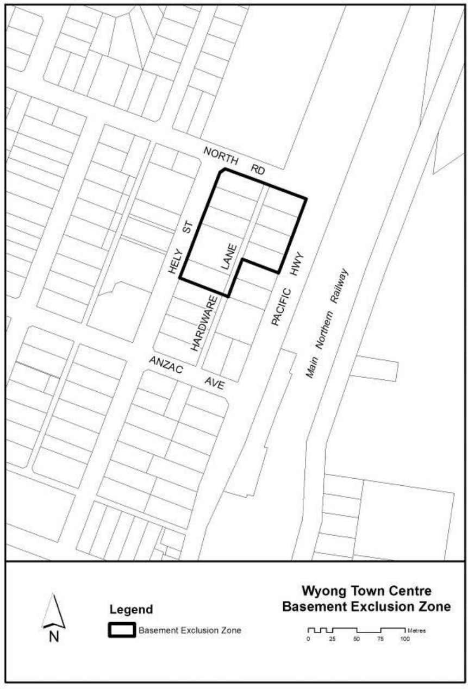

#### 4.5.4.4 Basement Exclusion Zone

In most parts of the Wyong Town Centre, basement car parking is encouraged to improve the visual amenity of the streetscape. However, some areas of the town centre are unsuitable for basement car parking due to localised stormwater and drainage issues.

#### OBJECTIVE

▪ To exclude basement car parking on sites with localised stormwater and drainage issues

#### REQUIREMENT

Basement car parking is prohibited for developments on those sites located on Hardware Lane and shown on Figure 41.

> [Picture on page 50: a picture, saved as a picture (images/ch-04-05-wyong-town-centre-page-50-1.gif, 150 dpi).]

#### Figure 41 Wyong Town Centre basement exclusion zone
