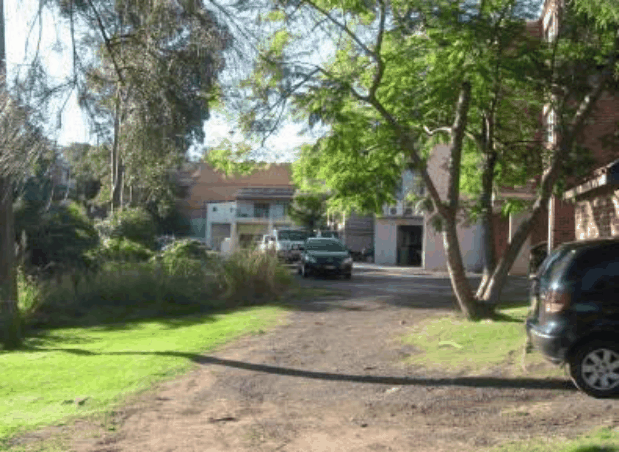
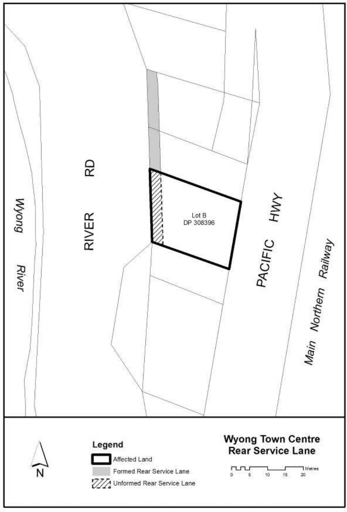

#### 4.5.4.5 Rear Service Lane

In the Wyong Town Centre, there are several sites with frontage to the Pacific Highway and River Road. Some of these sites require vehicular access via the creation of a rear service lane off River Road. Part of this service lane has been constructed, however the remainder of the lane will need to be finalised.

#### OBJECTIVE

To complete the formalisation of a rear service access lane to those properties situated between the River Road reserve and the Pacific Highway. A photo of the formed and unformed parts of the rear service lane is shown below in Figure 42

> [Picture on page 51: a picture, saved as a picture (images/ch-04-05-wyong-town-centre-page-51-9.gif, 150 dpi).]

#### Figure 42 Formed and unformed sections of the rear service lane

#### REQUIREMENTS

a Upon development of Lot B DP 308296, identified in Figure 43, Council will require the construction of a rear service lane in accordance with Council’s Civil Works Specifications.

b Prior to determination of applications on Lot B DP 308296, Council will require a transfer in fee simple to Council of the land required for the rear service laneway at no cost to Council.

> [Picture on page 52: a picture, saved as a picture (images/ch-04-05-wyong-town-centre-page-52-1.gif, 150 dpi).]

#### Figure 43 Rear service lane
