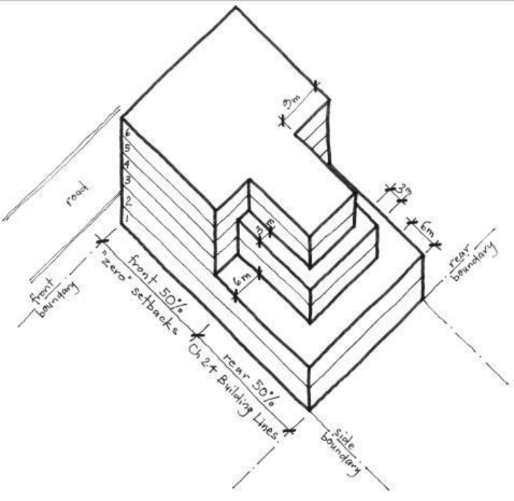

#### 4.5.5.1 Scale

This section provides provisions for the scale of mixed-use and commercial development. For more scale provisions relating to zoning, height, bonuses and FSR in the Wyong Town Centre refer to the Central Coast LEP 2022.

#### 4.5.5.1.1 Setbacks OBJECTIVE

▪ To allow reduced building setbacks in urban areas for mixed-use and commercial development, and to avoid excessive overshadowing of neighbouring sites

#### REQUIREMENTS

a For commercial development in B3 Commercial Core and B4 Mixed Use zones, zero building setbacks to all boundaries are generally permitted except where a heritage setback is required or the development could cause excessive overshadowing to public places. Refer to Section 4.5.2.2.5 – Heritage Setbacks of this Chapter for requirements relating to setbacks of new development adjacent to heritage items.

b For mixed-use development in B3 Commercial Core and B4 Mixed Use zones, zero building setbacks for the first two storeys are generally permitted except where a heritage setback is required or the development could cause excessive overshadowing to public places.

c For mixed-use development above two storeys, a zero front boundary setback is permitted except where a heritage setback is required. A zero side setback is permitted for the front 50% of the side boundary above two storeys. For the rear 50% of any side boundary above two storeys and for any rear boundary above two storeys, the building line requirements of Chapter 2.3: Residential Flat Buildings and Shop-Top Housing will apply.

d For lots with a double frontage, at least 50% of the site must adhere to the minimum setback requirements of Chapter 2.3.

e The above setbacks are minimum requirements. Floor space ratio limits and other factors will have an additional effect on the possible building envelope achievable.

For example, six-storey mixed-use development is permitted to have zero building setback to all boundaries for the first two storeys. The upper storeys are residential and so a zero front boundary setback is permitted except where a heritage setback is required. Zero side boundary setbacks are permitted for the upper storeys for the first 50% of the side boundary except where a heritage setback is required. A 6 metre side setback is required for the rear 50% of the side boundary of the third and fourth storeys. A 9 metre side setback is required for the rear 50% of the side boundary of the fifth and sixth storeys. Finally a 6 metre rear setback is required for the third and fourth storeys, and a 9 metre rear setback is required for the fifth and sixth storeys of residential in accordance with the Building Setbacks section of Chapter 2.3: Residential Flat Buildings and Shop-Top Housing

The example above is illustrated in Figure 44 below.

> [Picture on page 54: a picture, saved as a picture (images/ch-04-05-wyong-town-centre-page-54-10.gif, 150 dpi).]

Figure 44 Example of setback requirements for a mixed use development or shop top housing

above two storeys

f For building setbacks on corner blocks the front boundary is generally taken to be the street boundary that is shorter in length of the two street boundaries and/or that is facing the principal street.

g For mixed-use and commercial development with zero setbacks to boundaries, Council requires facades to be articulated in length and height. This clause particularly applies to those facades facing streets or laneways. Monotonous and unbroken lengths of wall exceeding 10 metres and two storeys in height will not be permitted. Textured facades or a mix of materials is encouraged. For development over two storeys, physical design elements shall be used to provide visual interest and articulation to the building. These can include balconies, screens, awnings, projecting windows, recessed entrances, and wall offsets.

h Note that on some lots fronting the Pacific Highway and Alison Road, a heritage height limit of 10 metres applies for the first 5m from the boundary addressing these roads. This applies to all types of development as required in the Central Coast LEP 2022.

#### 4.5.5.1.2 Floor to Floor Heights

For economic reasons, most development is designed to the minimum requirements for a particular scheme. In commercial buildings floor to floor heights are generally required to be greater than in residential buildings. This means that in the future, commercial buildings can be converted to residential but the reverse is not always possible. This section aims to provide some guidance for appropriate floor to floor heights to allow buildings to be flexible.

#### OBJECTIVE

▪ To set minimum floor to floor heights for mixed-use and commercial development

#### REQUIREMENTS

a Mixed-use and commercial buildings are required to have a minimum floor to floor height of 3.6 metres for the ground floor and second storey, whether the use be retail, commercial or residential.

b Car parking and residential levels of a commercial or mixed-use development are required to have a minimum floor to floor height of 3.0 metres.
