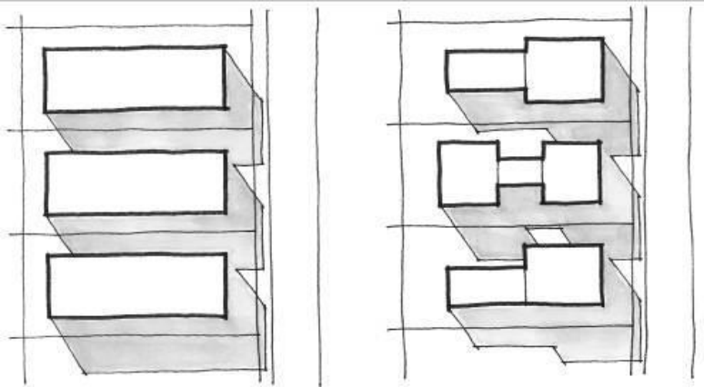

#### 4.5.5.3 Solar Access and Overshadowing

Solar access and overshadowing can present more problems in the Wyong Town Centre due to the east-west orientation of many of the lots. Accordingly, special provisions for mixed-use and commercial buildings have been developed to offer some concessions for solar access in accordance with the Apartment Design Guide (ADG) while also preventing excessive overshadowing to sites to the south of proposed development. These provisions are particularly critical to enable successful mixed-use development in the town centre.

#### OBJECTIVES

▪ To provide special provisions for mixed-use and commercial development in the Wyong Town Centre to prevent excessive overshadowing

▪ To provide some concessions for solar access in mixed-use development appropriate to urban areas and in accordance with the ADG

▪ To provide adequate natural lighting and minimise the need for artificial lighting during daylight hours

#### REQUIREMENTS

a In accordance with recommendations for residential (and mixed-use) development contained in the ADG for Daylight Access: Living rooms and private open spaces for at least 70% of apartments in a development should receive a minimum of 3 hours direct sunlight between 9.00am and 3.00pm in mid-winter.

b Also in accordance with the ADG: Limit the number of single-aspect apartments with a southerly aspect (SW-SE) to a maximum of 10% of the total units proposed. Developments which seek to vary from the minimum standards must demonstrate how site constraints and orientation prohibit the achievement of these standards and how energy efficiency is addressed.

c Commercial and mixed-use development shall provide setbacks to boundaries to enable solar access in accordance with Section 4.5.5.1.1 Setbacks of this Chapter. In addition to providing setbacks, overshadowing of adjacent sites can be reduced by allowing some separation or modulation of buildings. Building modulation can occur by stepping the façade in plan and by varying the building in height. The diagram shows the effects of building modulation on overshadowing.

> [Picture on page 59: a picture, saved as a picture (images/ch-04-05-wyong-town-centre-page-59-27.gif, 150 dpi).]

#### Figure 45 Effects of Building Modulation on Overshadowing

d Developments of two storeys height and above shall provide shadow diagrams based on a survey of the site and adjoining development, showing shadow casting at 9.00am, 12.00noon and 3.00pm on June 21 (winter solstice). The shadow diagrams must show the impact on the proposed development and surrounding areas of the shadows cast by the proposed development, and the surrounding existing development, the area’s natural topography, fencing, and any cut and fill.

e In assessing the impact of shadow on an adjoining property, Council shall have regard for the standards stated above in Section 4.5.5.3 Solar Access and Overshadowing of this Chapter and also for the setback requirements for the particular development type.

f Where a development does not comply with the required solar access requirements under s.4.5.5.3, additional information in the form of elevational shadow diagrams shall be submitted to show the impact of the shadowing on affected properties.
