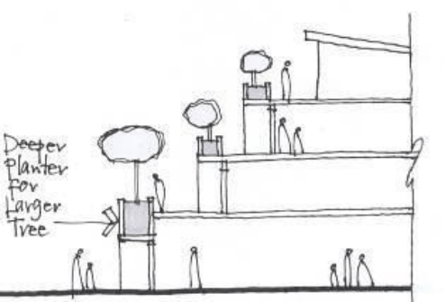
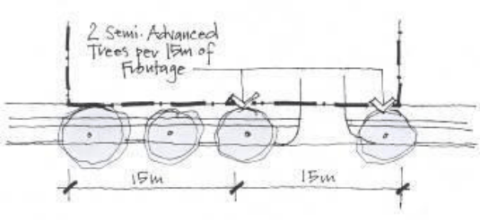

#### 4.5.5.5 Landscape Design

This part provides provisions for landscape design that are relevant to mixed-use and commercial development. For general landscape design provisions relating to the Wyong Town Centre refer to Section

4.5.2.4 Landscape Design of this Chapter.

#### OBJECTIVE

▪ To ensure appropriate landscape design is provided for in mixed-use and commercial development

#### REQUIREMENTS

#### 4.5.5.5.1 Planting on Structures

A common scenario in urban areas is the establishment of landscape areas on top of basement car parks, podiums or roofs. High quality landscape design and open space amenity relies in part on the quality and health of plants. The plants in these areas are grown in total containment with artificial soils, drainage and irrigation. Plants grown in such situations are subject to a range of environmental stresses that affect the health and survival of the plants.

a Design for optimum conditions for plant growth by:

i providing soil depth, volume and area appropriate to the mature size of proposed plantings;

ii providing appropriate soil conditions and irrigation methods;

iii providing appropriate drainage.

b Design planters to support the appropriate soil depth and plant selection by:

i ensuring planter proportions accommodate the largest volume of soil possible. Minimum soil depths will vary depending on the size of the plant however, soil depths less than 1.5 metres are unlikely to have any benefits for tree growth;

ii providing square or circular planting areas rather than long, narrow linear areas to promote balanced root development and robust plant structure.

c Increase minimum soil depths in accordance with:

i the mix of plants;

ii the level of landscape management, particularly the frequency of irrigation;

iii anchorage requirements of large and medium trees;

iv soil type and quality.

> [Picture on page 62: a picture, saved as a picture (images/ch-04-05-wyong-town-centre-page-62-1.gif, 150 dpi).]

#### Figure 46 Example of suitable planting on structures

#### 4.5.5.5.2 Street Trees

All mixed-use and commercial development shall incorporate street tree plantings at a rate of at least two semi-advanced trees per 15 metres of frontage. The tree species that have been selected for the Wyong Town Centre are shown in the Street Tree Masterplan in Section 4.5.2.4 Landscape Design of this Chapter.

Details of the proposed street tree planting including species and locations shall be submitted with the development application. Street trees are to be maintained and nurtured until established.

A street tree planting plan shall be included as part of the landscape design report, except in circumstances where it is demonstrably impractical to provide street trees.

> [Picture on page 62: a picture, saved as a picture (images/ch-04-05-wyong-town-centre-page-62-11.gif, 150 dpi).]

#### Figure 47 Example of street tree planting
