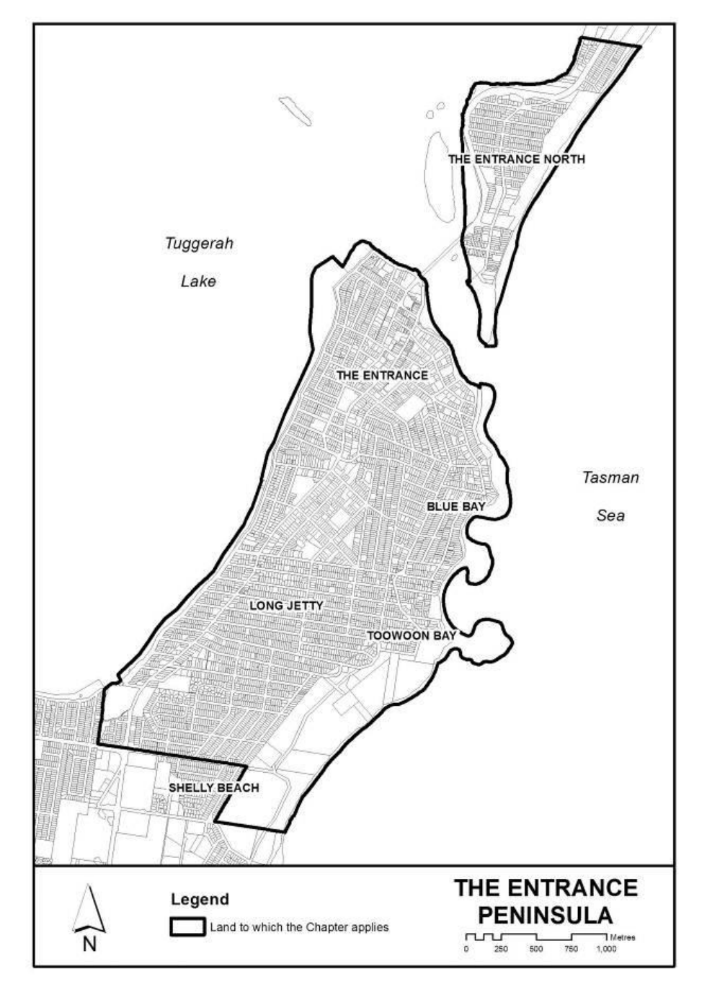

#### 4.6.1.3 Relationship to other Chapters and Policies

With regard to The Entrance Peninsula, Central Coast Local Environmental Plan (LEP) 2022 contains development standards for provisions such as floor space ratio and building heights along with information with regard to the permissibility of land uses. In addition, this Chapter should be read in conjunction with other relevant Chapters of this Development Control Plan and other Policy Documents of Council, including but not limited to:

▪ Chapter 2.1: Dwelling Houses, Secondary Dwellings and Ancillary Development

▪ Chapter 2.3: Residential Flat Buildings and Shop-Top Housing

▪ Chapter 2.13: Transport and Parking

▪ Chapter 5.49: Northern Areas - Key Sites

▪ Council’s Civil Works Specification

Chapter 4.6– The Entrance Peninsula has the following Five Part Structure:

1 Introduction

2 Coastal Character – Character considerations for certain development types and/or sites

3 Building Envelopes – Building setback and envelope requirements for certain uses and zones

4 Design Guidelines – Generally relates to consideration of access requirements, provision of public space and the relationship between public and private space.

5 Key Sites – to be read in conjunction with Chapter 5.49: Northern Areas - Key Sites

> [Picture on page 2: a picture, saved as a picture (images/ch-04-06-the-entrance-peninsula-page-2-1.gif, 150 dpi).]

#### Figure 1 The Entrance Peninsula Area
