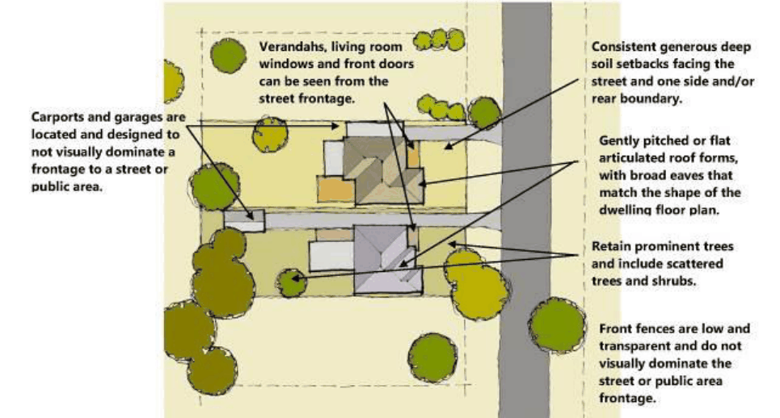

#### 4.6.2.1 Desired Character: Dwellings Houses and Dual Occupancy

### Development

#### OBJECTIVES

The Critical Elements of Desired Character for Detached Dwellings and Dual Occupancy Developments are:

▪ To enhance the neighbourhood’s existing landscape setting

▪ To improve the current quality of local streetscapes

▪ To protect the scenic quality of coastal or lakeside backdrops for properties where buildings would be visible from waterways or shorelines

▪ To promote an outdoor lifestyle by the appropriate design of buildings and dwellings

#### REQUIREMENTS

The following points are to be considered in the design of dwelling houses and dual occupancy development.

#### 4.6.2.1.1 Landscape Settings and Protect Scenic Quality

Provide consistent generous deep soil setbacks facing the street, as well as facing one side boundary or the rear boundary.

Retain existing trees that are prominent elements of any streetscape or scenic backdrop.

Promote neighbourhood networks of canopy trees or tall shrubs, predominantly with indigenous coastal species.

> [Picture on page 4: a picture, saved as a picture (images/ch-04-06-the-entrance-peninsula-page-4-19.gif, 150 dpi).]

Figure 2 Desired character of dwelling house and dual occupancy type development

#### 4.6.2.1.2 Quality of Streetscapes and Protect Scenic Quality

a Site new buildings in a way that is compatible with surrounding development.

b Disguise the scale and minimise the bulk of new buildings.

c Ensure that new dwellings address their street frontage.

d Avoid tall fences that would visually-dominate any frontage to a street or public open space next to the site.

#### 4.6.2.1.3 Minimise and Disguise the Scale and Bulk of New Buildings

a Divide floor space into well-articulated pavilion forms which are partly-separated by landscaped courtyards, and which are identified by individual roof forms.

b Incorporate roofs which are gently-pitched or flat, with broad eaves that cast patterns of deep shadows across facades.

c Screen prominent corners with balconies and verandahs that incorporate lightly-framed structures and sunscreens.

d Use painted finishes with light tones for walls rather than extensive face brickwork.

e Locate and design garages so that they would not visually-dominate any facade which might be seen from the primary street frontage.

#### 4.6.2.1.4 Present an Effective Residential Address for each Dwelling and Promote an Outdoor Lifestyle

a Locate verandahs, living room windows and front doors so that they may be seen from the street frontage.

b Ensure that size or location of garages would not obstruct the desired visibility of outdoor living areas, windows or doors.

c Orient living areas to face any public open space that adjoins the site.
