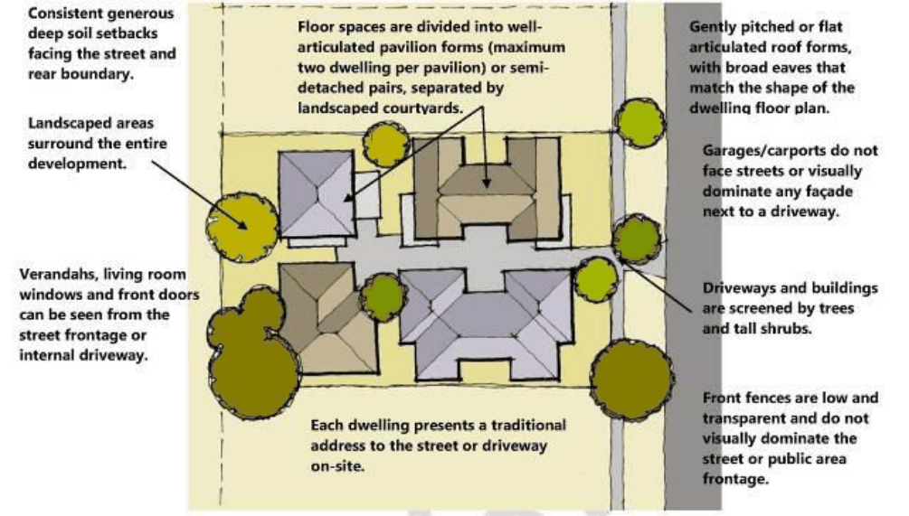

#### 4.6.2.2 Desired Character: Multi-Dwelling Housing

#### OBJECTIVES

The Critical Elements of Desired Character for Multi-Dwelling Housing Developments are:

a To achieve higher standards of urban design quality

b To enhance the neighbourhood’s existing landscape setting

c To improve the current quality of local streetscapes

d To protect the scenic quality of coastal or lakeside backdrops for properties where buildings would be visible from waterways or shorelines

e To promote an outdoor lifestyle by the appropriate design of buildings and dwellings

#### REQUIREMENTS

The following points are to be considered in the design of multi-dwelling housing development.

#### 4.6.2.2.1 Enhance Landscape Settings and Protect Scenic Quality

a Maintain areas of deep soil in generous setbacks facing the street and rear boundaries, and also in courtyards between buildings.

b Retain existing trees that are prominent elements of any streetscape or scenic backdrop.

c Promote neighbourhood networks of canopy trees or tall shrubs, predominantly with indigenous coastal species.

#### 4.6.2.2.2 Improve the Quality of Streetscapes

a Disguise the scale and minimise the bulk of new building forms.

b Prevent parking within any setback that faces a street or park, as well as limiting the width of driveways and the number of garages that might be seen from any street.

c Ensure that all new dwellings address their street frontage or face a driveway.

d Avoid tall, visually-opaque fences that would visually-dominate any frontage to a street or an open space next to the site.

e Screen driveways and new buildings by avenues or rows of trees and tall shrubs.

#### 4.6.2.2.3 Minimise and Disguise Scale and Bulk of New Developments

a Divide floor space into well-articulated pavilion forms which are separated by landscaped courtyards, with not more than two dwellings in each pavilion.

b Incorporate roofs which are gently-pitched or flat, with broad eaves that cast patterns of deep shadows across facades.

c Screen prominent corners of each building with balconies and verandahs that incorporate lightly-framed structures and sunscreens.

d Use painted finishes with light tones for exterior walls and vary tones or colours for successive buildings, rather than using extensive face brickwork or repeating the same colours.

e Avoiding garages in street facades, and avoiding continuous wide garages that would visually-dominate any facade next to a driveway.

> [Picture on page 7: a picture, saved as a picture (images/ch-04-06-the-entrance-peninsula-page-7-1.gif, 150 dpi).]

#### Figure 3 Desired character of multi-dwelling housing type development

#### 4.6.2.2.4 Provide Effective Residential Addresses and Promote an Outdoor Lifestyle

a Orient living areas primarily toward street frontages or open spaces.

b Locate verandahs, living room windows and front doors so that they may be seen from the street frontage or from a driveway.

c Avoid garages as part of any street facade.

d Avoid tall fences that would visually-dominate any frontage to a driveway or a communal open space which is part of the development.
