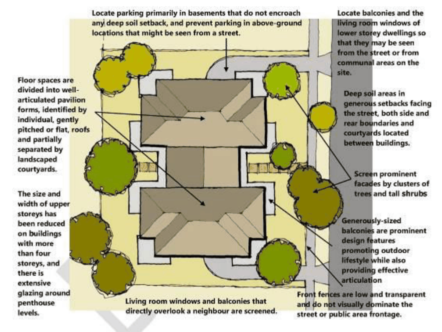

#### 4.6.2.3 Desired Character:  Residential Flat Buildings up to Six Storeys

#### OBJECTIVES

The Critical Elements of Desired Character for Residential Flat Buildings with Six Storeys or less are:

▪ To achieve a significantly-improved standard of urban design quality

▪ To enhance the neighbourhood’s existing landscape setting

▪ To improve the current quality of local streetscapes

▪ To protect the scenic quality of coastal or lakeside backdrops for properties where buildings would be visible from waterways or shorelines

▪ To promote an outdoor lifestyle by the appropriate design of buildings and dwellings

#### REQUIREMENTS

The following points are to be considered in the design of residential flat buildings (up to six storeys).

#### 4.6.2.3.1 Enhance Landscape Settings and Protect Scenic Quality

a Maintain areas of deep soil in generous setbacks facing the street, the rear boundary, along both side boundaries, and also in any courtyards that might be located between buildings.

b Retain existing trees that are prominent elements of any streetscape or scenic backdrop.

c Promote neighbourhood networks of canopy trees or tall shrubs, predominantly with indigenous coastal species.

> [Picture on page 8: a picture, saved as a picture (images/ch-04-06-the-entrance-peninsula-page-8-9.gif, 150 dpi).]

Figure 4 Desired character of residential flat building type development up to six storeys

#### 4.6.2.3.2 Improve the Quality of Streetscapes and Protect Scenic Quality

a Disguise the scale and minimise the bulk of new building forms.

b Use generously-sized balconies as prominent design features that promote an outdoor lifestyle and also provide effective sun shading.

c Screen prominent facades by clusters of trees and tall shrubs.

d Locate parking primarily in basements that do not encroach any deep soil setback, and prevent parking in above-ground locations that might be seen from a street.

e Avoid tall, visually-opaque fences that would visually-dominate any frontage to a street or an open space next to the site.

#### 4.6.2.3.3 Minimise and Disguise Scale and Bulk of New Developments

a Divide floor space into well-articulated pavilion forms which are partly-separated by landscaped courtyards, and which are identified by individual roofs.

b Incorporate roofs which are gently-pitched or flat, with broad eaves that cast patterns of deep shadows across facades.

c For buildings with more than four storeys, reduce the size and width of upper storeys and introduce extensive glazing around penthouse levels.

d Incorporate balconies as a pronounced design feature for facades, including lightly-framed structures and sunscreens to screen the most-prominent corners of each building, and also to promote an outdoor lifestyle.

e Use painted finishes for exterior walls with predominantly light tones rather than extensive face brickwork, and vary paint tones or colours to accentuate articulated building forms.

f Provide basement parking.

#### 4.6.2.3.4 Provide Effective Residential Addresses and Promote an Outdoor Lifestyle

a Incorporate generously-proportioned balconies which include sun and weather-screening.

b Orient living areas primarily toward street frontages or open spaces.

c Locate balconies and the living room windows of lower storey dwellings so that they may be seen from the street or from communal areas on the site.

d Screen living room windows and balconies that might directly overlook a neighbour.
