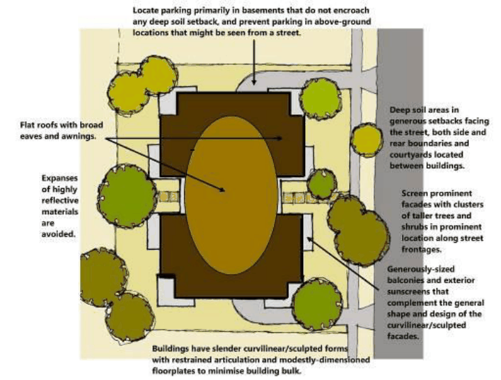

#### 4.6.2.4 Desired Character:  Residential Flat Buildings over Six Storeys

#### OBJECTIVES

The Critical Elements of Desired Character for Residential Flat Buildings with more than Six Storeys are:

▪ To achieve a significantly-improved standard of urban design quality

▪ To protect the scenic quality of coastal or lakeside backdrops

▪ To enhance the neighbourhood’s existing landscape setting

▪ To improve the current quality of local streetscapes

▪ To promote an outdoor lifestyle by the appropriate design of buildings and dwellings

#### REQUIREMENTS

The following points are to be considered in the design of residential flat buildings (over six storeys).

#### 4.6.2.4.1 Enhance Landscape Settings and Protect Scenic Quality

a Maintain areas of deep soil in generous setbacks facing the street, the rear boundary and along both side boundaries.

b Retain existing trees that are prominent elements of any streetscape or scenic backdrop.

c Promote neighbourhood networks of canopy trees, predominantly with indigenous coastal species.

> [Picture on page 10: a picture, saved as a picture (images/ch-04-06-the-entrance-peninsula-page-10-16.gif, 150 dpi).]

Figure 5 Desired character of residential flat buildings type development over six storeys

#### 4.6.2.4.2 Protect Scenic Quality

a Disguise the scale of buildings by slender forms with modestly-dimensioned floor plates.

b Minimise bulk by facades that have a streamlined or curvilinear form.

c Locate parking primarily in basements that do not encroach any deep soil setback, and prevent parking in above-ground locations that might be seen from a street.

d Plant clusters of taller trees in prominent locations along street frontages.

e Maintain or, where possible, enhance waterway view corridors.

#### 4.6.2.4.3 Disguise Scale and Minimise the Bulk of New Buildings

a Incorporate roofs that generally are flat, with broad eaves and awnings that cast patterns of deep shadows across facades.

b Employ restrained articulation for facades, primarily through a co-ordinated diversity of finishes or design treatments, incorporating balconies and exterior sunscreens that complement the general shape and design of curvilinear facades.

c Avoid expanses of highly-reflective materials.

d Limit predominant paint finishes to tones that are light rather than dark or sombre.

e Provide basement parking with driveways that would not appear prominent from any street frontage.

#### 4.6.2.4.4 Provide Effective Residential Addresses and Promote an Outdoor Lifestyle

a Incorporate generously-proportioned balconies which include sunshades and weather-screens.

b Provide lower-storey dwellings and building lobbies that address their street frontage or face communal areas and walkways within the development.

c Screen living room windows and balconies that might directly overlook a neighbour.
