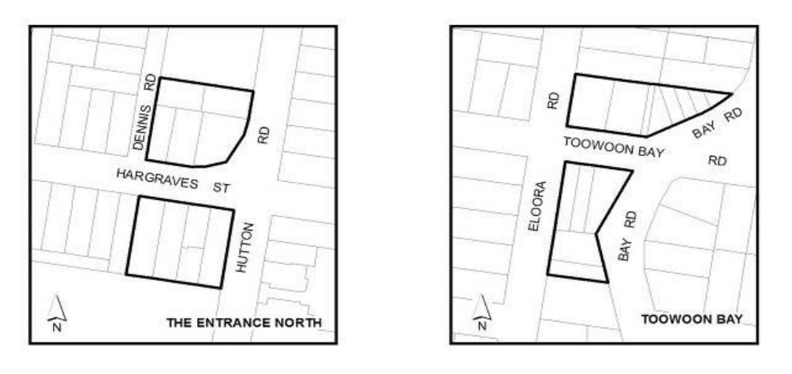

#### 4.6.2.5 Desired Character:  Mixed Development in Zone B1

> [Picture on page 12: a picture, saved as a picture (images/ch-04-06-the-entrance-peninsula-page-12-2.gif, 150 dpi).]

Figure 6 Location of mixed use development in The Entrance North and Toowoon Bay for Zone
