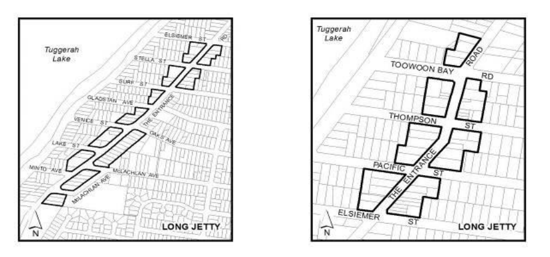

#### 4.6.2.6 Statement of Desired Character:  Mixed Development in Long

### Jetty (Zones B2 and B6)

> [Picture on page 14: a picture, saved as a picture (images/ch-04-06-the-entrance-peninsula-page-14-3.gif, 150 dpi).]

Zone B6 – Enterprise Corridor Zone B2 – Local Centre

Figure 7 Location of mixed use development at Long Jetty Village Centre for zones B2 Local

#### Centre and B6 Enterprise Corridor

#### OBJECTIVES

The Critical Elements of Desired Character for Mixed Developments on Lands at Long Jetty:

▪ To achieve significantly-improved standards of urban design quality

▪ To protect the scenic quality of lakeside backdrops for properties where buildings would be visible from waterways or shorelines

▪ To promote an outdoor lifestyle by the appropriate design of buildings and open spaces

▪ To improve the amenity and civic quality of existing street frontages

▪ To contribute to efficient management of local and district traffic

▪ To maintain the amenity of neighbouring residential properties

#### REQUIREMENT

The following points are to be considered in the design of mixed development in Long Jetty.

#### 4.6.2.6.1 Contribute to Efficient Management of Traffic

a Allow for future widening of The Entrance Road by providing an adequate front setback.

b Provide rear setbacks to accommodate access lanes to service all properties in each street block.

#### 4.6.2.6.2  Encourage an Outdoor Lifestyle and Increased Levels of Pedestrian Activity

a Provide reasonable levels of midwinter sunlight along commercially-significant street frontages.

b Provide a pedestrian friendly-scale next to any pedestrian frontage by avoiding “street wall” building forms with sheer vertical facades that are excessively long.

c Stimulate highest levels of pedestrian activity along commercially-significant street frontages.

d Contribute to the Council’s improvements strategies for street frontages and open spaces.

e Incorporate facilities for public transport, pedestrians and cyclists.

#### 4.6.2.6.3 Stimulate Highest Levels of Pedestrian and Business Activity

a Concentrate shops, entertainment or business-related premises, community facilities or major pedestrian entrances in podium facades that will face and abut a commercially-significant street frontage.

b Avoid blank walls, building services, vehicle entrances or above-ground car parking that would face any commercially-significant street frontage.

c Locate car parking predominantly in basements or behind “active” floor space.

#### 4.6.2.6.4 Protect Scenic Quality and Promote an Outdoor Lifestyle

a Provide landscaped buffers along rear boundaries which separate new developments from residential neighbours.

b Limit the height of street facades to low-rise podiums, maximum two storeys.

c Storeys above any podium are to have a pronounced setback from the podium façade.

d Provide green roofs above podiums, which may be used as communal open spaces.

e Divide upper-storey floor space into well-articulated pavilion forms which are separated by courtyards and identified by individual roofs.

f Incorporate roofs which are gently-pitched or flat, with broad eaves that cast patterns of deep shadows across facades.

g Screen prominent facades by verandahs or balconies that incorporate lightly-framed structures and sunscreens.

h Use painted finishes with light tones for exterior walls, and vary tones or colours for successive buildings, rather than using extensive face brickwork or repeating the same colours.

i Coordinate the size, number and location of business signs, and avoid major corporate logos.

j Maintain or, where possible, enhance waterway view corridors.
