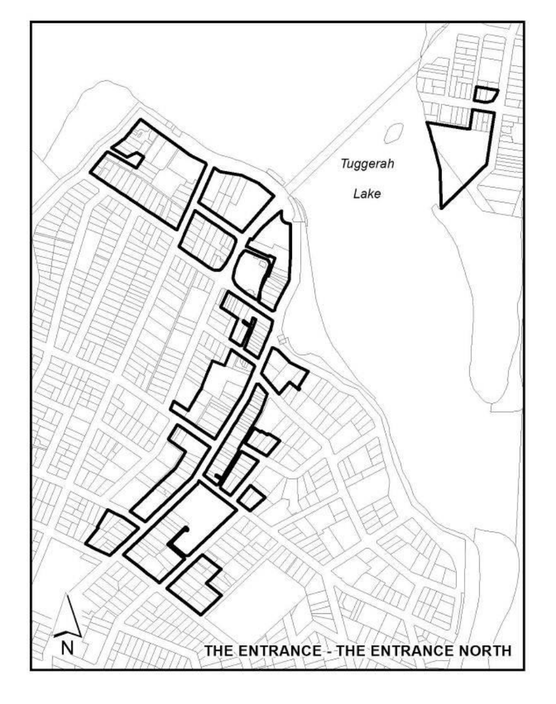

#### 4.6.2.7 Desired Character:  Mixed Development in The Entrance Town

### Centre

> [Picture on page 16: a picture, saved as a picture (images/ch-04-06-the-entrance-peninsula-page-16-3.gif, 150 dpi).]

Figure 8 Location of Mixed Use Development in The Entrance Town Centre for Zones B2 Local

#### Centre and SP3 Tourist

#### OBJECTIVES

The Critical Elements of Desired Character for Mixed Developments on Lands within or surrounding The Entrance Town Centre (Generally Southwards from The Entrance Channel in Zones B2 or SP3 and on The Greens The Entrance Bowling Club Freehold Lands):

▪ To achieve a significantly-improved standard of urban design quality

▪ To protect the scenic quality of coastal or lakeside backdrops for properties where buildings would be visible from waterways or shorelines

▪ To promote an outdoor lifestyle by the appropriate design of buildings and open spaces

▪ To encourage increased levels of pedestrian activity along streets and open spaces

▪ To improve the amenity and civic quality of existing street frontages and parks

#### REQUIREMENTS

The following points are to be considered in the design of mixed development in The Entrance.

#### 4.6.2.7.1 Encourage an Outdoor Lifestyle and Increased Levels of Pedestrian Activity

a Provide reasonable levels of midwinter sunlight for street frontages and open spaces.

b Provide a pedestrian friendly-scale next to any pedestrian frontage by avoiding “street wall” building forms with sheer vertical facades that are excessively long.

c Stimulate the highest levels of pedestrian activity around open spaces and along commercially-significant street frontages.

d Provide views from pedestrian areas toward scenic backdrops or the sky by limiting the width of upper storey facades and by separating the upper storeys of adjoining buildings.

e Contribute to the Council’s improvements strategies for street frontages and open spaces.

f Incorporate facilities for public transport, pedestrians and cyclists.

#### 4.6.2.7.2 Stimulate Highest Levels of Pedestrian and Business Activity

a Concentrate shops, entertainment or business-related premises, community facilities or major pedestrian entrances in podium facades that that will face and abut an open space area or a commercially-significant street frontage.

b Avoid blank walls, building services, vehicle entrances or above-ground car parking that would face any open space area or commercially-significant street frontage.

c Locate car parking predominantly in basements or behind “active” floor space.

d Limit pedestrian links across any site to those which would service destinations that are commercially or socially significant, incorporating an outdoor fresh-air character rather than conventional indoor arcades, but only if such links would not detract from the desired level of street activity.

#### 4.6.2.7.3 Protect Scenic Quality and Promote an Outdoor Lifestyle

a Limit the height of street facades to podiums which generally are no taller than two storeys.

b Require that storeys above any podium have a pronounced setback from the podium façade.

c Provide green roofs above podiums which may be used as communal open spaces.

d For buildings up to six storeys, apply built-form character guidelines for residential flat buildings up to six storeys.

e For buildings taller than six storeys, apply built-form character guidelines for residential flat buildings taller than six storeys.

f Coordinate the size, number and location of business signs, and avoid major corporate logos.
