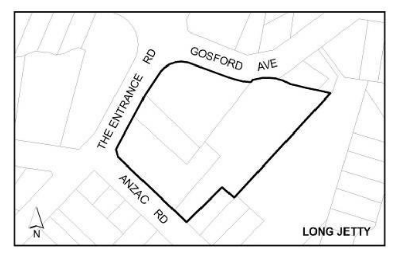

#### 4.6.2.8 Desired Character:  Mixed Light Industrial Development at Long

### Jetty

> [Picture on page 18: a picture, saved as a picture (images/ch-04-06-the-entrance-peninsula-page-18-12.gif, 150 dpi).]

Figure 9 Location of Mixed Use Light Industrial Development at Long Jetty for the IN2 Light

#### Industrial Zone

#### OBJECTIVES

The Critical Elements of Desired Character for Mixed Developments on Lands at Long Jetty within Zone IN2 are:

▪ To achieve significantly-improved standards of urban design quality

▪ To improve the amenity and civic quality of existing street frontages

▪ To contribute to efficient management of local and district traffic

▪ To maintain the amenity of neighbouring residential properties

The following points are to be considered in the design of mixed use light industrial development in Long Jetty.

#### 4.6.2.8.1 Contribute to Efficient Management of Traffic

a Allow for future widening of The Entrance Road by providing an adequate front setback.

b Provide all access from Anzac Road and Gosford Avenue, generally.  Access is not to be provided from The Entrance Road, except for sites where access from Anzac Road or Gosford Avenue is not available.

#### 4.6.2.8.2 Improve Amenity and Civic Quality of Street Frontages

a Provide adequate setback to facilitate any necessary vehicle parking, sufficiently screened by appropriate landscaping along The Entrance Road.

b Partly-screen buildings and forecourt parking by rows of tall canopy trees that are predominantly indigenous coastal species.

c Locate ancillary offices and showrooms facing The Entrance Road and minimise the extent of blank walls that would be seen from that road.

d Contribute to the Council’s improvements strategies for street frontages and open spaces.

#### 4.6.2.8.3 Disguise the Scale of Buildings

a Provide landscaped buffers along rear boundaries which separate new developments from residential neighbours.

b Limit the height of street facades to a two storey podium.

c Storeys above any podium to have a pronounced setback from the podium façade.

d Divide upper-storey floor space into well-articulated pavilion forms which are separated by courtyards and identified by individual roofs.

e Incorporate roofs which are gently-pitched or flat, with broad eaves that cast patterns of deep shadows across facades.

f Screen prominent facades by balconies that incorporate lightly-framed structures and sunscreens.

g Use painted finishes with light tones for exterior walls, and vary tones or colours for successive buildings, rather than using extensive face brickwork or repeating the same colours.

h Coordinate the size, number and location of business signs, and avoid major corporate logos.
