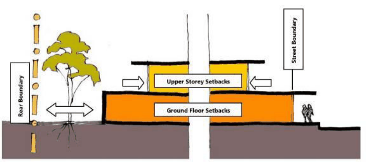
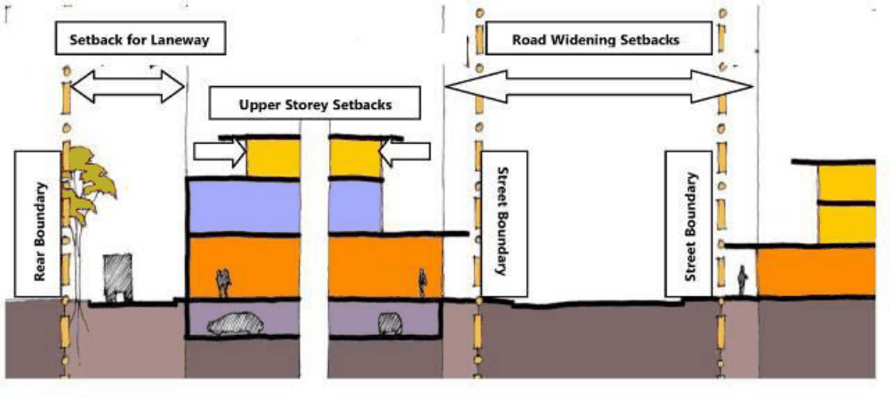
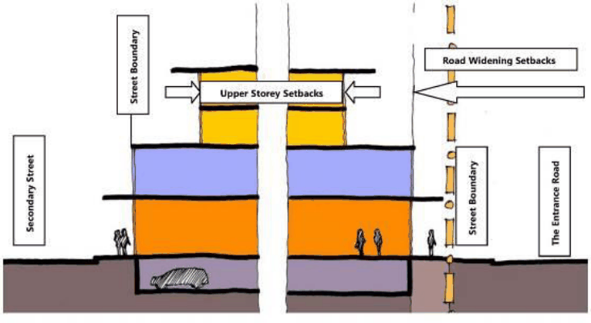
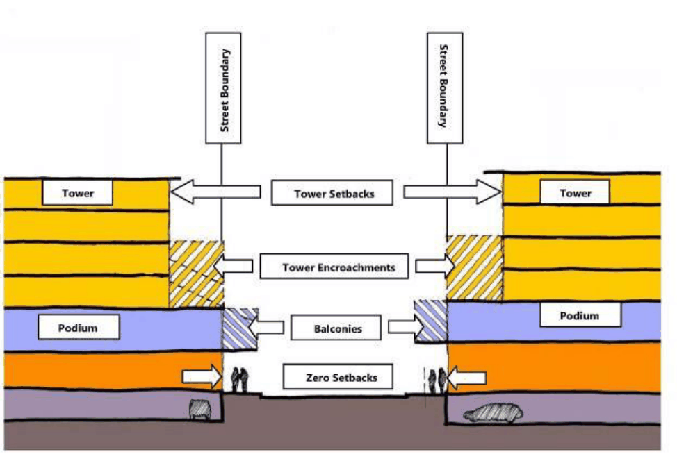
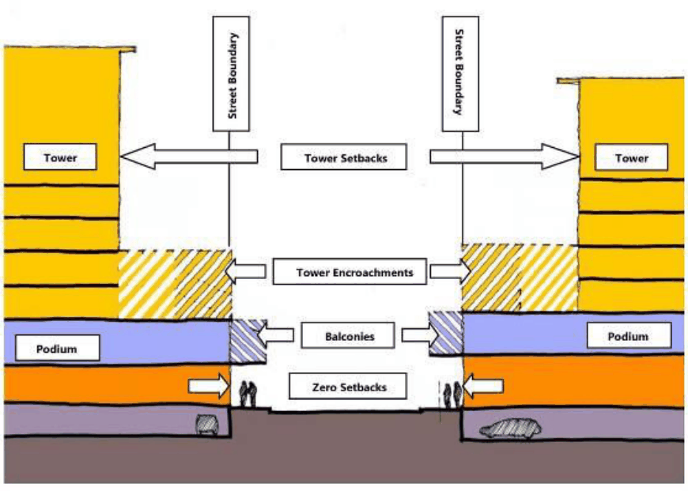
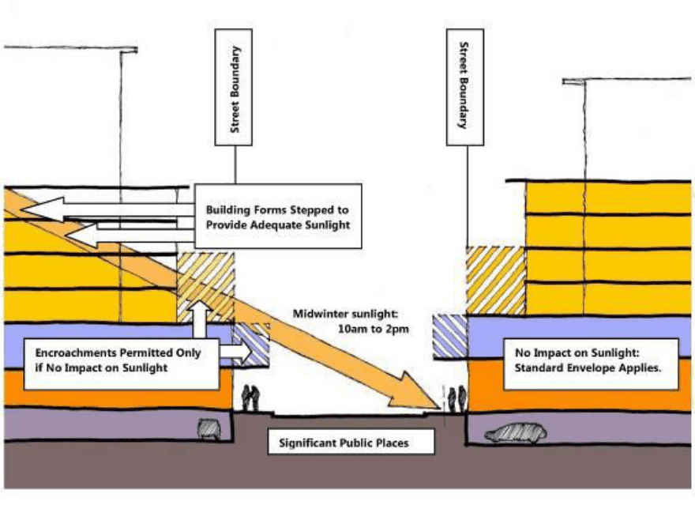
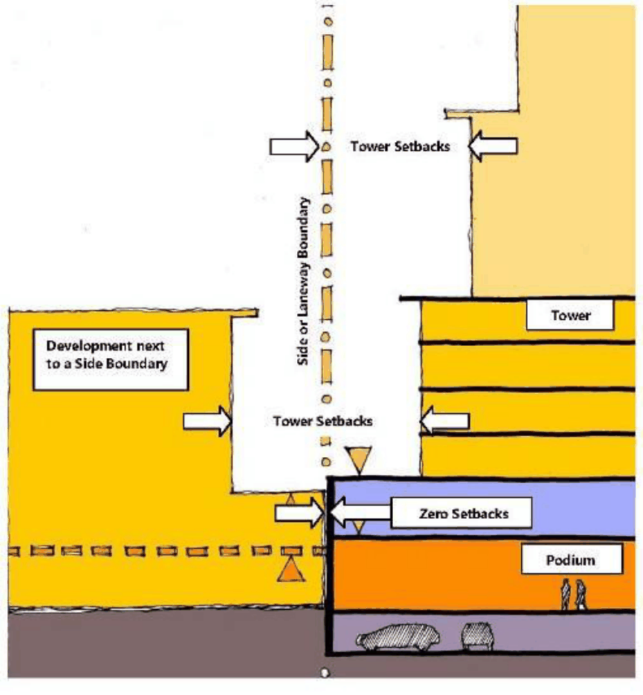
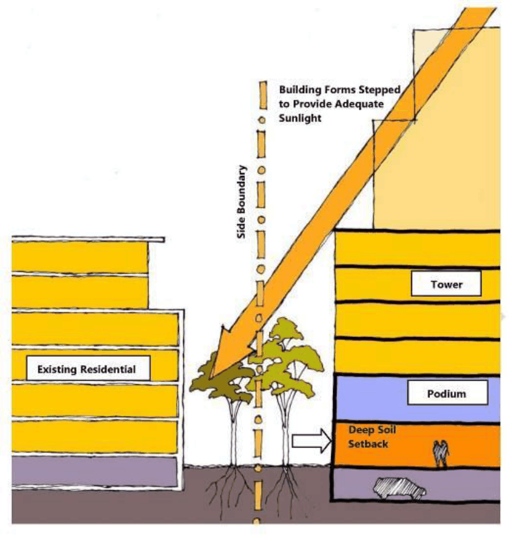
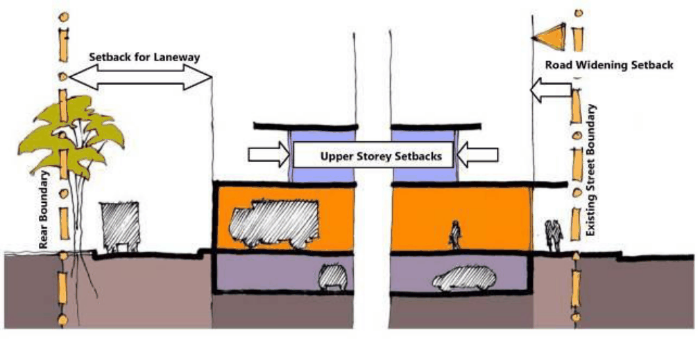
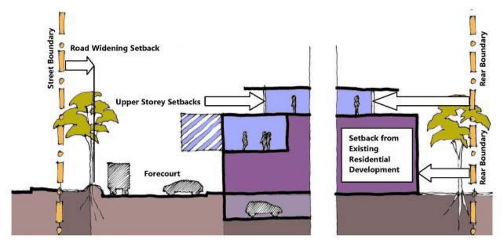

#### 4.6.3.2 Building Envelope Provisions:  Mixed Development

a Mixed development applies to zones B1, B2, B4, B6, SP3 and RE2.

b In relation to mixed development in general, there are several topics or situations which require envelope controls:

i typical frontages to streets, laneways and civic spaces:  Setbacks for ground floors and upper storeys, together with desirable encroachments;

ii for development within The Entrance Town Centre:  Setbacks from side boundaries to moderate the scale and visual impact of upper stories;

iii next to residential developments:  Landscaped setbacks and/or sunlight controls;

iv for development at Long Jetty:  Setbacks to accommodate road-widening and rear lanes.

A sequence of several envelope controls follows.

#### 4.6.3.2.1 Mixed Development in Zone B1:  The Entrance North and Toowoon Bay

> [Picture on page 20: a picture, saved as a picture (images/ch-04-06-the-entrance-peninsula-page-20-23.gif, 150 dpi).]

Figure 10 Building envelope for mixed use development in Zone B1 Neighbourhood Centre at

#### The Entrance North and Toowoon Bay (refer Figure 6)

#### 4.6.3.2.1.1 Impact on Adjoining Residential Property OBJECTIVE

▪ To moderate the scale and bulk of developments that is next to a residential property

#### REQUIREMENTS

a A setback, which is predominantly deep soil, to be provided next to a rear boundary that adjoins a residential property.

b New buildings and any basement to be setback by a minimum of 6m from a rear boundary that adjoins a residential property.

c Storeys above the ground floor of any new building to have an additional setback of 5m from a rear boundary that adjoins a residential property.

#### 4.6.3.2.1.2 Streetscape OBJECTIVE

▪ To maintain amenity, new buildings should have a single storey appearance when viewed from any street

#### REQUIREMENTS

a The maximum building height and the floor space ratio shall be in accordance with Clauses 4.3, 4.3A, 4.4, 4.4Aand 4.4B of Central Coast LEP 2022.

b Buildings to have a zero setback from building lines which are defined by the site’s boundaries that face a street or lane.

c Second storeys to be setback a minimum of 5m from any building line.

d Buildings may have a zero setback from any boundary that is shared with another mixed development in zone B1.

#### 4.6.3.2.1.3 General

The following encroachments beyond the building envelope are acceptable:

a A balcony or terrace may be located within any upper storey setback.

#### 4.6.3.2.2 Mixed Development in Zone B2:  Long Jetty Village Centre (Three Storey)

> [Picture on page 22: a picture, saved as a picture (images/ch-04-06-the-entrance-peninsula-page-22-2.gif, 150 dpi).]

Figure 11 Building envelope for three storey mixed use development in Zone B2 Local Centre at

#### Long Jetty Village Centre (refer Figure 7)

#### 4.6.3.2.2.1 Laneways OBJECTIVE

▪ To provide deep setbacks from rear boundaries to accommodate new laneway access

#### REQUIREMENTS

a All properties that face The Entrance Road shall contribute to the Council’s laneway strategy.

b Buildings to be setback 10m from rear boundaries.

c Third storeys to have an additional setback of 5m.

d The required rear boundary setback to accommodate two way traffic and one continuous landscaped verge which is located next to the rear boundary and at least 2m wide.

e Basements may encroach beneath a laneway to within 4m of a rear boundary.

f Laneway pavements to accommodate the medium rigid design vehicle which is specified by AS 2890.2.

g Reciprocal rights-of-way to be established for all properties which would benefit from the laneway.

#### 4.6.3.2.2.2 Road Widening OBJECTIVE

▪ All development shall accommodate future widening of The Entrance Road

#### REQUIREMENTS

a Developments shall be setback from existing front boundaries by the distance which is specified by the NSW Roads and Maritime Services in order to accommodate future widening.

b Land within the road widening setback shall be dedicated to the NSW Roads and Maritime Services, without cost.

#### 4.6.3.2.2.3 Streetscape OBJECTIVE

▪ To maintain amenity, new facades facing any street should have a single storey appearance

#### REQUIREMENTS

a Maximum building height shall be according to provisions of Clause 4.3 and 4.3A of Central Coast LEP 2022.

b Buildings and any basements to have a zero setback from building lines which are defined by a road widening setback, or by a site’s boundaries which face a secondary street or a lane.

c Second and third storeys to be setback from any building line by a minimum of 5m.

d Buildings may have a zero setback from any boundary that is shared with another mixed development in zone B2.

#### 4.6.3.2.2.4 General

The following encroachments beyond the building envelope are acceptable:

a A balcony or terrace may be located within any upper storey setback.

#### 4.6.3.2.3 Mixed Development in Zone B2:  Long Jetty Village Centre (Four Storey)

> [Picture on page 24: a picture, saved as a picture (images/ch-04-06-the-entrance-peninsula-page-24-2.gif, 150 dpi).]

Figure 12 Building envelope for four storey mixed use development in Zone B2 – Local Centre at

#### Long Jetty Village Centre (refer Figure 7)

#### 4.6.3.2.3.1 Streetscape OBJECTIVE

▪ To maintain amenity new facades facing any street should have a two storey appearance

#### REQUIREMENTS

a Maximum building height shall be according to provisions of Clause 4.3 and 4.3 A of Central Coast LEP 2022.

b Buildings and any basements to have a zero setback from building lines which are defined by a road widening setback, or by a site’s boundaries which face a secondary street or a lane.

c Third and fourth storeys to be setback from any building line by a minimum of 5m.

d Buildings may have a zero setback from any boundary that is shared with another mixed development in zone B2.

#### 4.6.3.2.3.2 Road Widening OBJECTIVE

▪ To ensure all development accommodates future widening of The Entrance Road

#### REQUIREMENTS

a Developments shall be setback from existing front boundaries by the distance which is specified by the NSW Roads and Maritime Services in order to accommodate future widening.

#### 4.6.3.2.3.3 General

The following encroachments beyond the building envelope are acceptable:

a A balcony or terrace may be located within any upper storey setback.

#### 4.6.3.2.4 Mixed Development in Zones B2, SP3 and RE2 up to six storeys:  Frontages to Streets, Lanes and Civic Spaces

> [Picture on page 25: a picture, saved as a picture (images/ch-04-06-the-entrance-peninsula-page-25-6.gif, 150 dpi).]

Figure 13 Building envelope for mixed use development up to six storeys in Zones B2 Local

Centre, SP3 Tourist and RE2 Private Recreation at The Entrance Town Centre (refer

#### Figure 8)

#### 4.6.3.2.4.1 Streetscape OBJECTIVE

▪ To maintain appropriate amenity and built form, all new buildings shall comprise podium and tower elements

#### REQUIREMENTS

a Maximum building height and floor space ratio shall be in accordance with Clauses 4.3, 4.3A, 4.4, 4.4A and 4.4B of Central Coast LEP 2022.

b Podium elements to have a zero setback from building lines which are defined by a site’s boundaries that face a street, a lane or a public open space.

c Podium elements to face any civic open space on a development site.

d Podium elements to be a maximum of two storeys high.

Note:  The height of the podium shall be determined by ceiling heights that are necessary to accommodate proposed uses.

e A podium is not to include an additional mezzanine level.

f All storeys above a podium to be located within tower elements.

g For buildings up to six storeys, tower elements to be setback from building lines by a minimum of 5m.

#### 4.6.3.2.4.2 General

The following encroachments beyond the building envelope are acceptable:

a A balcony on the first storey above any street or open space may extend up to 3m beyond a building

line. (Indicated by mauve diagonal hatching).

Note:  Balconies that extend beyond a property boundary over the footpath need to obtain a licence from Council.

For tower facades, up to 50% of the width may extend as far as the general building line but only for third and fourth storeys. (Indicated by yellow diagonal hatching).

In general, basements are not to extend beyond a building line.

Unless noted above, balconies shall not extend beyond the tower envelope.

#### 4.6.3.2.5 Mixed Development in Zones B2, SP3 over Six Storeys:  Frontages to Streets, Lanes and Civic Spaces

> [Picture on page 27: a picture, saved as a picture (images/ch-04-06-the-entrance-peninsula-page-27-3.gif, 150 dpi).]

Figure 14 Building envelope for mixed use development over six storeys in Zones B2 Local Centre

and SP3 Tourist at The Entrance Town Centre (refer Figure 8)

#### 4.6.3.2.5.1 Streetscape OBJECTIVE

▪ To maintain appropriate amenity and built form, all new buildings shall comprise podium and tower elements

#### REQUIREMENTS

a Maximum building height and floor space ratio shall be in accordance with Clauses 4.3, 4.3A, 4.4, 4.4Aand 4.4B of the Central Coast LEP 2022.

b For podium elements, heights and setbacks to be the same as for buildings up to six storeys.

c For buildings taller than six storeys, tower elements to be setback from building lines by a minimum of 10m.

#### 4.6.3.2.5.2 General

The following encroachments beyond the building envelope are acceptable:

a a balcony on the first storey above any street or open space may extend up to 3m beyond a building

line. (Indicated by mauve diagonal hatching);

Note:  Balconies that extend beyond a property boundary over the footpath need to obtain a licence from Council.

b for tower facades, up to 50% of the width may extend as far as the general building line but only for third and fourth storeys. (Indicated by yellow diagonal hatching);

c in general, basements shall not extend beyond a building line; d unless noted above, balconies shall not extend beyond the tower envelope.

#### 4.6.3.2.6 Mixed Development in Zones B2, SP3 and RE2:  Sunlight to Footpaths and Open Spaces

> [Picture on page 28: a picture, saved as a picture (images/ch-04-06-the-entrance-peninsula-page-28-7.gif, 150 dpi).]

Figure 15 Building envelope for mixed use development in Zones B2 Local Centre, SP3 Tourist

and RE2 Private Recreation in relation to provide adequate sunlight to footpaths and open spaces at The Entrance Town Centre (refer Figure 8)

Note:  Significant public places are footpaths along The Entrance Road, north-facing footpaths in side streets off The Entrance Road, public open spaces (existing or as proposed by a site-specific DCP or a development application which has been submitted to the Council).

#### OBJECTIVE

▪ To ensure that new building works shall provide sunlight to significant public places

a Significant public places occur within zones B2 and SP3 at The Entrance Town Centre.  As well as satisfying other envelope controls, new buildings are to:

i maintain the amount of sunlight that is currently available to significant public places between the hours of 10 am and 2.00pm during midwinter (June 21); and

ii ensure specified sunlight is to be available to at least half of any public open space, and at least half of the width for the specified footpaths.

The following encroachments may be acceptable:

iii encroachments must demonstrate that the minimum sunlight would be achieved;

iv balconies on the first storey above any street or open space may be permitted as for six storey buildings;

v for tower facades, up to 25% of the width may extend as far as the general building line but only for third and fourth storeys. (Indicated by yellow diagonal hatching).

Development applications to provide the following information:

vi shadow diagrams for midwinter and the equinoxes, demonstrating existing and proposed shadows between 10 am and 2pm in relation to significant public places.

#### 4.6.3.2.7 Mixed Development in Zones B2, SP3 and RE2:  Facing a Side Boundary or a Rear Lane

> [Picture on page 30: a picture, saved as a picture (images/ch-04-06-the-entrance-peninsula-page-30-3.gif, 150 dpi).]

Figure 16 Building envelope for mixed use development in Zones B2 Local Centre, SP3 Tourist

and RE2 Private Recreation in relation to a side boundary or a rear lane or street in any location

#### OBJECTIVE

▪ To ensure adequate amenity and appropriate built form, consistent with Councils Adopted Strategy for this locality, street elevations of new buildings shall comprise podium and tower elements

#### REQUIREMENTS

a Podium elements may have a zero setback from any boundary that faces another mixed development in zone B2 or SP3, or an existing rear lane.

b Podium elements to be a maximum of two storeys high.

c Next to an existing mixed development, podium elements to be approximately 1m taller or lower than the adjacent podium.

d Tower elements to be setback from any boundary that faces another mixed development, or an existing rear lane, by half of the “distance separation” that is specified by the SEPP No 65 Apartment Design Guide.

Note:  The required tower setback is calculated according to the number of storeys within the tower element only.

#### 4.6.3.2.8 Mixed Development in Zones B2, SP3 and RE2:  Boundary Facing Residential Development

> [Picture on page 31: a picture, saved as a picture (images/ch-04-06-the-entrance-peninsula-page-31-8.gif, 150 dpi).]

Figure 17 Building envelope for mixed use development in Zones B2 Local Centre, SP3 Tourist

and RE2 Private Recreation in relation to a boundary facing residential development

#### 4.6.3.2.8.1 Landscaped Setbacks OBJECTIVE

▪ To maintain amenity for residents, new buildings shall provide a landscaped setback

#### REQUIREMENTS

a A setback which is predominantly deep soil is to be provided next to any residential property.

b Podium elements and any basement to be setback from any boundary that faces a residential property by a minimum of 6m.

#### 4.6.3.2.8.2 Sunlight Access OBJECTIVES

▪ To address issues such as sunlight access, tower elements to be setback from any boundary that faces a residential property

▪ To ensure that upper storeys do not to reduce sunlight to neighbouring dwellings

#### REQUIREMENTS

a The setback should be half of the “distance separation” which is specified by the SEPP No 65 Apartment Design Guide.

b Neighbouring dwellings to receive the amount of sunlight that is specified by the SEPP No 65 Apartment Design Guide.

c If a neighbouring dwelling currently receives less than the required amount of sunlight, there is to be no further reduction.

d To protect existing sunlight, adjustment may be necessary to the form, siting and dimensions of upper storeys that are permitted by the general envelope controls.

Note:  The required tower setback is calculated according to the number of storeys within the tower element only.

#### 4.6.3.2.9 Mixed Development in Zone B6: Bulky Goods Retailing at Long Jetty

> [Picture on page 33: a picture, saved as a picture (images/ch-04-06-the-entrance-peninsula-page-33-2.gif, 150 dpi).]

Figure 18 Building envelope for two storey mixed use development in Zone B6 Enterprise

#### Corridor at Long Jetty Village Centre (refer Figure 7)

#### OBJECTIVE

#### 4.6.3.2.9.1 Laneways

▪ To provide deep setbacks from rear boundaries to accommodate new laneway access

#### REQUIREMENTS

a All properties that face The Entrance Road shall contribute to implementation of the Council’s laneway strategy.

b Buildings to be setback 10m from rear boundaries.

c Second storeys to have an additional setback of 5m.

d The required rear boundary setback is to accommodate two way traffic and one continuous landscaped verge, which is located next to the rear boundary and at least 2m wide.

e Basements may encroach beneath a laneway to within 4m of a rear boundary.

f Laneway pavements to accommodate the medium rigid design vehicle which is specified by AS 2890.2.

g Reciprocal rights-of-way are to be established for all properties which would benefit from the laneway.

#### 4.6.3.2.9.2 Road Widening OBJECTIVE

▪ To accommodate future widening of The Entrance Road

#### REQUIREMENTS

a Developments shall be setback from existing front boundaries by the distance which is specified by the NSW Roads and Maritime Services in order to accommodate future widening.

b Land within the road widening setback shall be dedicated to the NSW Roads and Maritime Services without cost.

#### 4.6.3.2.9.3 Streetscape OBJECTIVE

▪ To maintain amenity, facades facing any street are to have a single storey appearance

#### REQUIREMENTS

a Maximum building height and floor space ratio shall be in accordance with Clauses 4.3, 4.3A, 4.4, 4.4A and 4.4B of Central Coast LEP 2022.

b Buildings and any basements to have a zero setback from building lines which are defined by a road widening setback, or by a site’s boundaries which face a secondary street or a lane.

c Second and third storeys to be setback from any building line by a minimum of 5m.

d Buildings may have a zero setback from any boundary that is shared with another mixed development in zone B6.

#### 4.6.3.2.9.4 General

The following encroachments beyond the building envelope are acceptable:

a a balcony or terrace may be located within any upper storey setback.

#### 4.6.3.2.10 Mixed Development in Zone IN2:  Light Industrial at Long Jetty

> [Picture on page 35: a picture, saved as a picture (images/ch-04-06-the-entrance-peninsula-page-35-2.gif, 150 dpi).]

Figure 19 Building envelope for mixed use development in Zone IN2 Light Industrial at Long

#### Jetty Village Centre (refer Figure 9)

#### 4.6.3.2.10.1 Road Widening OBJECTIVE

▪ To accommodate future widening of The Entrance Road

#### REQUIREMENTS

a Developments shall be setback from existing front boundaries by the distance which is specified by the NSW Roads and Maritime Services in order to accommodate future widening.

Land within the road widening setback shall be dedicated to the NSW Roads and Maritime Services, without cost.

#### 4.6.3.2.10.2 Streetscape OBJECTIVE

▪ To moderate the scale and bulk of buildings facing The Entrance Road

#### REQUIREMENTS

a Maximum building height and floor space ratio shall be in accordance with Clauses 4.3, 4.3A, 4.4, 4.4A and 4.4B of Central Coast LEP 2022.

b Buildings to be sited behind landscaped forecourts that accommodate parking and delivery access.

c Forecourts to accommodate the medium rigid design vehicle which is specified by AS 2890.2.

d Second storey balconies or office premises may overhang forecourt parking areas by up to 5m.

e Third storeys to be setback from the ground floor facade and from any side boundary by a minimum of 5m.

f The lower two storeys may have a zero setback from any side or rear boundary that is shared with another mixed development in zone IN2.

#### 4.6.3.2.10.3 Impact on Adjoining Residential Property OBJECTIVE

▪ To moderate the scale and bulk of buildings that are next to a residential property

#### REQUIREMENTS

a A setback which is predominantly deep soil is to be provided next to a side or rear boundary that adjoins a residential property.

b New buildings and any basement are to be setback from the boundary with a residential property by a minimum of 6m.

c Storeys above the ground floor of any new building are to have an additional setback of 5m.

#### 4.6.3.2.10.4 General

a The following encroachments beyond the building envelope are acceptable:

i a balcony or terrace may be located within any upper storey setback.

b Alterations and additions may maintain existing building setbacks for lower storeys:

i top storey additions are to apply setbacks that are specified at 4.6.3.2.10.2(e).
