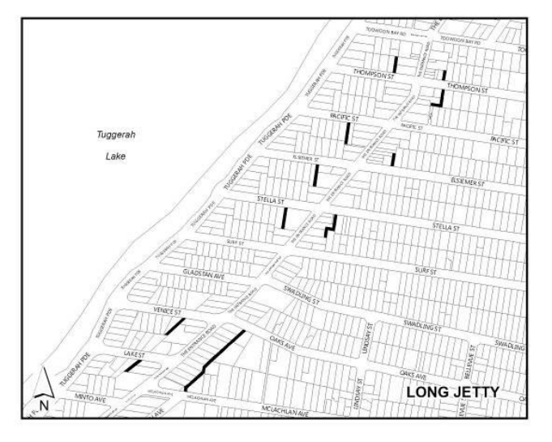
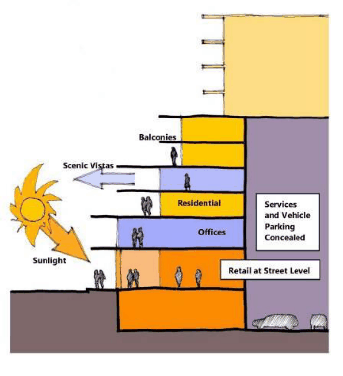

#### 4.6.4.2 Design Guidelines:  Mixed Use Development

#### 4.6.4.2.1 Pedestrian Networks

a Footpaths that have potential to/already contribute to simulating significant social and commercial activity of centres are:

i The Entrance Town Centre:

▪ The Entrance Road northwards from Campbell Avenue/Warrigal Street;

▪ Dening Street from The Entrance Road to Taylor Street;

▪ Theatre Lane;

▪ Bayview Avenue from The Entrance Road to Short Street;

▪ Ambler Parade;

▪ Ocean Parade from The Entrance Road to Ambler Parade;

▪ Marine Parade in the vicinity of the intersection with The Entrance Road;

▪ Coral Street from The Entrance Road to Torrens Avenue;

▪ Victoria Avenue from The Entrance Road to east of Farnell Lane;

▪ Fairview Avenue from The Entrance Road to Torrens Avenue;

▪ along and facing The Entrance Channel at Picnic Point (including, all frontages to The Entrance Road West and Oakland Avenue between its intersections with The Entrance Road West and Oakland Avenue);

ii Long Jetty Village Centre:

▪ all frontages along The Entrance Road;

▪ Thompson Street westwards from the corner of The Entrance Road;

▪ Pacific Street westwards from the corner of The Entrance Road;

iii The Entrance North and Toowoon Bay Neighbourhood Centres:

▪ all frontages to existing shops;

New open spaces with the potential to simulate significant social and commercial activity are:

iv The Entrance Town Centre:

▪ A town square in the Dening Street, The Entrance Road, Short Street vicinity;

▪ An outdoor forecourt along the eastern side of Theatre Lane;

▪ Extension of Bayview Avenue Mall along the Bayview Avenue to Short Street;

▪ A forecourt or small square in the vicinity of the Ebb Tide Mall property;

▪ Waterfront mall/promenade alongside and facing The Entrance Channel, between Wilfred Barrett Drive and Picnic Point, along the current alignment of The Entrance Road West;

▪ A water front open space area/promenade in The Entrance North Waterfront Vicinity west of Hutton Road, between The Entrance Bridge and (including) Karagi Reserve;

v Long Jetty Village Centre:

▪ A village square incorporated into the future Long Jetty Village Centre extension vicinity, west of The Entrance Road between Pacific and Thompson Streets.

#### OBJECTIVES

▪ To recognise the significant role of pedestrian places in relation to social and business activity within centres on The Entrance Peninsula

▪ To promote an outdoor lifestyle by concentrating pedestrian and business activity along significant pedestrian footpaths and around existing and new public open spaces

▪ To establish a framework for planning and design of future development in order to stimulate optimum levels of pedestrian activity within centres on The Entrance Peninsula

▪ To nominate new open spaces which would provide public benefits as part of a “Key Site” development

#### REQUIREMENT

a Development proposals upon lands which face any of the nominated public places (whether existing or as desired) are to be planned and designed to maximise pedestrian and business activity:

i incorporate new open spaces as specified above;

ii provide active frontages facing pedestrian footpaths that are nominated above, or facing any desired open space that is specified above

iii locate major facilities, services and parking areas where they would not disrupt the desired level of pedestrian activity;

iv include new cross-site pedestrian pathways only where they would follow “desire lines” to major destinations or facilities.

#### 4.6.4.2.2 Transport and Access Infrastructure OBJECTIVES

▪ To provide new facilities in locations that would contribute to the desired levels of outdoor pedestrian activity

▪ To improve the efficiency of existing traffic flows and avoid conflict between cars, heavy vehicles, cyclists and pedestrians

▪ To nominate facilities which would provide public benefits as part of a “Key Site” development

#### REQUIREMENTS

a Public car parking is to be provided as part of the following “Key Site” developments in The Entrance Town Centre and at Picnic Point:

i Lakeside Plaza;

ii The Dening Street carpark;

iii Ebbtide Mall;

iv the designated public carpark in Manning Road;

v Tourist Zone Site between Wilfred Barrett Drive and Picnic Point.

b A public transport layover area is to be provided along The Entrance Road in the vicinity of Dening Street as part of the Lakeside Plaza “Key Site” redevelopment.

c To accommodate new public open spaces, the redirection of existing town centre traffic is to be evaluated and, where desirable, implemented as part of the following “Key Sites”:

i Lakeside Plaza;

ii The Dening Street Carpark.

d To improve road safety and efficiency of traffic flows, existing site access should be realigned for the following “Key Site” developments:

i Lakeside Plaza:  rear lane access is to be provided to properties fronting The Entrance Road, and possibly extended through to The Entrance Road;

ii Ebbtide Mall:  site access from Torrens Avenue to be consolidated as a single access/egress;

iii Diggers @ The Entrance:  site access from The Entrance Road is to be consolidated as a single access/egress, with traffic signals at The Entrance Road, if required by the RTA and Council’s traffic committee, with the access/egress to be connected to a simplified network of internal access roads.

e To improve the safety and efficiency of The Entrance Road through Long Jetty, site access at Long Jetty, properties zoned B2 and B6 are to be accessed from side streets and/or from a system of rear lanes, in accordance with the  following image:

i access is not to be provided from The Entrance Road except for “mid-block” sites where access to a side street or laneway, is not available;

ii rear lane access is to be provided, dedicated and constructed at no cost to Council, with the redevelopment of any site that would not occupy the full width of a street block, and where existing or future development of the remaining properties in that street block would not have direct access to a side street;

iii rear laneways are to be wide enough to accommodate two way traffic and one continuous landscaped verge at least 2m wide, which abuts the rear boundary and vehicle parking, where on-site parking is not otherwise available;

iv laneway pavements are to accommodate a medium rigid design vehicle, specified by AS2890.2;

v reciprocal rights-of-way are to be established for all properties which would benefit from the laneway.

f Cycle access to be promoted by all new developments:

i bike storage is to be provided in safe and accessible locations, either at street level or as part of basement carparks;

ii cycle storage is to be provided at a rate required by Council or specified by Council policy.

> [Picture on page 40: a picture, saved as a picture (images/ch-04-06-the-entrance-peninsula-page-40-15.gif, 150 dpi).]

Figure 20 Access arrangements from side streets and rear lanes at Long Jetty Village Centre in

#### Zones B2 Local Centre and B6 Enterprise Corridor

#### 4.6.4.2.3 New Public Open Spaces OBJECTIVES

▪ To provide new facilities in locations that would contribute to the desired levels of outdoor pedestrian activity

▪ To ensure that new facilities have the flexibility to accommodate a variety of activities  as well as encouraging informal social interaction

▪ To co-ordinate the planning, design and construction of publicly-accessible spaces

▪ To nominate facilities which would provide public benefits as part of a “Key Site” development

#### REQUIREMENTS

a A new town square is to be provided as a focal point for The Entrance Town Centre:

i the square is to be located along Dening Street between The Entrance Road and Short Street;

ii the square ought to be provided as part of “Key Site” developments upon the Lakeside Plaza and the Dening Street Carpark Sites;

iii subject to a positive traffic assessment and the redirection of existing vehicles, the square may incorporate portion of the Dening Street road reserve;

iv the square is to be designed to accommodate planned events as well as informal social interaction;

v the square is to have a minimum width of approximately 30m and an area of approximately 2,000m2, with at least two thirds of the required space located on the Lakeside Plaza property with a minimum width of 20m;

vi pavements in the square are to be generally level and may include steps to raised areas around the perimeter that are suitable for pavement dining and spectators;

vii the square is to be shaded by rows of trees, and its surface area should not be encumbered by any fixed furniture or substantial structures.

b A waterfront mall/promenade should be provided along The Entrance Channel:

i the waterfront mall/promenade is to be located along the current alignment of The Entrance Road west, between Wilfred Barrett Drive and Picnic Point;

ii the waterfront mall/promenade ought to be provided as part of “Key Site” developments at Picnic Point;

iii subject to a positive traffic assessment and the redirection of existing vehicles, the waterfront mall/promenade may incorporate portion of the Oakland Avenue Road Reserve;

iv the waterfront mall/promenade is to be designed as a series of outdoor recreation areas along a broad pedestrian pathway;

v construction of the waterfront mall/promenade is to be designed to resist erosion and scour of banks along The Entrance Channel;

vi the waterfront mall/promenade is to have a minimum width of approximately 20m;

vii pavements along the waterfront mall/promenade are to be generally level, but may include steps to raised areas that accommodate specific recreation settings such as children’s play areas;

viii the waterfront mall/promenade is to be shaded by rows of trees, and structures are to be designed creatively to display a distinctly-coastal character or theme.

c Widening of Theatre Lane to accommodate a pedestrian forecourt:

i the forecourt is to extend along the eastern side of the Lane from Dening Street to Bayview Avenue;

ii the forecourt may be provided as part of “Key Site” development upon the Dening Street Carpark Site;

iii the forecourt is to be designed to separate pedestrians from vehicles and is to be wide enough to accommodate pavement cafes;

iv the forecourt is to have a minimum width of 5m;

v the pavement is to be gently-sloping, and be shaded by a row of trees;

vi the forecourt is to incorporate urban-designed traffic barriers, with clear crossing points opposite existing arcades off The Entrance Road.

d A small centrally-located forecourt or square to be provided as part of a “Key Site” development on the Ebbtide Mall property and its immediate neighbours:

i the forecourt/square is to face a new access avenue off Torrens Avenue, opposite existing outdoor parking areas on the neighbouring properties;

ii the forecourt/square to be designed as an address for the “Key Site” development, and to accommodate arrivals and drop-offs;

iii the forecourt/square is to have a minimum width of 5m;

iv pavements should be level or gently-sloping, and are to incorporate a clear crossing point toward outdoor car parking at the rear;

v the forecourt/square is to have a pedestrian link to The Entrance Road.

e An extension of Bayview Avenue Mall along the Bayview Avenue to Short Street to be provided as part of a “Key Site” development on the Dening Street Carpark Site:

i the square is to be located along Bayview Avenue between The Entrance Road and Short Street, subject to a positive traffic assessment and the redirection of existing vehicles;

ii the square ought to be provided as part of “Key Site” developments upon the Dening Street Carpark Site;

iii the square is to be designed to accommodate planned events as well as informal social interaction;

iv the square is to have a minimum width of approximately 20m and an area of approximately 1,000m2.  Additional space could be located on the Dening Street Carpark property;

v pavements in the square are to be generally level and may include steps to raised areas around the perimeter that are suitable for pavement dining and spectators, if sufficient space;

vi the square is to be shaded by rows of trees, and its surface area is not to be encumbered by any fixed furniture or substantial structures.

f A waterfront open space area/promenade should be provided in The Entrance North Waterfront Vicinity west of Hutton Road, between The Entrance Bridge and (including) Karagi Reserve:

i the waterfront open space area/promenade is to be located west of Hutton Road, between The Entrance Bridge and (including) Karagi Reserve;

ii the waterfront open space area/promenade should be provided as part of “Key Site” development on the Dunleith Tourist Park Site;

iii the waterfront open space/promenade is to be designed as a series of outdoor recreation areas along a broad pedestrian pathway along the waterfront;

iv construction of the waterfront open space area/promenade is to be designed to resist erosion and scour of banks along The Entrance Channel;

v the waterfront open space area/promenade is to have a minimum width of approximately 10m generally and 20m within the Dunleith Tourist Park “Key Site” property boundary;

vi pavements along the waterfront open space area/promenade are to be generally level, but may include steps to raised areas that accommodate specific recreation settings such as children’s play areas;

vii the waterfront open space area/promenade is to be shaded by rows of trees, and structures are to be designed creatively to display a distinctly-coastal character or theme.

g A village square should be incorporated into the future Long Jetty Village Centre extension vicinity, west of The Entrance Road between Pacific and Thompson Streets:

i the square is to be located west of The Entrance Road between Pacific and Thompson Streets;

ii the square ought to be provided as part of “Key Site” developments upon the Long Jetty Village Centre Extension Site;

iii the square is to be designed to accommodate planned events as well as informal social interaction and connect to Tuggerah Lakes Foreshore Reserve;

iv the square is to have a minimum area of approximately 2,000m2;

v pavements in the square are to be generally level and may include steps to raised areas around the perimeter that are suitable for pavement dining and spectators, if sufficient space;

vi the square is to be shaded by rows of trees, and its surface area is not to be encumbered by any fixed furniture or substantial structures.

h Consistent design standards are to be applied by all new open spaces:

i surfaces, gradients and level changes are to accommodate visitors with impaired mobility or sight, and should satisfy relevant requirements of AS 1428;

ii tree plantings are to be consistent or compatible with the Council’s established town centre plans;

iii surfaces, materials and furniture (including play structures, shelters, seating and lighting) are to be designed and constructed according to the applicable Australian Standards as well as satisfying the Council’s established works standards or town centre plans.

Note:  Consultation with the Council’s Open Space and Landscape units is recommended prior to the detailed design of works.

#### 4.6.4.2.4 Active Frontages OBJECTIVES

▪ To promote an outdoor lifestyle by concentrating pedestrian and business activity along significant pedestrian footpaths and around existing and new public open spaces

▪ By concentrating pedestrian activity, to optimise social interaction and economic development within centres on The Entrance Peninsula

▪ To identify activities or building elements that would interrupt or compromise desired levels of pedestrian activity

> [Picture on page 44: a picture, saved as a picture (images/ch-04-06-the-entrance-peninsula-page-44-9.gif, 150 dpi).]

▪ Figure 21 Building elements and land uses that are visible and attractive to pedestrian and enhance the safety and amenity of places publicly accessible

#### REQUIREMENTS

a Active frontages display a variety of land uses or building elements which are visible and attractive to pedestrians, and enhance the safety and amenity of publicly-accessible places:

i active frontages in any facade are measured by the width of windows or balconies;

ii at street level, active frontages include building entrances or lobbies, and premises with substantial display windows such as business premises, food and drink premises, and shops;

iii immediately above street level, active frontages include balconies, and premises that accommodate substantial numbers of customers such as food and drink premises or lobbies and foyers of entertainment facilities, function centres and registered clubs;

iv on higher storeys, active frontages are achieved by residential balconies and living room windows.

b Active frontages are to be provided along footpaths and other publicly-accessible places, and the extent of active frontages within any facade is to be in proportion to the commercial-significance of the adjacent footpath or publicly-accessible place:

i facing new civic spaces, active frontages are to occupy at least 90% of any ground floor facade and 80% of facades for the first three storeys above the ground floor;

ii facing existing streets that are commercially-significant, active frontages are to occupy 85% to 90% of any ground floor facade, and at least 80% of the first storey above the ground floor;

iii facing rear laneways that are significant pedestrian routes and streets that provide vehicle access, active frontages are to occupy at least 30% of any ground floor facade, and 50% of the first storey above the ground floor;

iv facing streets that are not defined as commercially-significant, there is no requirement to provide active frontages at ground floor level or on the storey immediately above.

c Certain facilities or building elements interrupt the continuity and effectiveness of active frontages, and are not to be located in any facade which faces a new open space, a commercially-significant footpath or a new cross-site pedestrian link:

i carparks and delivery docks are to be accessed from streets or laneways that are not commercially-significant, unless no alternative is available;

ii carparks are to be located in basements or if located above-ground level, are to be hidden behind active frontages that face any new open space, cross-site link, or commercially-significant footpath;

iii above-ground carparks are to occupy 50% of a facade that faces a laneway or a street which is not commercially-significant provided that parking decks are shrouded completely by architecturally-designed screens which complement the form and design of the development’s facades;

iv “big box” retailers and entertainment facilities that are enclosed by blank walls are subject to the same restrictions as above-ground carparks;

v service areas and delivery docks are to be accessed from streets or laneways that are not commercially-significant, unless no alternative is available.

#### 4.6.4.2.5 New Pedestrian Links OBJECTIVES

▪ To accommodate new cross-site pathways that would not compromise the desired levels of pedestrian activity in public places

▪ To allow new links that follow “desire lines” to major destinations or facilities

▪ To promote an outdoor lifestyle by providing a fresh-air character for new cross-site  pathways

▪ To co-ordinate the planning, design and construction of publicly-accessible spaces

▪ To nominate facilities which would provide public benefits as part of a “Key Site” development

#### REQUIREMENTS

a New cross-site pedestrian links are be provided as part of the following “Key Site” developments:

i Lakeside Plaza;

ii Ebbtide Mall;

iii the vacant property facing Marine Parade;

iv the Tourist zoned properties between Wilfred Barrett Drive and Picnic Point;

v Dunleith Tourist Park;

vi Diggers @ The Entrance;

vii Shelley Beach Golf Club.

b An outdoor character is preferred for new cross-site pedestrian links:

i walkways are to be designed like a public street or courtyard, and the major thoroughfares should incorporate rows of shade trees;

ii the width of new links are to be between 5m and 10m according to commercial significance of the link, and the desirability of providing winter sunlight to active frontages;

iii walkways are to be flanked by awnings and active frontages which occupy at least 90% of the walkway’s facades at “ground” level and on the storey immediately above (if any);

iv alignment of walkways is to highlight major destinations within or surrounding the development, and is to emphasise the location of lifts, stairs and travelators;

v 24 hour access is desirable.

c Indoor pedestrian links are to be compatible with the desired outdoor lifestyle:

i length of arcade-style links are to be minimised;

ii width of arcades are to be at least 5m;

iii arcade ceilings are to be tall, and alignment is to provide a direct outlook to sunlit outdoor areas or scenic backdrops;

iv alignment is to highlight major destinations within or surrounding the development, as well as emphasising the location of lifts, stairs and travelators, and is not to include any hidden recesses or blind corners.
