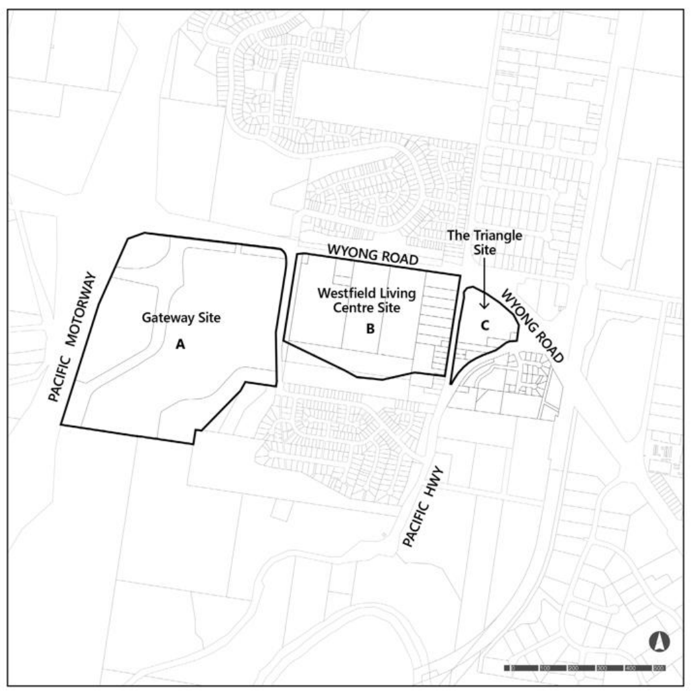

#### 4.7.1 INTRODUCTION

The purpose of this Chapter is to provide specific guidelines for development within the Tuggerah Regional City.

#### 4.7.1.1 Objectives of this Chapter

▪ To promote the orderly use of land in accordance with its status and development potential as a Regional City.

▪ To encourage high quality urban design as appropriate to the presentation, perception and development of a multi-functional Regional City.

▪ To provide appropriate controls and incentives to attract investment in the centre.

▪ To maintain and reinforce the existing competitive advantage of the Tuggerah Regional City centred on accessibility and connectivity.

▪ To encourage higher density development adjacent to the primary retail uses, and service amenity with public transport service.

▪ To encourage a high-quality building stock which can adapt over time to a range of uses.

▪ To ensure that the built form defines a spatial hierarchy with a human scale which contributes to the legibility of the Tuggerah Regional City.

#### 4.7.1.2 Land to which this Chapter Applies

The land to which this Chapter applies is shown edged heavy black in Figure 1

> [Picture on page 2: a picture, saved as a picture (images/ch-04-07-tuggerah-regional-city-page-2-3.gif, 150 dpi).]

#### Figure 1 Land to which this Chapter Applies

#### 4.7.1.3 Using this Chapter

#### 4.7.1.3.1 Relationship to other Chapters and Policies

All development applications MUST be accompanied by the required assessments under the relevant State Government Policy and Council policy, including but not limited to, any matters identified in this chapter for further investigation.

This Chapter should be read in conjunction with other relevant Chapters of this Development Control Plan and other Policy Documents of Council, including but not limited to:

▪ Chapter 2.1 - Dwelling Houses, Secondary Dwellings and Ancillary Development

▪ Chapter 2.2 – Dual Occupancies and Multi Dwelling Housing

▪ Chapter 2.3 – Residential Flat Buildings and Shop-Top Housing

▪ Chapter 2.4 – Subdivision

▪ Chapter 2.5 – Commercial Development

▪ Chapter 2.13 – Transport and Parking

▪ Chapter 3.1 – Floodplain Management

▪ Chapter 3.5 – Tree and Vegetation Management

▪ Council’s Civil Works Specification

For any inconsistencies, the requirements in this chapter prevail.

#### 4.7.1.3.2 Area Plans

For the purposes of this Chapter, the Tuggerah Regional City is divided into a number of areas.

Section 2 applies across the entire Tuggerah Regional City.

Sections 3 contains controls specific to the Gateway Site A.

Section 4 contains controls specific to the Westfield Living Centre Site B.

Section 5 contains controls specific to the Triangle Site C.

All relevant Sections are to be considered as part of any development proposal.
