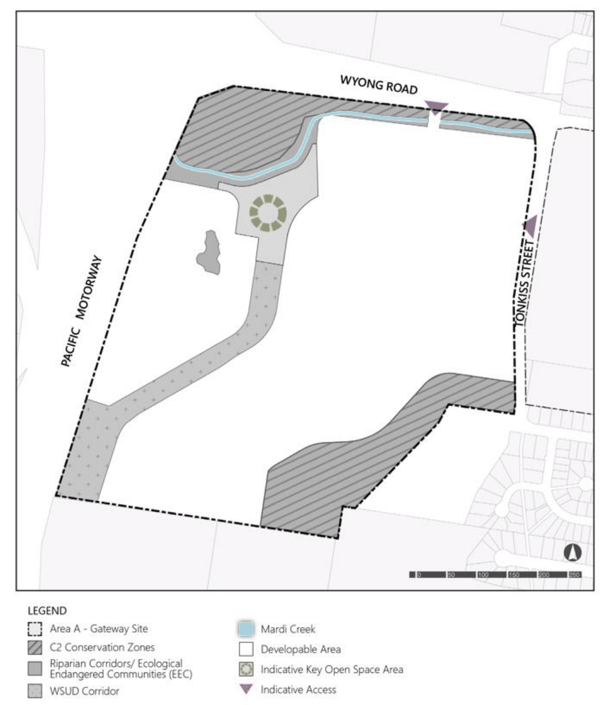
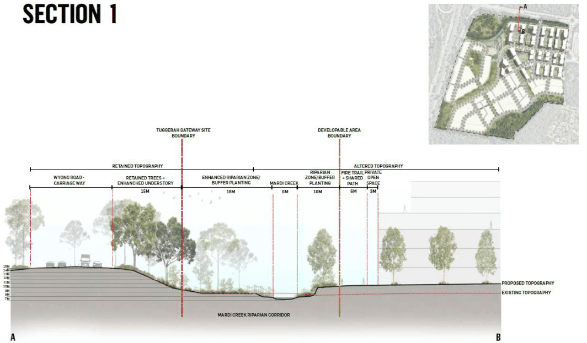
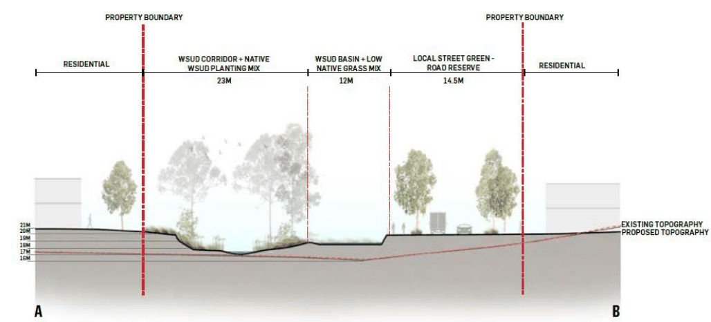

#### 4.7.3 AREA A – GATEWAY SITE

The land to which this Section applies is shown in thick black dashed line in Figure 2.

> [Picture on page 7: a picture, saved as a picture (images/ch-04-07-tuggerah-regional-city-page-7-3.gif, 150 dpi).]

#### Figure 2 Area A – Gateway Site

#### 4.7.3.1 Vision for the Gateway Site

The vision for the Gateway Site is to create a diverse community with active transport opportunities nestled amongst nature and on the doorstep of Tuggerah Living Centre. As the gateway to the Tuggerah Regional City, this site provides the opportunity to integrate the significant natural features, public and active transport into the new mixed-use community.

To enable this vision, the Gateway Site should deliver:

o Reinstated blue grid for healthier waterways: Re-establishment of Mardi Creek and its riparian corridor along the original alignment following the southern boundary of the C2 Environmental Management zone and continuing along Wyong Road. Installation of Water Sensitive Urban Design (WSUD) to treat water on-site and improve downstream outcomes.

o Diverse and inclusive housing: Offers a new lifestyle for the Central Coast community bringing families, students the elderly and everything in-between together in diverse housing including low to medium rise apartments, terrace homes, townhouse, independent living units and detached homes.

o Active and healthy lifestyles: Embedded through a network of pathways along green and blue links for everyday journeys in a compact community.

o Reduced car dependence: Improved public transport connections to the neighbourhood connecting the community to jobs - both local and regional - as well as local services and facilities at Westfield Tuggerah.

o Day-to-day convenience: Safe, comfortable and direct connections via tree covered streets from the neighbourhood to the everyday amenities and entertainment offer of Westfield Tuggerah 'Living Centre' through a new signalised intersection at Tonkiss Street.

o Local jobs throughout the project life cycle: Through the delivery of interim short-term bulky goods employment transitioning to future mixed-use development.

#### OBJECTIVES

▪ To strengthen and promote the Gateway Site as an integral component of the Tuggerah Regional City.

▪ To establish a clear identity and image for the Gateway Site as the primary focus of mixed-use retail, service and residential activities in the Tuggerah Regional City.

▪ To encourage development design of high quality, which controls and mitigates the potential environmental impacts arising from the development.

▪ To ensure the development is undertaken in an orderly and sustainable fashion with sequencing that provides adequate infrastructure service and amenities for the residents.

▪ To minimise noise impacts on residential and other noise sensitive land uses located in the vicinity of significant noise generating sources.

▪ To establish consistent and appropriate built forms to mitigate noise and vibration impacts.

#### REQUIREMENTS

a The development design of the Gateway site shall be capable of satisfying all requirements outlined in this Section below, with consideration to the existing physical, built and environmental features and constraints of the land, and the phasing of development.

#### 4.7.3.2 Environmental Management

The natural landscape of the Gateway Site is characterised by undulating landforms, open grassland areas with rocky outcrops to the northwest, extensive bushlands to the south, including Mardi Creek and a meandering natural low-lying corridor traversing the Site. The controls in this section aim to retain and provide management measures to protect the environmental quality of Gateway Site.

This section must be read in conjunction with Central Coast Council Civil Works Specification, which provides minimum requirements for the design and construction of civil works including pavements, paths, earthworks, drainage and sewerage systems.

#### OBJECTIVES

▪ To protect, rehabilitate and manage significant environmental features located within the site.

▪ To prioritise the local natural assets by protecting native bushland, restoring waterbody and retaining natural vegetation and topographical feature.

▪ To minimise and mitigate the potential flooding risks and impact, by implementing stormwater treatment and management with WSUD principles and strategies.

▪ To allow development that is compatible with the flood hazard of the land.

▪ To prevent the loss of life and property due to bushfire, by discouraging the establishment of incompatible uses on bushfire prone land.

▪ To prevent the risk to public health or the biophysical environment when changes to land uses are applied to site.

▪ To reduce the impact of the existing transmission line to future development and the environment.

▪ To reduce the impact of development on ecological systems and processes that sustain life.

#### REQUIREMENTS

#### 4.7.3.2.1 Biodiversity Management

a Comply with the Biodiversity Certification Order, the approved Biodiversity Certification Assessment Report (BCAR) and the approved Biodiversity/Vegetation Management Plan for the site, to minimise impacts to the land proposed for conservation areas. This includes:

i Existing native vegetation and Threatened Ecological Communities (TEC) within the Rocky Outcrop to the northwest of the site;

ii Existing vegetated area within the western portion of the site; and

iii Existing vegetated area along the south-eastern boundary.

b Detailed information must accompany any future development application regarding the intention for the boundary treatment and plans for recreational trails leading from the development site to the Council and Crown reserves adjoining the site. The interface treatment needs to show that Council-owned vegetation will not be negatively impacted by Asset Protection Zone (APZ) clearing requirements, construction impacts, landscaping, road batters/culverts, WSUD, or edge effects.

Note: The southern conservation zone may need to be fenced along the property boundary.

c Re-establish and revegetate the riparian/waterway/biodiversity corridors in accordance with the approved Biodiversity/Vegetation Management Plan for the site.

d All land zoned C2 Environmental Management must be retained in common ownership and subject to a permanent “in perpetuity” conservation arrangement unless satisfactory arrangements are reached with Council to accept ownership and maintenance of this land.

e A soft buffer of a minimum of 10 metres is to be provided to all land zoned C2 Environmental Management and riparian/biodiversity corridors throughout the site. Soft buffers may include grassed areas and planting with locally indigenous species, as approved by Council.

#### 4.7.3.2.2 Flood Plain Management

This section applies to land at or below the flood planning level and is to be read in conjunction with clauses

5.21 and 5.22 of Central Coast Local Environmental Plan 2022, and Chapter 3.1 Flood Plain Management of Central Coast DCP 2022.

a Any development is to be designed in accordance with WSUD principles and NSW Government’s Flood Prone Land Policy and the principles of the Floodplain Risk Management Manual 2023.

b Climate change assessment should be included in flood modelling and may be used to set available development areas.

c All lots are to be constructed with a finished floor level above the future flood planning level, as demonstrated to be achievable by flood modelling.

d A site-specific Flood Emergency Plan is required to be submitted with any future development application for housing. The Flood Emergency Plan is to detail the PMF flood event evacuation route, demonstrating safe access and evacuation in a PMF event.

#### 4.7.3.2.3 Dam Safety

a Part of the site falls within an Emergency Dam Break Flood zone. Future development proposals within this area must consider risks to life and property and incorporate mitigation measures within the development design that eliminate or reduce risks, but only in so far as is reasonably practicable.

b The development design must consider and include any requirements of the relevant Dam Emergency Plan. Reference should also be made to dams safety related legislation.

c Prior to the lodgement of any development application for the Gateway site, Council’s Water Assessment Team must be consulted to discuss any dam safety requirements.

#### 4.7.3.2.4 Bushfire / Asset Protection Zone

a Developments must be designed to accommodate the required Asset Protection Zone (APZ) dimensions.

b Where tree canopy can meet APZ requirements, it should be retained.

c All required APZs are to be located outside of the riparian vegetation and drainage areas (RVDA) and outside the land zoned C2 Environmental Management.

d Future roads are to be located along the perimeter of environmental lands and shall form part of the APZ.

e Future design iterations (including revegetation and landscape plans) must be prepared with consideration to bushfire and meet the requirements of Planning for Bush Fire Protection 2019 (PBP).

f Any stormwater quality improvement device within an APZ must ensure vegetation types are compliant.

g Future development must provide compliant asset protection zones (APZs) in alignment with Table A1.12.2 of PBP 2019 for residential subdivisions and Table A1.12.1 of PBP 2019 for special fire protection purpose (SFPP) developments. This must include all zones with the potential to support future SFPP developments (i.e. this includes APZ setbacks from the bushland located to the south of the site and the proposed internal vegetated corridors).

h Access for future residential subdivision must comply with Table 5.3b of PBP 2019.

i Perimeter and non-perimeter roads are to consider minimum carriageway widths in compliance with Table 5.3b of PBP 2019 and the parking provisions outside of the carriageway.

j Future development must be supported by evidence, such as a Vegetation Management Plan (VMP) or Plan of Management (POM), that demonstrate that the managed central corridors and parks will be maintained to the standard of an APZ to demonstrate that the future residential development can comply with Table 5.3b of PBP 2019 where a compliant perimeter road has not been proposed.

k The provision of services for future residential subdivisions must comply with Table 5.3c of PBP 2019.

l Future multi-storey residential developments must comply with 8.2.2 Multi-storey residential development of PBP 2019.

m Future development classified as SFPP must comply with Chapter 6 - SFPP Developments of PBP 2019, Appendix B of the Addendum to PBP and the amendment to the bush fire protection provisions of the National Construction Code (NCC) 2022.

n The evacuation capacity of the existing network and future traffic modelling of the proposal must be reviewed to confirm the capacity of the road network to support evacuation during bush fire events.

#### 4.7.3.2.5 Stormwater Quality Management

d Mardi Creek is to be integrated with the future landscape design with an appropriate riparian corridor. A conceptual cross section is provided below in Figure 3 that reflects the intended outcome of the riparian corridor.

e A natural low land corridor is to be provided to accommodate trunk stormwater drainage, stormwater basins and associated vegetation. A conceptual cross section is provided below in Figure 4 that reflects these principles.

f Stormwater pit & pipe network is to be designed in accordance with the road network and building lot grading, with adequate land and separation provided with the development design.

g On-site detention (OSD) is to be incorporated into the development where required in accordance with the storage and discharge requirements of the Central Coast Stormwater Detention Policy.

h Changes to the existing drainage system/pattern should not impact stormwater drainage from the M1 Motorway.

i Stormwater improvement devices (SQUDS) are to have a high flow bypass that reduces the risk of flooding and erosion in high flow events. Vegetated SQIDS are to be offline during the establishment period.

j Ensure all SQIDS can be maintained safely and efficiently.

k All stormwater and drainage assets created through the development must be retained in common ownership and subject to a permanent ‘in perpetuity’ management arrangement unless satisfactory arrangements are reached with Council to accept ownership and maintenance of these assets.

l A Stormwater Management Plan is to be submitted which details a strategy for dealing with stormwater runoff from the site and the integration of stormwater quality improvement devices into the landscape design. The plan is to demonstrate that the proposed SQIDS and onsite detention (OSD) basins are feasible for engineering design and that they can be protected from damage in use and able to be safely maintained. The proposal must demonstrate that water quality requirements can be met for all parts of the development.

Note: the impact of future cut and fill works on development sites may not be able to be managed by modest erosion and sediment controls typical for single site development. The impact on ongoing sediment loads needs to be considered in bioretention design and may require pre-treatment of stormwater via settling ponds.

> [Picture on page 12: a picture, saved as a picture (images/ch-04-07-tuggerah-regional-city-page-12-17.gif, 150 dpi).]

#### Figure 3 Indicative concept of riparian corridor along Wyong Road

> [Picture on page 13: a picture, saved as a picture (images/ch-04-07-tuggerah-regional-city-page-13-1.gif, 150 dpi).]

#### Figure 4 Indicative concept of WSUD/drainage corridor through the site

#### 4.7.3.2.6 Water & Sewer

a Reticulation mains must be delivered in stages to align with development rollout.

b Sewer upgrades to existing infrastructure should be delivered to the final permanent size rather than being staged or progressively upgraded over time.

c A Servicing Strategy is to be submitted with any future development application detailing how development of the land will be serviced in accordance with Council’s Water Supply and Sewerage Development Servicing Plan 2019. The Servicing Strategy must demonstrate the different options and relevant assessment to service the proposed development.

#### 4.7.3.2.7 Utilities

a The existing electrical transmission line is to be relocated underground with the alignment to be agreed in consultation Ausgrid.

b All street lighting is to be designed and constructed in consultation with Ausgrid and TfNSW.

c All services and utilities are to be located underground with adequate separation between assets.

d No services are to be constructed through the land zoned C2 Environmental Conservation.

#### 4.7.3.2.8 Noise management

a A report by a suitably qualified acoustic consultant is to be submitted with any future development application to address potential road traffic noise impacts from the M1 Pacific Motorway and Wyong Road in accordance with the Department of Planning, Development near Rail Corridors and Busy Roads – Interim Guideline 2008.  The report shall identify:

i existing and potential future noise sources;

ii areas where specific development should be restricted due to likely noise; and

iii mitigation measures to reduce existing or potential noise effects.

b To mitigate road noise from the M1 Pacific Motorway on adjoining dwellings the following is to be provided:

i a minimum 12m boundary setback for any future housing along the western boundary; and

ii noise barriers and at-property treatments in the form of architectural treatments such as acoustic insulation, concrete roof construction, double glazed windows, etc for any dwellings along the western boundary.

#### 4.7.3.2.9 Contamination

a An assessment under Clause 4.6 of State Environmental Planning Policy (Resilience and Hazards (2021) is to be submitted with any future development application to detail whether land is contaminated.  If required, a detailed site investigation (DSI) and remediation action plan (RAP) must be prepared with consideration given to the proposed land use.

#### 4.7.3.3 Local Open Space and Parks

The local open space and parks within the Gateway Site are proposed to deliver a high-performance green and blue grid that will create a matrix of multifunctional spaces which protect and enhance natural systems, deliver urban amenity, biodiversity and cooling, and create places for residents and visitors to relax, unwind and play.

#### OBJECTIVES

▪ To provide variety of high-quality open spaces with local natural characters and identities.

▪ To provide focus for social and recreational activities.

▪ To integrate open spaces with stormwater treatment.

▪ To ensure direct public access to open spaces.

▪ To create key visual corridors to the core open space and wayfinding system for open spaces.

#### REQUIREMENTS

a Public open spaces are to be provided in consultation with Council.

b Provision of Public Open Space (POS) of at least 1 hectare in size. The land shall be dedicated at no cost to Council once embellishment to Council’s requirement and satisfaction has occurred. Any play space within the POS is to be located on unencumbered land free of flood hazards (H3 and above). The POS is to be fit for purpose with the Concept Design to be prepared generally in accordance with the POS Provision Framework for a District Recreation Park outlined in Council’s draft Open Space Strategy (November 2022).

c A Maintenance Management Plan (MMP) is to be prepared that sets out the proposed maintenance of all open space areas in accordance with Council’s current minimum service provisions and a proposed reporting regime.

d The proposed waterway is not to be included in any open space calculation and may need protective fencing due to the steep banks and high hazard flows predicted in this area.

e Provide legible and safe access and prioritise safe pedestrian and cycle links between open spaces.

f Address Water Sensitive Urban Design (WSUD) principles in the open space design.

g Optimise topographical features for open spaces and major vista corridors.

#### 4.7.3.4 Access/Movement, Traffic and Parking

The Gateway Site is envisaging a connected network of permeable streets that integrate the site into the surrounding movement network while new and upgraded pedestrian and cycle connections induce more active transport journeys to local destinations including Westfield Tuggerah, Tuggerah Train Station and Tuggerah Town Centre.

The purpose of this section is to ensure that convenient and safe active and public transport prioritised street networks is provided within Gateway Site.

#### OBJECTIVES

▪ To prioritise and promote public transport and active transport.

▪ To enhance safe connections to the train stations, bus stops and accessibility to Westfield Tuggerah, Tuggerah Town Centre and adjacent neighbourhoods.

▪ To establish clear street hierarchy and well-connected street networks for all movements and purposes.

▪ To promote mid-block and through-site links to improve pedestrian permeability of the development blocks that consider the Crime Prevention through Environmental Design (CPTED) principles.

▪ To minimise the vehicle and pedestrian/cycle movement conflict.

▪ To provide shaded, connected and safe shared and footpaths within the streetscape network.

▪ To encourage continuous pedestrian or shared pedestrian and cycleway within open spaces.

#### REQUIREMENTS

#### 4.7.3.4.1 Street Network

a Prior to the lodgement of any development application for the Gateway site, further traffic impact assessment is to be undertaken to ascertain potential impacts to the surrounding road network and identify mitigation measures relevant to any proposed staging. A microsimulation model (prepared in accordance with TfNSW’s base model) is required to assess the impacts of the development on the broader network, including the M1 Pacific Motorway interchange and the intersection of the Pacific Highway and Wyong Road.

b A Traffic Impact Assessment Report undertaken by a suitably qualified traffic consultant is to be submitted with any development application for the site to ensure the traffic and parking impacts generated by each stage of development are considered and addressed. The report shall identify:

i potential impacts to the surrounding road network ii mitigation measures relevant to any proposed staging iii proposed public transport routes, with evidence documenting the outcome of discussions with local public transport providers, specifically local bus service providers. Public transport routes are to be designed in accordance with the TfNSW Guidelines for Bus Capable Infrastructure in Greenfield Sites 2018.

iv active transport facilities and infrastructure.

c Future development of the Gateway Site relies on access arrangements outlined in the executed planning agreement between the Minister for Planning and the landowner/developer to support the proposed land uses. Following the further traffic assessment work being undertaken as outlined above, this planning agreement must be amended or renewed to reflect the required infrastructure improvements and the proposed timing of road upgrades to support the development of the site. The updated planning agreement is to be finalised prior to the determination of any development application for housing on the R1 General Residential portion of the site.

d A Safe System Assessment is to be submitted with any development application for the site together with a Road Safety Audit to assist in the development of a safer environment for all road users.

e All intersections and access points to Gateway Site are to be modelled to demonstrate that the proposed road configuration operates safely. Modelling is to demonstrate how any potential conflicts with the Westfield Living Centre Site B are resolved.

f The road layout (horizontal and vertical) shall consider the final development upon the land regarding flood storages and floodway cross sectional area within the watercourses and flow paths.

g Future subdivision layout is to create a legible and permeable street hierarchy that responds to the natural site topography and environmental characteristics of the land.

h Street network is to be provided generally in accordance with the following street typologies:

i Collector Road: primary access routes connecting the site from Wyong Road and Tonkiss Street for all road user movement with activated frontage and shared paths within mixed use area.

ii Green Boulevard: secondary connection within the southern area of the site providing generous verge with tree canopy, plantings and shared path.

iii Local Street: local streets with residential development interface on both sides providing direct access to residential lots.

iv Local Street Green: local streets with open space interface on one side.

v Local Perimeter Street: local streets along the southern boundary with conservation zone interface in accordance with the Planning for Bush Fire Protection 2019 (PBP) requirement.

vi Laneway: provide vehicle access to residential lots with rear garage and no on-street parking provision.

i A regional shared pathway is to be provided from the Gateway Site along Wyong Road to the pedestrian overpass.

j Road hierarchy and road reserve are generally as per the requirements in Council’s Civil Works Specification - Design Guideline (2020) Table 6. Road Hierarchy and Road Width Schedule.

k Roads identified as a local bus route must be designed to cater for large and rigid vehicles, having regard for grade, sightlines and avoidance of lane departure during turning movements.

l The development must be designed to accommodate service vehicles, loading and waste facilities on the site. Such facilities are to be incorporated into the overall design of the development and should not detract from the streetscape.

m Provide a safer street environment by ensuring appropriate lighting and using crime prevention through environmental design principles.

n Road geometry such as steep roads, combined horizontal and over vertical curves, long straight streets, smaller radii curves with adverse crossfall, lot accesses in close proximity to entry and departures of roundabouts etc. that contribute to increased crash risk are to be avoided.

o Appropriate safety arrangements such as non-scalable fencing must be established along the western boundary adjacent to the M1 Motorway to avoid access to the top of the cliff.

p Roads to land zoned C2 Environmental Management in the southeast of the Gateway Site are to provide adequate urban interface between conservation areas and residential areas.

q Provision of adequate buffer within the road reserve for roads internal to the Gateway site and adjoining Wyong Road and Tonkiss Street for street tree planting.

#### 4.7.3.4.2 Pedestrian and Cycle Network OBJECTIVES

▪ To provide a well-designed, safe and active public domain which contributes to the wellbeing of the community.

▪ To provide linkages between open space, streets and drainage features to create a clearly distinguishable public domain.

▪ Provide safe and convenient pedestrian and cycle networks with clear internal links and connection to external regional networks to promote healthy lifestyle choices.

#### REQUIREMENTS

a Shared paths/footpaths and cycleways are to be designed and constructed in accordance with Central Coast Council’s Civil Works Specification - Design Guideline (2020) and Civil Works Specification - Construction Specification (2020).

b All park edge streets are to have the cycleway/shared footpath located on the park side of the road. c Active Transport Infrastructure and facilities, bike lanes, shared paths, footpaths and kerb ramps etc. will consider and align with the vision, aims and objectives of the Central Coast Bike Plan and Pedestrian Access and Mobility Plan (PAMP), and provide safety and connectivity to all existing and proposed bicycle and pedestrian routes in accordance with the Prioritisation Criteria and the required Standards.

#### 4.7.3.5 Subdivision and Lot Size

The Gateway Site is characterised by an undulating landform setting. The development encourages varied housing typology including small lot housing with proximity to retail and service amenity ensuring housing diversity can be delivered within Gateway Site.

This section applies to residential lot subdivision for dwellings, dual occupancy, semi-detached, multi dwelling and attached dwelling. It does not apply to Residential Flat Buildings/Shop Top Housing uses.

#### OBJECTIVES

▪ To provide housing diversity close to high amenity of the Westfield Shopping Centre and surrounding open space, whilst ensuring the built form is responsive to the slope of the land.

#### REQUIREMENTS

a Lot layouts for future residential subdivision shall consider scenic amenity, natural topography of the land, open space areas and environmental corridors.

b The development is to be staged to ensure a coordinated subdivision layout that responds to site constraints and ensures delivery of infrastructure requirements.

c The residential subdivision of the land within the Gateway site is to enable a diversity of housing types and facilitate a maximum of 600 lots in the R1 zone. The final subdivision lot layout and minimum lot size is subject to satisfying matters such as slope management, drainage, use of retaining walls and the like.

#### 4.7.3.6 Built Form Guidelines for Dwelling Houses, Semi Detached,

### Multi Dwelling Housing and Attached Dwellings

The Gateway Site encourages varied housing offer with built forms that are compatible with the desired future character of the locality. The purpose of this section is to ensure that the built form and housing typologies provide adequate amenity for the residents and respond to the surrounding context and character.

#### OBJECTIVES

▪ Provide appropriate residential development in proximity to the Tuggerah Town Centre and Tuggerah Train Station to promote walking and cycling.

▪ To provide a range of residential development densities and dwelling types including housing for seniors or people with a disability, to cater for changing demographics.

▪ To ensure buildings are compatible with the height, bulk and scale of the existing and desired future character of the locality.

▪ To ensure building height is compatible with the scenic qualities of hillside and ridgetop locations and respects the sites natural topography.

#### REQUIREMENTS

#### 4.7.3.6.1 Building Design

a Residential development will achieve a high standard of urban design through:

i A range of architectural features to provide visual relief and individual amenity.

ii Building design that encourages surveillance of streets and public spaces.

iii Garages and parking structures sited and design to reduce their impact on the street.

b Building height shall generally be two to three storeys with a maximum building height of 12m.

c The maximum building height for outbuildings and detached ancillary development is 8.5m.

d The Floor Space Ratio for development is as per the Floor Space Ratio Map in the Central Coast Local Environmental Plan (LEP) 2022.

e Building siting design and construction shall incorporate Ecologically Sustainable Development (ESD) principles and implement best practice approaches to water and energy efficiency including solar access.

#### 4.7.3.6.2 Private Open Space

a For all dwelling types, the principal private open space areas shall be directly accessible from and adjacent to a habitable room other than a bedroom and shall be provided in accordance with the following:

i Lots with a width less than 10m wide at the building line - 16m2.

ii Lots with a width greater than 10m wide at the building line - 24m2.

iii Minimum dimension of 3m.

Note: the principal private open space area should be sited behind the front building line and should be generally level and may be in the form of a deck, terrace or paved area. This area should be determined having regard to dwelling design, allotment orientation, and adjoining development and to minimise disturbance from any significant noise sources.

#### 4.7.3.7 Built Form Guidelines for Specialised Retail Premises

#### REQUIREMENTS

a A minimum street setback of 4.5 metres is required to allow enough width for a landscaped buffer.

b The building setbacks fronting the Mardi Creek and the Rocky Outcrop should be in accordance with the Planning for Bushfire Protection 2019 (PBP).

c Large retail or commercial floor spaces not requiring continuous and direct connection to the street (e.g. bulky goods) should provide landscape buffer and façade treatment.

d Building frontages fronting Mardi Creek and The Rocky Outcrop should provide landscape buffer to screen building services.
