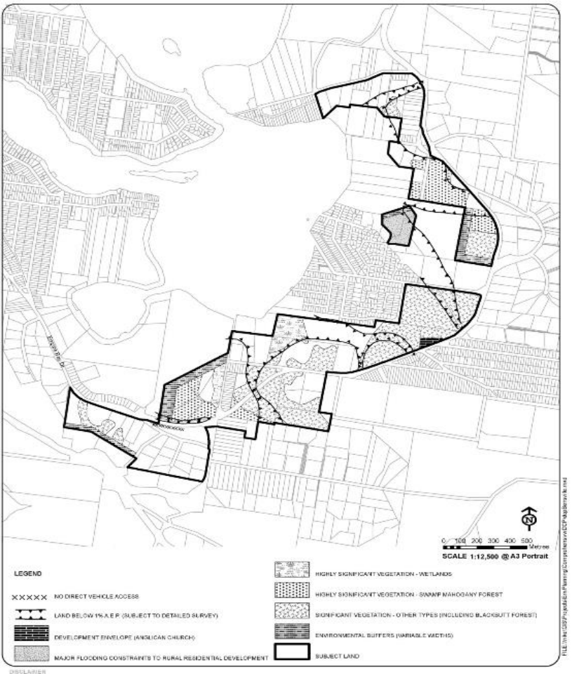

#### 5.1.1 WHERE THIS CHAPTER APPLIES

This chapter applies to land as outlined by a bold black line on the accompanying map.

> [Picture on page 1: a picture, saved as a picture (images/ch-05-01-bensville-page-1-4.gif, 150 dpi).]

#### Figure 1 – Land to which this chapter applies
