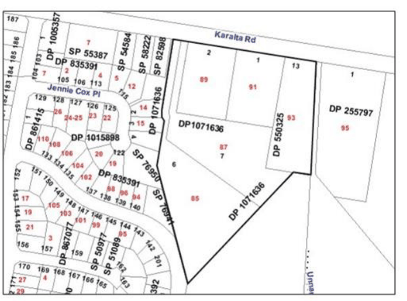

#### 5.2.1 WHERE THIS CHAPTER APPLIES

This chapter applies to the subdivision and development of Lots 1, 2 DP 259824 and Lots 6, 7 DP 1071636 and Lot 13 DP 550325, House Nos 85 - 93 Karalta Road Erina. The purpose of this chapter is to provide more detailed provisions to support the rezoning and development of the subject land.

> [Picture on page 1: a picture, saved as a picture (images/ch-05-02-erina-85-93-karalta-road-page-1-7.gif, 150 dpi).]

#### Figure 1 - Land to which this chapter applies
