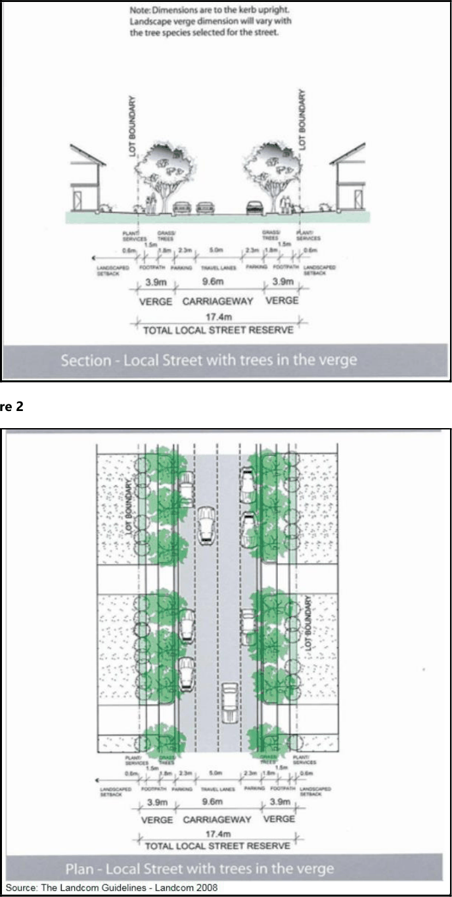
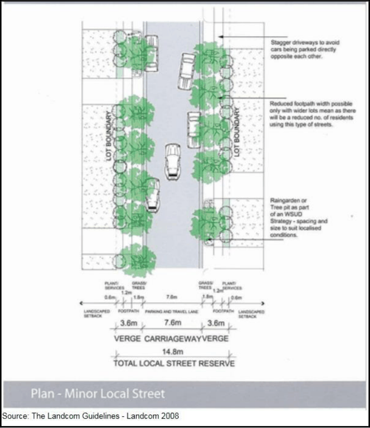

#### 5.2.4  STREET NETWORK AND STREET TYPES

#### 5.2.4.1 Objectives

▪ To provide a safe, legible and efficient through road system

▪ To provide an internal road layout that is not based on a one way in, one way out system that is contrary to guidelines for use by emergency vehicles, particularly for bushfire protection and for safe and efficient garbage collection services

▪ To prevent the use of right of ways or carriageways as a means of vehicle access to development

▪ To create a safe environment for walking and cycling

▪ To serve all existing and proposed land parcels with a local street that provides connection to the remainder of the land

▪ To provide through a local street system connection to the only vehicle access point to the precinct in a location which meets RMS sight distance standards as identified by Council's Traffic Engine

▪ To serve the resubdivision of existing land parcels with a local street that provides connection to the remainder of the precinct and the only vehicle access point to the precinct

#### 5.2.4.2 Controls

a Only one vehicle access point is to be provided to Karalta Road and located in accordance with the accompanying plan

b No temporary or permanent vehicle access from any new development will be permitted to Karalta Road or Bronzewing Drive.

c Development applications are to provide for the construction as part of the development proposed roads that are to be located on the subject property. Road plans are required to comply with the street layout identified on the accompanying plan. Any proposed changes to street layout only to occur in accordance with objectives of this section and section 5.2.14.

d Street types and construction are to be in accordance with the accompanying plan (titled Amended DCP Map) figures 1, 2 and 3 and section 5.2.4.

> [Picture on page 3: a picture, saved as a picture (images/ch-05-02-erina-85-93-karalta-road-page-3-1.gif, 150 dpi).]

#### Figure 2

#### Figure 3

> [Picture on page 4: a picture, saved as a picture (images/ch-05-02-erina-85-93-karalta-road-page-4-1.gif, 150 dpi).]

#### Figure 4

Land that is hatched on the accompanying plan provides an accessway to Karalta Road access point. This land must be dedicated to Council at no cost as part of any development or subdivision of the original lots that contain the hatched land.
