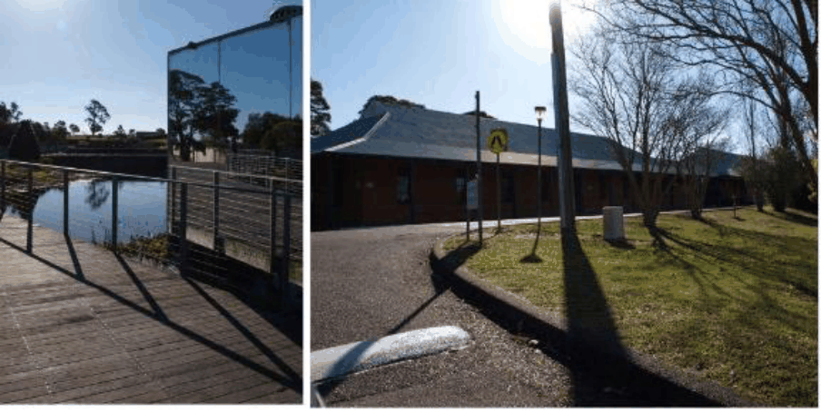
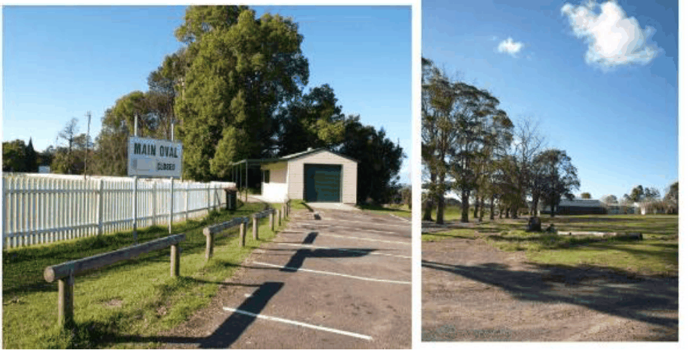

### 5.3 KARIONG, MOUNT PENANG PARKLANDS

#### 5.3.1  BACKGROUND

#### 5.3.1.1 Overview

The Mount Penang site is situated adjacent to the M1 Sydney/ Newcastle on the Pacific Highway exit ramp to Gosford, about 70kms from the Sydney CBD and 10 minute drive west from the centre of Gosford.

The site is a total 158ha of which approximately 67ha is bushland below the escarpment. The plateau, approximately 91ha, has views to the east over Brisbane Water. Part of the site has been developed as a semi- rural campus and comprises a collection of significant heritage buildings, surrounded by native and formal open space, gardens, sporting fields and facilities and various community uses, including the Kariong High School.

Mount Penang has been used as a Juvenile Justice Centre since 1912. The site was originally known as the Gosford Home Farm for Boys as it became a centre for Juvenile offenders in the early 1900’s. As one of the original institutions of its kind in Australia the site carried significant cultural and physical heritage values.

With the development of new facilities for a Juvenile Justice Centre in 1999 the NSW Cabinet agreed to the formation of a Development Corporation to manage the re-development of the remaining Juvenile Justice land, which is now referred to as Mount Penang and is the subject of this plan.

In September 1998 the Premier of NSW announced a NSW Government initiative for Mount Penang to provide the Central Coast with long term economic benefits and jobs. The key elements of the project identified by the Premier were:

▪ A flora/ horticultural festival to be held annually and for an extended period in 2001, the Centenary of Federation;

▪ Australian Football League (AFL), soccer and cricket facilities;

▪ Environmentally sustainable infrastructure and services;

▪ Gardens, restaurants and high-tech internet and interactive computer facilities;

▪ Legacy facilities of permanent gardens as well as community, cultural and accommodation facilities to attract tourism; and

▪ A commercial base for the development, securing private sector investment and sponsorship.

In November 1998 the Festival Development Corporation was officially created by Government Gazette Notice to achieve the objectives of the Growth Centre’s Act – as the majority of the Mount Penang site is classified as a growth centre.

> [Picture on page 2: a picture, saved as a picture (images/ch-05-03-kariong-mount-penang-parklands-page-2-1.gif, 150 dpi).]

In September 2010 the Central Coast Regional Development Corporation (CCRDC) replaced the Festival Development Corporation and expanded the growth centre to include land within the local government areas of Gosford and Wyong. The CCRDC is charged with the responsibility of promoting, coordinating, managing and securing the orderly economic development of Mount Penang. The CCRDC is subject to the control of the Minister for Planning and Infrastructure.

The original DCP 144 – Mount Penang Festival Development Site (now incorporated into Central Coast DCP 2022), which was prepared in 2000 by the Urban Design Advisory Service on behalf of the Festival Development Corporation, was adopted by Gosford City Council on 7th March 2000. The work undertaken in 2000 to prepare the Mount Penang DCP represented the culmination of an urban design and planning process that involved stakeholder and public consultation, specialist studies, and market feasibilities, all of which has been revisited and updated as part of this plan.

This Chapter 5.3 Kariong, Mount Penang Parklands is an update to the original DCP 144 and takes into account major changes to the site since 2000 as well as reflecting a revision of the master plan for the Mount Penang site that has been informed by a servicing strategy, transport assessment and heritage review.

#### 5.3.1.2 History of Mount Penang Juvenile Justice Centre

Following the announcement of the 1905 Neglected Children and Juvenile Offenders Act, the Mount Penang Juvenile Justice Centre was established, becoming the largest state-controlled centre in the southern hemisphere, accommodating 170 male offenders who were subjected to enforced physical labour, education and vocational training as a form of rehabilitation.

During the initial building phase (1912 – 1922) the physical labours of approximately 100 male juveniles were relied on for the construction of the centre’s major buildings. The centre was to replace the former Nautical Training Ships and detention centres for juvenile offenders, a connection that was reflected in the architecture of the school buildings, which were designed to resemble lighthouse cottages. The entire working party consisted of boys formerly of the training ship Sobraon, and was supervised by the former probation officer of the Nautical School Ship, Herbert Charles Wood.

With plans approved by the Minister of Public Instructions and a budget of £12,000, construction of the essential building facilities commenced in 1912. These included the dormitories, a dining room, staff quarters, offices, a kitchen, store room for supplies and equipment, and accommodation for the tradesmen and Clerk of Works. By September 1913, the first dormitory, the Assistant Superintendent’s residence and four weatherboard cottages for the married staff members had been completed. These cottages, still present on the site, are located along the existing entrance road to the complex.

> [Picture on page 3: a picture, saved as a picture (images/ch-05-03-kariong-mount-penang-parklands-page-3-1.gif, 150 dpi).]

It was not until 1915 that the second dormitory, constructed of concrete had been completed, along with a concrete reservoir, store and office. The arrangement of the dormitories on either side of the household block, allowed for a system to classify the juvenile detainees, in addition to providing constant supervision. Construction on the site didn’t conclude until 1922 by which time a windmill to pump water from a stream below the escarpment; five galvanised water storage tanks; a carpentry workshop; a 300 yard trolley line that transported sandstone to the site from the quarry; as well as the construction of a permanent dam were all completed and operational.

In addition to the practical experience in construction and building, which was part of the boy’s vocational training, the inmates were also provided with basic schooling. These classes originally operated in any of the constructed buildings or areas made available until the completion of the school building, which stands behind the main complex.

In 1923, the State Government passed the Child Welfare Act, repealing and consolidating a variety of provisions that existed in legislation relating to the care and management of children under State protection. The act was designed to place a much greater emphasis on children’s health, welfare and rehabilitation under the direction of the newly created Child Welfare Department. These acts played an influential role in the reformation of the school; both in terms of the physical and ideological structure.

While a continuation of the building program ensured that the boys gained experiences that could be harnessed upon their release, between 1923 and 1940, the upgrading of the facilities and improvement to living conditions and amenities were occurring simultaneously, to meet the requirements of legislation contained in the Child Welfare Act. In 1938, electric lighting and a hot water system were installed, followed by a refrigeration service in 1937. By the end of 1937, the centre consisted of four dormitories, a recreation hall for movies and concerts, a dining and kitchen block, a hospital, a bathing and sanitary block, as well as a variety of out buildings, including a dairy and accommodation for the single and married staff.

In 1944 the newly appointed Superintendent, Vincent Heffernan, brought about a new sense of purpose; with particular focus towards the physical condition of the centre and the principles for rehabilitation. Between 1944 and 1947, Heffernan, a former executive officer in the National Emergency Services during the war, began reinvigorating the centre, purchasing new equipment for the trade room, upgrading the pastures and raising the pigs and cows to stud standard. From the 1940’s, Mount Penang began showing their livestock, winning a number of prizes at local events at the Sydney Royal Easter Show.

In May 1944, a new sub-institution was opened at the centre by the then Minister for Education and Child Welfare, Clive Evatt. Initially built at a cost of £25,000, it was originally designed as a maximum security

complex for unresponsive boys. With the changes in government child welfare policies, the cottage sought to reflect a more open, family-style environment rather than the authoritarian structure and harsh discipline associated with reform schools. In 1948 the facility was opened, serving as the privileged cottage and later renamed in 1976, to the McCabe Cottage. Adjacent to the cottage two residences were built to house visiting families, reinforcing this reformation ideal.

The institution was renamed in 1946, from The Farm Home for Boys, Gosford to the Mount Penang Training School for Boys, Gosford, in order to represent the idea that a varied program of planned training was required for the re-education and rehabilitation of delinquent youths. After the 1950’s, no significant changes occurred at Mount Penang, with the construction limited to four new buildings; an assembly hall, a new kitchen and dining room, a laundry and boiler house, and a storeroom, along with new sporting grounds, all erected behind the administration block.

Of the buildings constructed from 1912 to 1923, all the dormitories, the house block and other accommodation blocks remain on the site. The site retains the basic form of the original layout from the earliest period of construction.

#### 5.3.1.3 Statement of Heritage Significance

Statement of Significance: NSW State Heritage Register [2001].

The Mount Penang Juvenile Justice Centre has been the most important juvenile detention centre in NSW for most of the twentieth century and is a direct continuation of the nineteenth century system of reformatory training ships. The design of the early buildings, their configuration and the layout of the site itself, as well as its agricultural and pastoral features, its remnant dairy and its landscaping collectively and individually illustrate juvenile penal philosophies and practices of the period and their subsequent evolution over eighty-five years of operation. The location of the Centre is a feature in the historical expansion of the City of Sydney into its rural hinterland and its operations are an element in the development of Gosford and the Central Coast.

Mount Penang also has significance for the local Aboriginal people both pre and post-contact, and during the time when Mount Penang was used as a juvenile detention centre and accommodated a number of Aboriginal detainees for whom the site would have profound associations.

The Centre has notable aesthetic qualities associated with its site and the available views, and layout of the low- scale buildings and the landscaping. The earlier buildings are attractive, human-scaled structures, which, while of an institutional character, utilise colonial homestead architecture, appropriate to their setting and construction techniques of particular interest. The earlier buildings reproduce these forms to reinforce the characteristic appearance of the complex, whilst the McCabe Cottages group is an excellent example of the Inter-War Functionalist architectural style.

The siting and relationship of buildings to each other and to the sports fields, paddocks and vistas are all components of the operational requirements and practices of the Centre. These provide technical information regarding juvenile detention and reformatory practices. Mount Penang is very important to the many boys and young men who were detained there over the course of nearly a century. For most detainees, Mount Penang is a place where the unforgettable occurred - experiences that strongly influenced the course of their lives. The place is significant to the many men and women who lived and worked at the former detention centre. For many of these people, it is a place of substantial personal and professional achievement. Mount Penang is also important to the local community as a landmark of historical and aesthetic importance. The place has functioned as a community meeting point, with many links between the wider community and the detainees and staff.

(Source: Mount Penang CMP 2001. Godden Mackay Logan)
