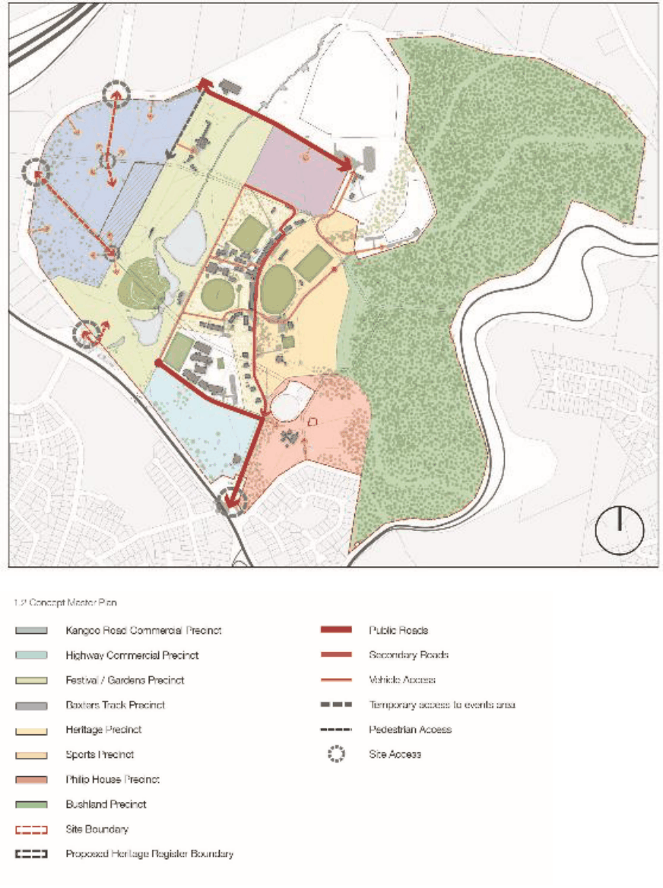

#### 5.3.2 INTRODUCTION

#### 5.3.2.1 Name of Plan

This Chapter is called Mount Penang Parklands. This Chapter is to guide the development of the area known as Mount Penang and applies to all land zoned SP1 Special Activities - Mount Penang Parklands as designated on the zoning maps in Central Coast Local Environmental Plan (LEP) 2022.

#### 5.3.2.2 Local Environmental Plan

This Chapter generally conforms with the provisions of the Central Coast LEP 2022.

#### 5.3.2.3  Purpose of this Chapter

This Chapter complements the amending LEP by providing detailed development principles and controls that explain the objectives and requirements more thoroughly. This Chapter is also informed by a revision to the master plan of the Mount Penang site undertaken by the CCRDC. This master plan revision was informed by further investigations into servicing strategies for the site, transport assessments of future development, ecology and bushfire strategies and the requirement to update the Conservation Management Plan on a regular basis.

Specifically, the reports that informed this revision are as follows and can be obtained from Central Coast Council:

▪ Revision of Heritage Curtilages Report, EJE Architects, November 2013

▪ Mount Penang Parklands Masterplan, Transport Assessment, AECOM, November 2013

▪ Water and Sewer Servicing Strategy, ADW Johnson, November 2013

▪ Roads, Stormwater and Utilities Servicing Strategy, ADW Johnson, November 2013

▪ Flora and Fauna Assessment, Mount Penang Parklands, Travers Bushfire & Ecology, February 2014

▪ Bushfire Protection Assessment, Mount Penang Parklands, Travers Bushfire & Ecology, February 2014

Other documents and policies set out requirements which must be taken into account when determining a development application. These are listed below and are updated from time to time as required by the CCRDC:

▪ Mount Penang Conservation Management Plan, as updated from time to time, provides guidelines and policies for the conservation of the items of heritage significance on the site.

#### 5.3.2.4 Operation of this Chapter

This plan was prepared in accordance with Section 72 (since revised) of the Environmental Planning & Assessment Act, 1979 and accompanying Regulation.

#### 5.3.2.5 Structure of this Chapter

The Chapter is structured in three sections:

Section 1 - explains how to use this plan and how it relates to other plans Section 2 - identities the site principles that provide the overall planning framework for the future use and development of the site Section 3 - identifies the controls and guidelines that provide the requirements for all development. The section is divided into 2 parts:

▪ General Built Form Controls that describe the controls relating to the design of all buildings within the site; and

▪ The Precinct Control provides additional detail and controls for new buildings within specific precincts to ensure the desired future character of the precincts is achieved.

#### 5.3.2.6 Vision

Mount Penang is to be an ecologically sustainable development that complements the existing heritage character and landscape setting. A vibrant mix of uses is proposed to enhance the quality of life for people on the Central Coast by providing new opportunities for employment, recreation, education, business, speciality retail, accommodation, festivals and events. Extensive gardens, event venues, sports facilities, picnic and bushland areas are to be established as a focus and amenity for the new facilities and the region.

#### 5.3.2.7 Objectives

The objectives of this Chapter are:

▪ To provide a comprehensive approach to the development of Mount Penang

▪ To accommodate a mix of uses that generate employment opportunities for the region and broaden its economic base

▪ To conserve significant bushland, archaeological, cultural and other natural features

▪ To provide an area of the site for open space which will preserve, enhance and link to regional open spaces and provide for the needs of the local community

▪ To provide design principles and controls to encourage development that responds to its natural context and contributes to the quality of the built environment, the future character and the cultural significance of the site;

▪ To encourage development that respects, enhances and contributes to the heritage significances of the site and its cultural setting

▪ To provide for efficient movement of traffic and all modes of transport including pedestrians and cyclists to, from and within the site;

▪ To plan all development in accordance with ecologically sustainable development principles, preventing damage to the environment, and where possible, ensures that development is planned in a way that enhances the environment; and

▪ To achieve maximum energy efficiency through such measures as building location, design, use of materials and the selection of energy and water efficient building services, equipment and appliances.

#### 5.3.2.8 When Do I Use This Chapter?

Central Coast Council will be the determining authority for all development applications in relation to Mount Penang.

Prior to lodging a development application (DA) applicants are encouraged to discuss their proposal with the Council Officers. Pre-lodgement meetings are an important part of the development assessment process as they assist the Council to identify potential challenges at an early stage of the assessment process and provides a valuable opportunity for Council officers to convey to potential applicants the requirements and intent of this Chapter.

This Chapter complements the LEP by providing the detailed development principles and controls that explains the objectives and requirement more thoroughly. Variations to the controls are possible only by demonstrating that the project meets the objectives of the development controls.

#### 5.3.2.9 Concept Master Plan

The Illustrative Concept Master Plan on this page provides an indication of a potential future development scenario for the site. It is the intention of this plan to convey the character and suggested development that may occur within the parameters of the Central Coast LEP 2022 and the Central Coast Development Control Plan (DCP) 2022. It does not represent the only scenario for the site, nor should it be used to limit alternative scenarios that may be consistent with the objectives and controls of the Central Coast LEP 2022 and Central Coast DCP 2022.

> [Picture on page 8: a picture, saved as a picture (images/ch-05-03-kariong-mount-penang-parklands-page-8-1.gif, 150 dpi).]
