#### 5.3.3 PLANNING PRINCIPLES

#### 5.3.3.1  Introduction

The overall planning framework for Mount Penang has been developed in response to the unique characteristics of the site as well as the requirements of potential uses and development that may be accommodated on the site in the future.

The planning principles outlined below provide the framework for the long term development of the site. More specific precinct controls are provided in Section 3: General Built Form Guidelines and Precinct Controls. The planning principles for Mount Penang address the following:

a Land Form b Conservation Area and Built Elements c Conservation Area and Landscape Setting d Land Use e Street Hierarchy f Pedestrian and Cycle Circulation g Parking h Public Transport and Events Transport i Landscape and Open Space j Flora and Fauna k Built Form, Character and Scale l Aboriginal Archaeology m Bushfire

#### 5.3.3.2 Land Forms

Development of the site is to maintain the integrity of the natural setting of the site by:

a Minimising impact on and enhancing the Piles Creek tributary and its position within broader festival/gardens precinct;

b Minimising impact on and enhancing remnant bushland and habitat areas on site;

c Responding to the natural topography of the site by locating larger parcels of development on the western side of the creek as it offers large flat expanses of land;

d Minimising impact on the steepest areas of the site from development, and minimising cut and fill;

e Minimising impact on existing views and vistas to and from ridge lines located to the east and west of Piles Creek;

f Integrating ecologically sustainable principles for onsite stormwater management; and

g Minimising impact on existing significant trees.

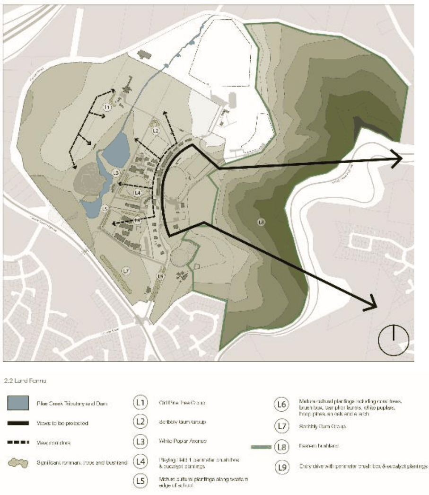

> [Picture on page 10: a picture, saved as a picture (images/ch-05-03-kariong-mount-penang-parklands-page-10-1.gif, 150 dpi).]

#### 5.3.3.3 Conservation Area (Historic Precincts) and Built Elements

Individual buildings, spaces and elements should be dealt with in accordance with their assessed cultural significance, as outlined in the current Conservation Management Plan. The former Mount Penang Juvenile Justice Centre is to be managed by:

a Respecting the layout of the buildings, their physical and visual interrelationships, the road system and the scale of development in future planning;

b Siting new development to retain the predominance of the existing form and pattern of development and to be appropriately scaled and screened in order to retain the site’s aesthetic qualities;

c Ensuring that new development is not visually intrusive within the heritage precinct of the site;

d Respecting the physical and visual relationship between complexes of buildings, such as the relationship of the existing cottages to each other, or the McCabe buildings to the rest of the heritage precinct and site;

e Conserving items of ‘High’ significance through appropriate conservation processes that may include preservation, restoration (including removal of intrusive elements where feasible) and appropriate reconstruction. If reuse requires additional built fabric, such building elements must respect all historically significant fabric. Such development should follow best practice infill guidelines and not cloud the definition of the heritage fabric;

f Conserving items of ‘Moderate’ significance by using any of the conservation processes identified above. Preservation, restoration, reconstruction (if previously demolished) or adaptation is acceptable, to assist in ensuring the continual use and security of the building provided that no adverse effect is created to more significant fabric;

g Conserving items of ‘Low’ significance where management requirements and resources permit retention. Any removal of ‘Low’ significance elements must be well considered and contribute to the overall development and interpretation of the site;

h Keeping or removing items of ‘Negligible’ significance, where retention is viable or removal is deemed appropriate and may be replaced by more sympathetic development;

i Core buildings should have purposes allowing an historic interpretation of the land which they define, as well as an understanding of the nature of the landscape on which they were built. They must remain identifiable in all future development of the site;

j If buildings or elements of High, Moderate or Low significance are altered, they should be recorded prior to the commencement of work;

k Where there is a conflict between fabrics of different significance, then the higher heritage value should be the determining factor in making the decision; and

l Protect historic fabric from damage arising from user impact, management interventions to facilitate or control user protection and maintenance of historic fabric and installation of fixed interpretation media.

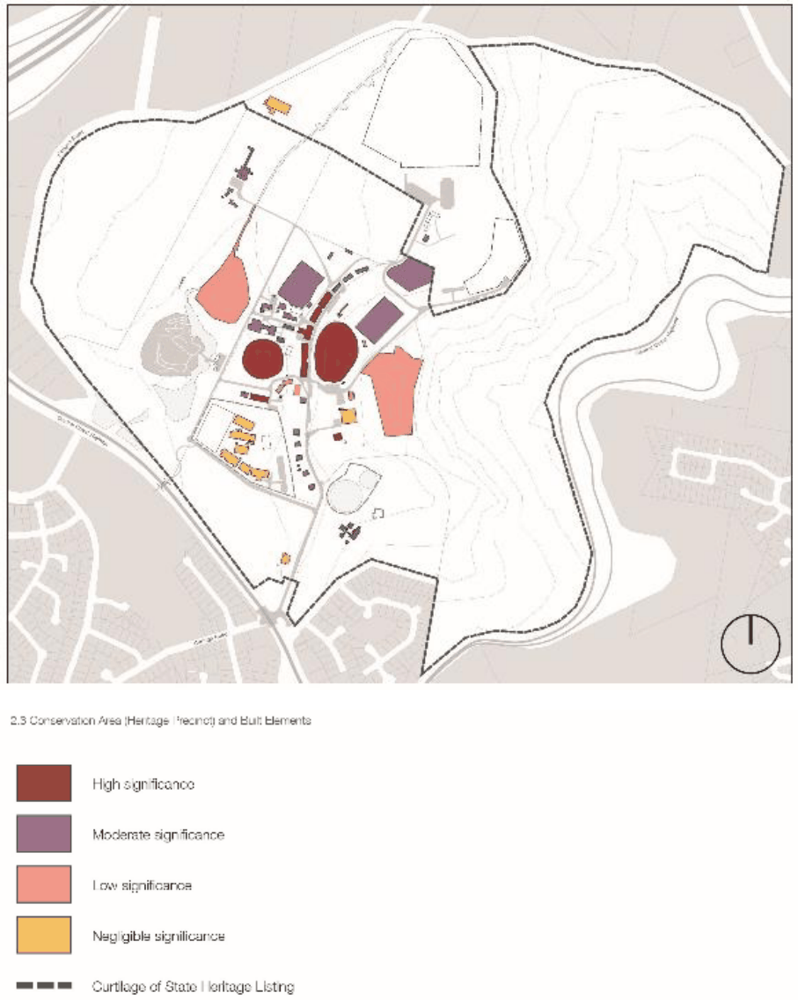

> [Picture on page 12: a picture, saved as a picture (images/ch-05-03-kariong-mount-penang-parklands-page-12-1.gif, 150 dpi).]

#### 5.3.3.4  Conservation Area and Landscape Setting

The overall site is to continue to be ‘read’ and interpreted in the future as the original Gosford Farm Home for Boys - that is, as essentially a rural site. Landscape precincts and elements should be dealt with in accordance with their assessed cultural significance by;

a Retaining and respecting its semi-rural character and ambience;

b Respecting the relationship of the buildings to the topography, with formal landscaping including avenues, groves, courtyard spaces, and paddocks;

c Preserving the natural bushland below the plateau to heavily vegetated nature and original setting of the Farm;

d Retaining, where appropriate, certain selected open spaces demonstrating the former character of the place;

e Preservation of view corridors within the site and from different parts of the site out to the surrounding landscape. Tree and shrub planting schemes should ensure access to important views out and linkages between heritage buildings and precincts are not eventually blocked when such vegetation matures;

f Retaining the mature historic plantings on the site, particularly the Avenue plantings along the entry roads and around the edges of the playing field; and

g Respecting the alignment of the original roads and pathways through the site, especially the major access point from the Pacific Highway and Kangoo Road at Baxter’s Track. It should be recognised that these have changed over time.

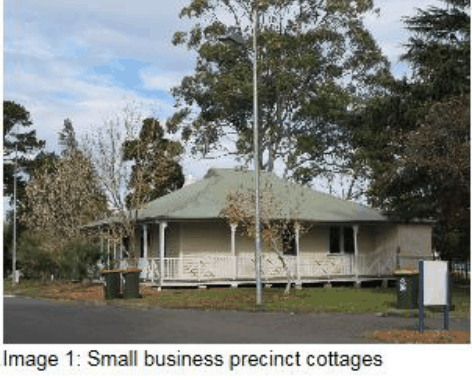

> [Picture on page 13: a picture, saved as a picture (images/ch-05-03-kariong-mount-penang-parklands-page-13-12.gif, 150 dpi).]

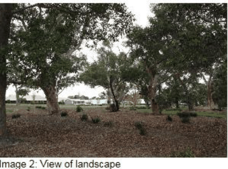

> [Picture on page 13: a picture, saved as a picture (images/ch-05-03-kariong-mount-penang-parklands-page-13-13.gif, 150 dpi).]

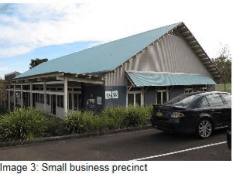

> [Picture on page 13: a picture, saved as a picture (images/ch-05-03-kariong-mount-penang-parklands-page-13-14.gif, 150 dpi).]

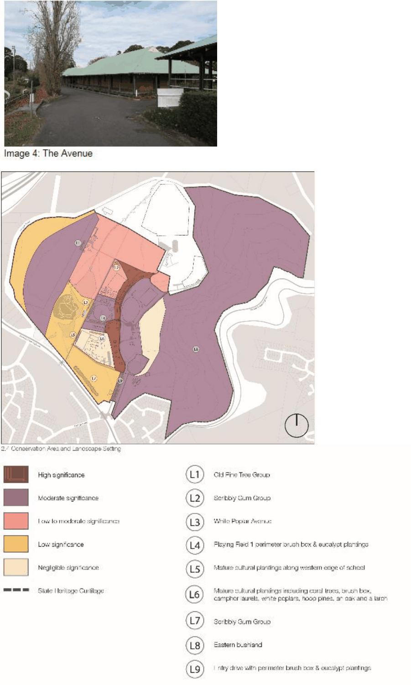

> [Picture on page 14: a picture, saved as a picture (images/ch-05-03-kariong-mount-penang-parklands-page-14-1.gif, 150 dpi).]

#### 5.3.3.5 Land Use

Uses have been located on the site to achieve a close relationship between the site’s character and development requirements. These land uses and their associated activities have been assigned to designated precincts across the site, which is the subject of Section 3.0 of the DCP, and include:

a Commercial:

i Commercial development is to be focused along the site’s western and southern boundaries, away from the heritage core, and where access can be gained from Central Coast Highway and Kangoo Road. The two precincts where commercial uses are to be located include:

▪ Kangoo Road Commercial Precinct, which forms the western edge of the site and provides development sites suitable for bulky goods retail, commercial and Business Park

uses. The sites will be accessed from Kangoo Road with a single access road providing access to the eastern most sites;  and

▪ Highway Commercial Precinct is positioned between Kariong High School to the north, Phillip House Precinct to the south-east and the Central Coast Highway to the south-west. Development in this precinct will be orientated towards the Central Coast Highway, and will be accessed via The Avenue.

b Festival/Gardens:

i The Festival/ Gardens Precinct extends from Baxter’s Track, which defines the northern boundary of the site, south along Piles Creek to the Mount Penang Gardens and the Central Coast Highway. The eastern edge of the precinct is defined by Parklands Road and the western edge by the heritage core. The precinct includes the listed item, McCabe House. The topography falls to Piles Creek which flows south through the precinct into the Upper and Lower Dams; and

ii There is an opportunity to locate festival activities to the northern edge of the precinct, accessed from Baxter’s Track.

c Mixed Use:

i Baxter’s Track Precinct occupies the area between the existing Heritage Precinct and the Juvenile Justice Centre. Access to this area will be gained from either The Avenue or Kangoo Road, via Baxter’s Track, depending on the nature of the land use and activity. A range of activates and facilities can be accommodated, including an extension of the existing grain and land uses from the Heritage Precinct in the south, or the festival and events activities from the west. Consideration will be given to the heritage character, visual impact, access and site conditions, particularly the terrain, access and drainage; and

ii Phillip House Precinct is the southernmost precinct and remains isolated from the majority of the site in terms of visual and movement connections, and activation. Development opportunities may be limited due to the quality and coverage of native vegetation, retention of Phillip House and the water tanks. A pocket of land exists to the east of the tanks that is suitable for development, subject to more detailed site investigations in relation to bushfire protection and native species.

d Sports:

i Sports Precinct encompasses the existing ovals and sports facilities located to the east of The Avenue, an area that features a protected easterly aspect and views towards Brisbane Waters; and

ii The refurbishment of existing and development of new facilities will support a range of indoor and outdoor sporting activities, supplemented by the business activities currently being undertaken in the Heritage Precinct (International Football School).

e Heritage:

i Heritage Precinct forms the core of the site’s existing commercial activities, which occur in the original dormitory buildings developed as part of the Gosford Home Farm (Juvenile Centre) in the early 1900’s. The precinct’s eastern edge is aligned with The Avenue and western edge with Parklands Road, which also provides access to Mount Penang Gardens and Village Greens No.1 and No. 2; and

ii A range of commercial, community and performance activities will continue to operate within this precinct.

f Bushland:

i Bushland Precinct remains an important natural component and will continue to be considered separate in its appearance and performance from the rest of the site; and

ii There’s an opportunity to use this area for a range of ecotourism, cultural and educational activities, which may relate to businesses and facilities elsewhere in Mount Penang

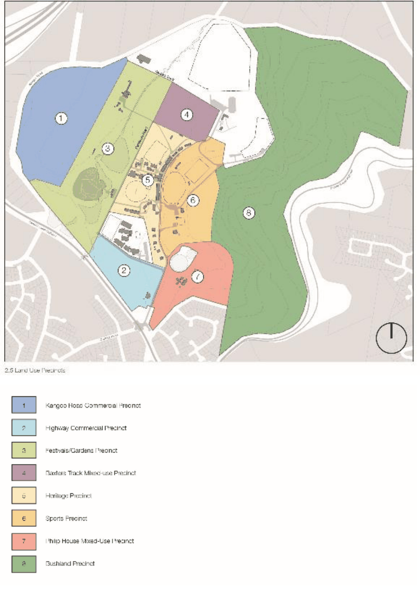

> [Picture on page 17: a picture, saved as a picture (images/ch-05-03-kariong-mount-penang-parklands-page-17-1.gif, 150 dpi).]

#### 5.3.3.6 Street Hierarchy

The structure, hierarchy and layout of streets on the site are to be designed to respond to the site’s character, existing features and land form, and future development opportunities. This hierarchy has been influenced by the Transport Assessment reference in this Chapter and available from Central Coast Council on request.

a The street hierarchy must consider:

i Entrance points that inform the site’s internal road hierarchy. The new road network should, where possible, use existing roadways and upgrades to existing routes to provide greater movement across the site that responds to the site’s physical and heritage values;

ii Establishing a road hierarchy that respects the existing road patterns and limits traffic in the Heritage Precinct by providing additional access and egress points along Kangoo Road;

iii Defining property and precinct boundaries, which reinforces the site’s various land uses and activities, whilst providing greater legibility and permeability; and

iv The definition and surveillance of open spaces throughout the site, so that the streets create an active edge and interface between public spaces and other uses.

b Access to the surrounding road network from the site is to be optimised by:

i Create a new primary access point at the north-western corner of the site from Kangoo Road to provide access to McCabe House, and via Baxter’s Track to the Juvenile Correction Centre and the Festival precinct;

ii Providing a new site access to the Festival Garden Precinct from the south, at the junction of Kangoo Road and the Central Coast Highway as part of the proposed expansion of the existing commuter parking area, which may also serve as parking for major event;

iii Providing a number of new site access points off Kangoo Road to directly service the Kangoo Road Commercial Precinct, Baxter’s Track Mixed Use Precinct and Juvenile Correction facilities; and

iv Retaining and upgrading the existing signalised site entry at The Avenue for access to the Commercial Precinct, Festival Garden Precinct, Kariong High School, Heritage Precinct and Sports Precincts only.

c The impact of vehicular traffic on the amenity of the environment is to be minimised by:

i Locating larger landscaped car parks on the site perimeter to minimise traffic circulation within the core area;

ii Providing a hierarchy of streets that concentrate the majority of traffic on a perimeter road and limits the traffic in the core of the site to narrow access ways that encourage slower speeds;

iii Ensuring the new roads are only used by traffic using the site and not used by through traffic for short cuts;

iv Designing streets to the minimum size to provide necessary movement and access;

v Designing roads to reinforce the rural landscape character of the site.

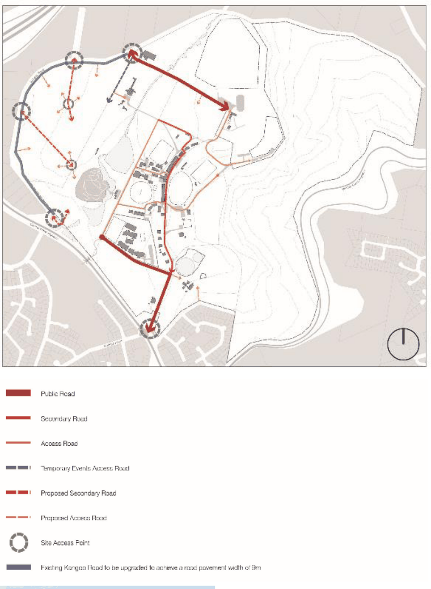

> [Picture on page 19: a picture, saved as a picture (images/ch-05-03-kariong-mount-penang-parklands-page-19-1.gif, 150 dpi).]

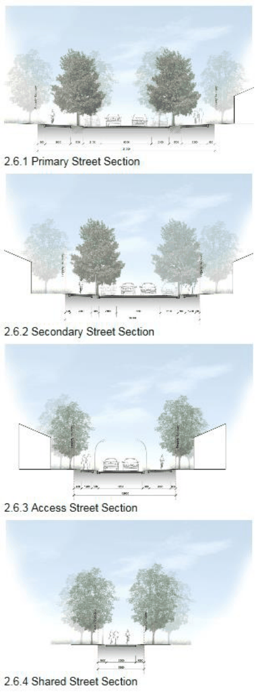

> [Picture on page 20: a picture, saved as a picture (images/ch-05-03-kariong-mount-penang-parklands-page-20-1.gif, 150 dpi).]

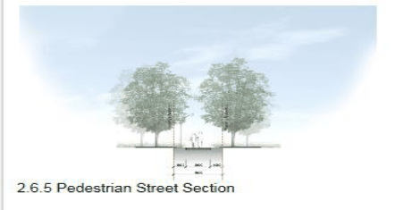

> [Picture on page 20: a picture, saved as a picture (images/ch-05-03-kariong-mount-penang-parklands-page-20-2.gif, 150 dpi).]

#### 5.3.3.7 Pedestrian and Cycle Circulation

Movement and connections within the site should be encouraged to be taken by foot or bicycle via an integrated network of routes that deliver the following:

a A continuous pedestrian path around the site connecting the major activities and features, open spaces and areas of natural value;

b A network of smaller paths within and between precincts that may align with historic routes and connections;

c Pedestrian only and shared routes with cyclists so that activity can be focused along key movement corridors, leading to improved safety and surveillance, particularly in relation to the connections between surrounding suburbs, the High School and sporting facilities;

d Adequate bicycle parking, located throughout the site;

e Integrated accessibility for the mobility impaired, paying careful consideration to the grade, treatment, lighting and visibility of the routes;

f A network of walks throughout the Bushland Precinct that links to various areas of the site and encourages users to engage with the site and its facilities; and

g Additional pedestrian links to connect with adjoining residential neighbourhoods and regional open space networks.

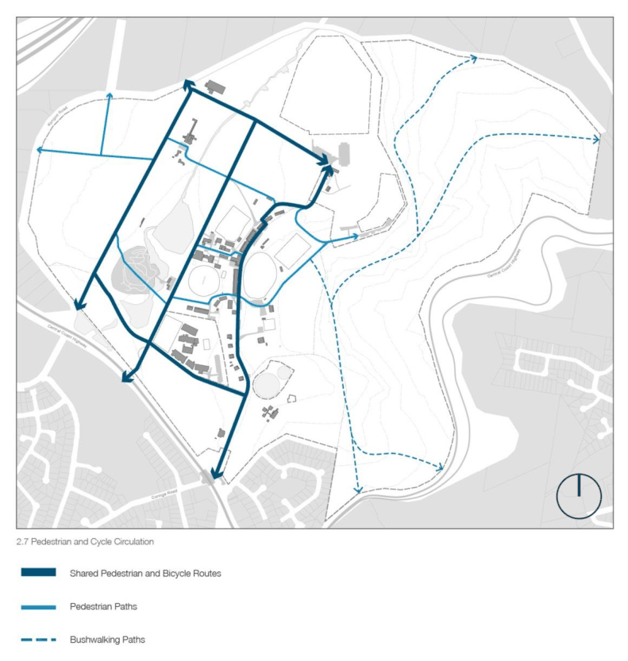

> [Picture on page 21: a picture, saved as a picture (images/ch-05-03-kariong-mount-penang-parklands-page-21-18.gif, 150 dpi).]

#### 5.3.3.8 Parking

Adequate car parking is to be incorporated on the site without compromising the setting and amenity of the site, whilst responding the fluctuations in activity throughout the year. Considerations should include;

a Locating larger car parks at the perimeter of the site and smaller permanent car parks (10-20) in locations related to specific uses;

b Ensuring car parks and overflow parking is shaded and screened with appropriate planting so that their visual presence is managed appropriately;

c Providing car parks for major events on grassed areas that receive proper drainage, on a relatively level terrain, and accessed by sealed roads with sufficient capacity to manage peak flows;

d Limiting lengths of on-street parking;

e Providing car parking in accordance with Central Coast Council’s current parking requirements;

f Parking associated with commercial developments in the Kangoo Road Commercial and Highway Commercial Precincts to be provided on a plot-by-plot basis, meeting the parking requirements outlined in Council’s current planning controls.

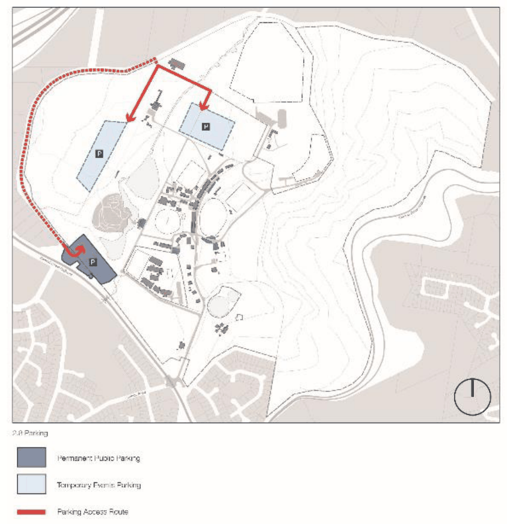

> [Picture on page 22: a picture, saved as a picture (images/ch-05-03-kariong-mount-penang-parklands-page-22-15.gif, 150 dpi).]

#### 5.3.3.9 Public Transport and Event Transport

Mount Penang is well served my major regional roads and arterial connections, but remains largely isolated from the majority of Gosford and the Central Coast. With the exception of those residents living in Kariong, the majority of people wishing to access the site must rely on private vehicles. Access to the site via public transport and event transport must be encouraged and supported by the following:

a Formulating a public transport strategy to promote regular transport services to the site and special event supplementary service;

b Providing coach and bus parking, taxi ranks and set down/pick-up areas at the entrance to the site off the Central Coast Highway; and

c Event transport drop-off and pick-up points located at the periphery of the site that are integrated into the established circulation network and provides direct access to the key precincts.

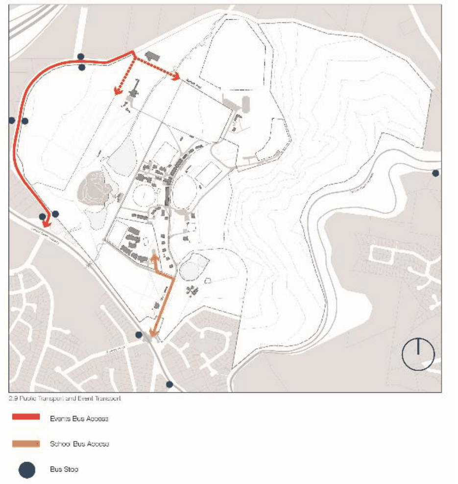

> [Picture on page 23: a picture, saved as a picture (images/ch-05-03-kariong-mount-penang-parklands-page-23-12.gif, 150 dpi).]

#### 5.3.3.10 Landscape and Open Space

The landscape character of Mount Penang is determined by the close relationship between the site’s various natural features, open spaces, and associated activities. To ensure these relationships are retained and where possible, enhanced, the following considerations should be made:

a Provide a high quality open space framework consisting of new public streets, avenues, and parks that encourage pedestrian activity;

b Develop a sequence of Village Greens as the focus for a range of activities and events, which may be associated with the Festival / Garden precincts, or respond to the uses within the Heritage Precinct;

c Provide a number of playing fields to cater for a range of sports and recreational activities;

d Structure the Festival / Garden Precinct around a major flexible public open space corridor, which forms the green spine for the site, and during the peak event periods the focal point for activities and movement.

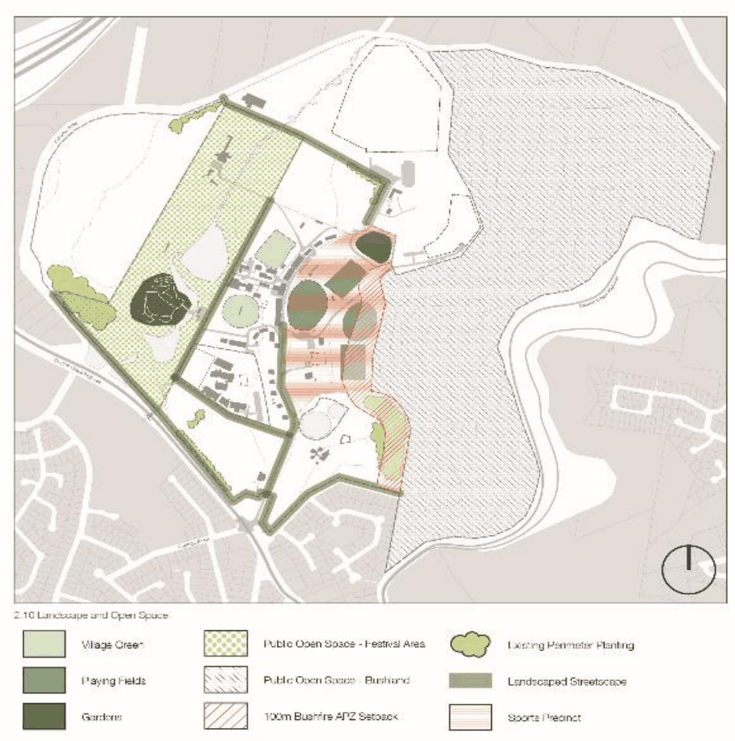

> [Picture on page 24: a picture, saved as a picture (images/ch-05-03-kariong-mount-penang-parklands-page-24-13.gif, 150 dpi).]

#### 5.3.3.11 Flora and Fauna

The site features an expansive network of native communities of flora and fauna that make a valuable contribution to the unique character of Mount Penang and must be considered as part of all future development proposals. To minimise the potential ecological impacts the following mitigation measures are recommended;

a As part of all major development applications for the site, undertake specific flora and fauna assessments;

b Stormwater management measures will need to ensure maintenance or improvement in water quality and the protection of receiving waters (surface and groundwater) into nearby water bodies;

c Provision of a minimum vegetated riparian buffer (10 m from top of bank) for the mapped watercourse upstream of the existing Mount Penang Gardens and associated dams; and

d Retain or provide canopy vegetation to maintain arboreal linkages through the central riparian corridor across the site.

These measures have been influenced by the Flora and Fauna Assessment referenced in this Chapter and available from Central Coast Council on request.

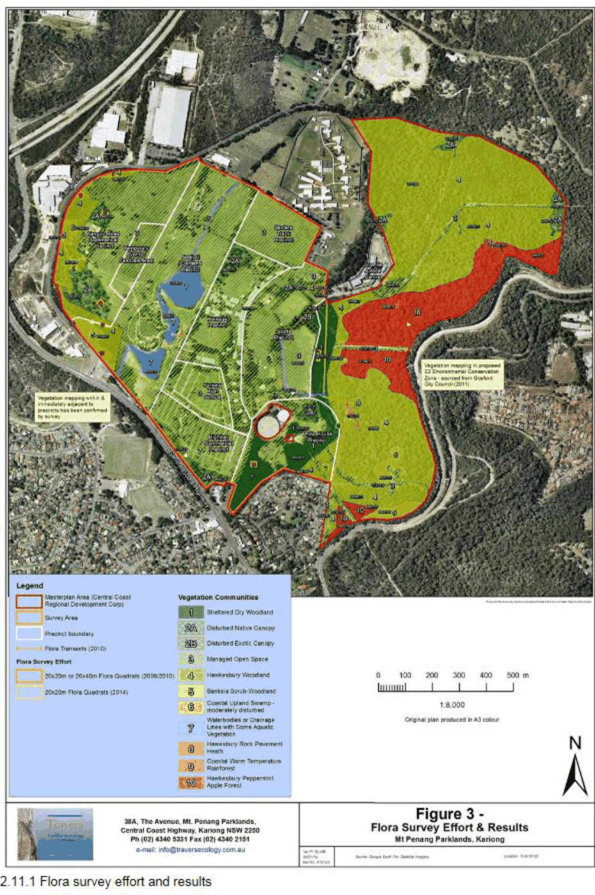

> [Picture on page 26: a picture, saved as a picture (images/ch-05-03-kariong-mount-penang-parklands-page-26-1.gif, 150 dpi).]

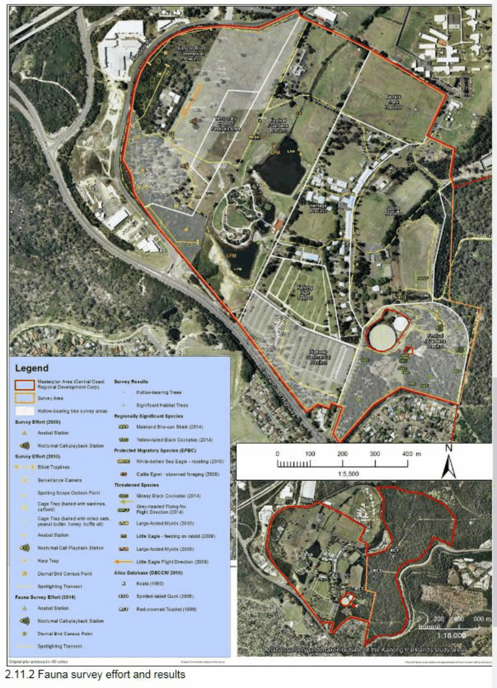

> [Picture on page 27: a picture, saved as a picture (images/ch-05-03-kariong-mount-penang-parklands-page-27-1.gif, 150 dpi).]

#### 5.3.3.12 Built Form, Character and Scale

Development on the site is to be carefully managed so that the location, scale, and character of new buildings respond, and where possible, enhance the overall cultural significance of Mount Penang. For this reason a series of potential development zones have been identified that must be overlaid with the precinct guidelines outlined in Section 3.0. The key considerations for development occurring within these zones include:

a Ensuring new buildings associated with the existing heritage buildings respect the scale, form and character of these heritage buildings;

b Protecting the existing physical and visual relationships between groups or complexes of significant buildings;

c Siting larger commercial structures on the western side of the site;

d Encouraging buildings which define and address the streets and public spaces;

e Ensuring new buildings are appropriately scaled to street widths and open spaces;

f Developing buildings which protect the amenity of open spaces and key views into and from the site; and

g Integrating parking and servicing access without compromising street character, landscape or pedestrian amenity.

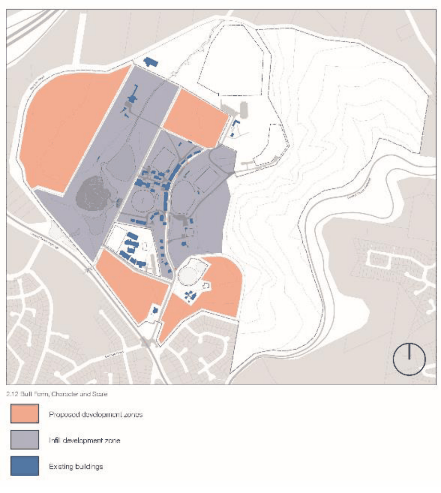

> [Picture on page 29: a picture, saved as a picture (images/ch-05-03-kariong-mount-penang-parklands-page-29-1.gif, 150 dpi).]

#### 5.3.3.13 Aboriginal Archaeology

Aboriginal sites are to be incorporated into the development of the site by:

a Conserving the undisturbed bushland area to protect all known Aboriginal sites within a bushland setting;

b Locating managed pathways in appropriate locations through the bushland;

c Ensuring active ongoing management of all known aboriginal sites.

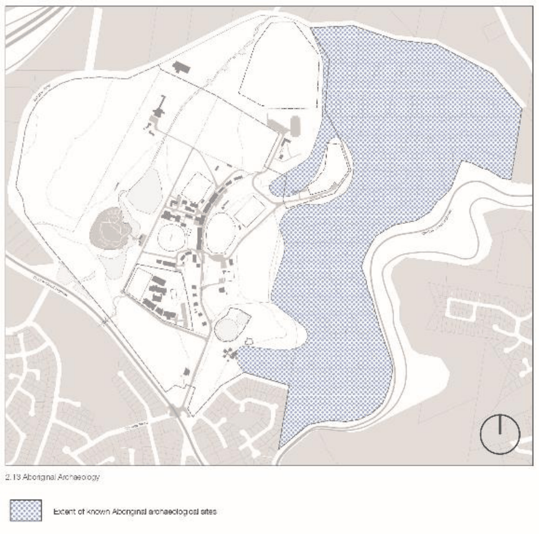

> [Picture on page 30: a picture, saved as a picture (images/ch-05-03-kariong-mount-penang-parklands-page-30-1.gif, 150 dpi).]

#### 5.3.3.14 Bushfire

The local terrain, coverage of native vegetation and proximity of development to the Bushland Precinct raises several key considerations associated with bushfire and the threat associated with future development across the site.

As required, a detailed Bushfire Assessment Report is to be prepared before lodging a development application, and which should address:

a Asset Protection Zones (APZs) that are to be provided;

b Necessary fuel management within the APZs including, regular maintenance of the landscaped areas;

c Building construction standards to be applied to any future Class 1 to 4, 9 or 10a building in accordance with Australian Standard AS3959 Construction of buildings in bushfire prone areas (2009) with additional construction requirements as listed within Section A3.7 of Addendum Appendix 3 in Planning for Bushfire Protection (PBP).

d Building construction standards for Class 5-8 and 10 buildings to be considered on a case by case basis;

e Access that will comply with the acceptable solutions (Section 4.1.3 PBP);

f Necessary water supply;

g Emergency management.

These guidelines have been influenced by the Bushfire Protection Assessment referenced in this Chapter and available from Central Coast Council on request

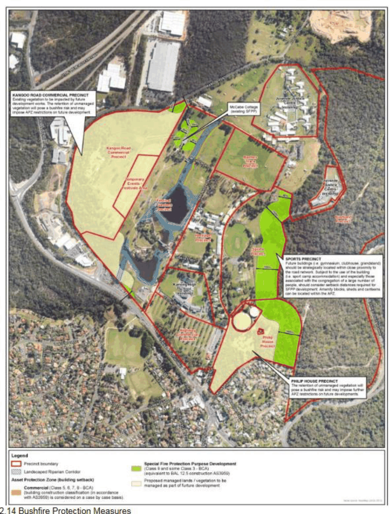

> [Picture on page 32: a picture, saved as a picture (images/ch-05-03-kariong-mount-penang-parklands-page-32-1.gif, 150 dpi).]
