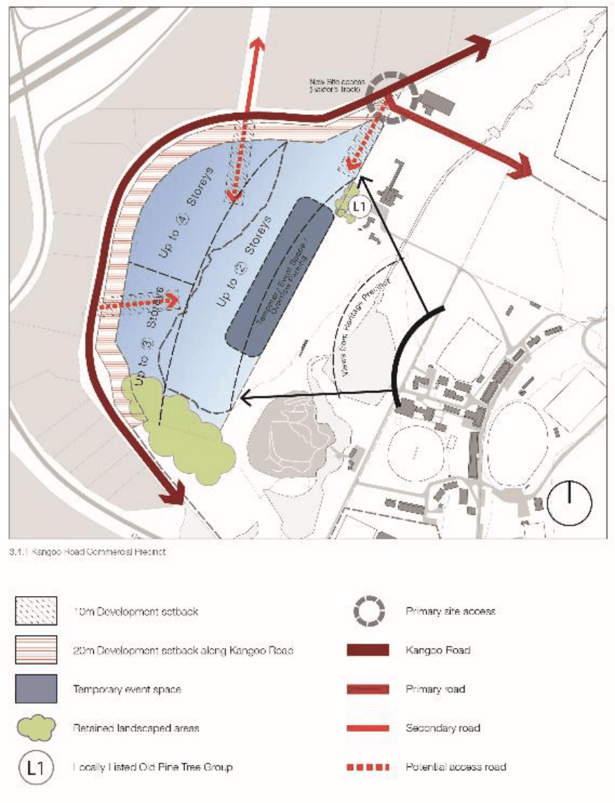
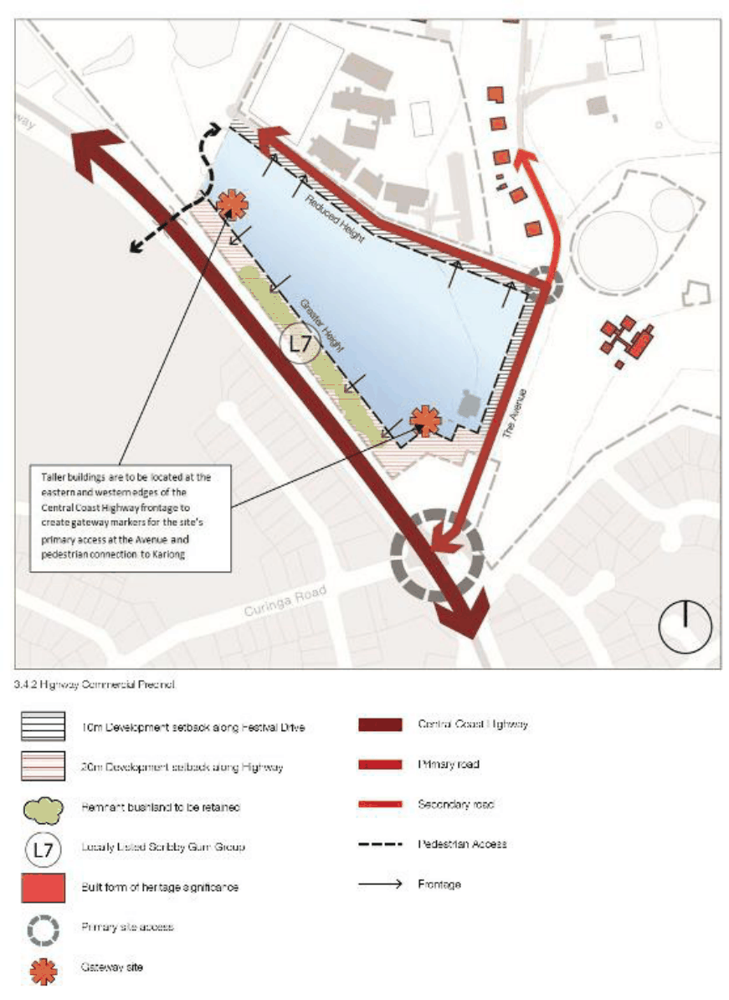
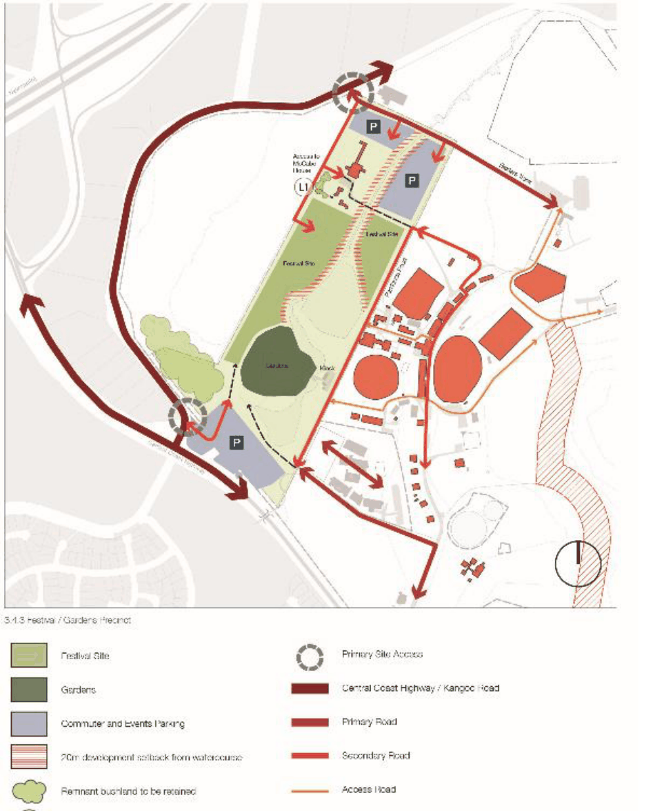
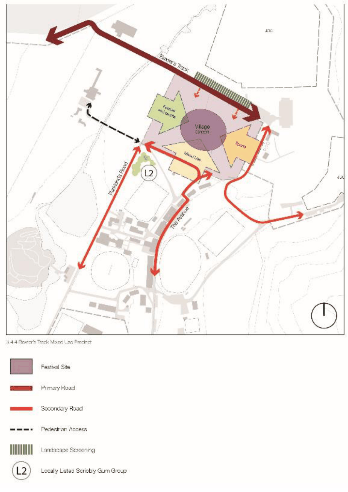
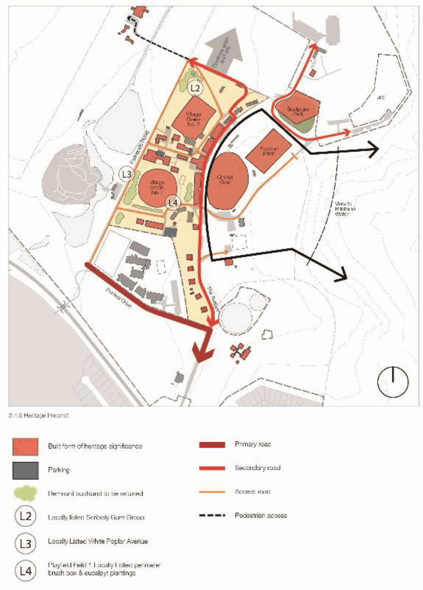
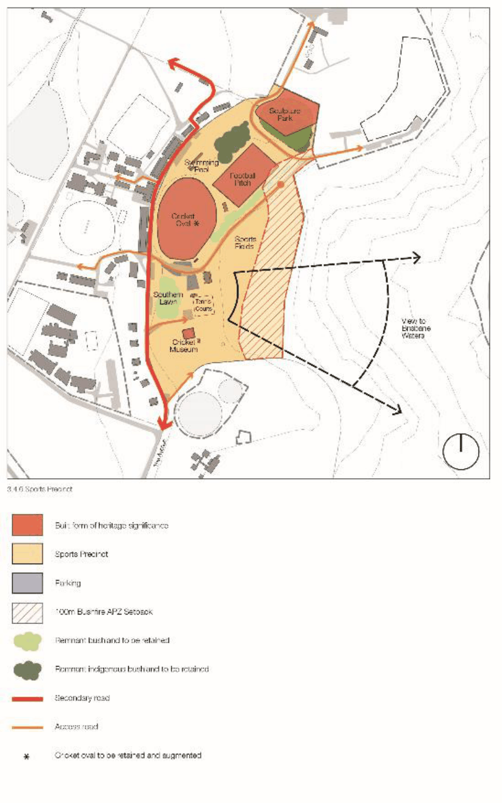
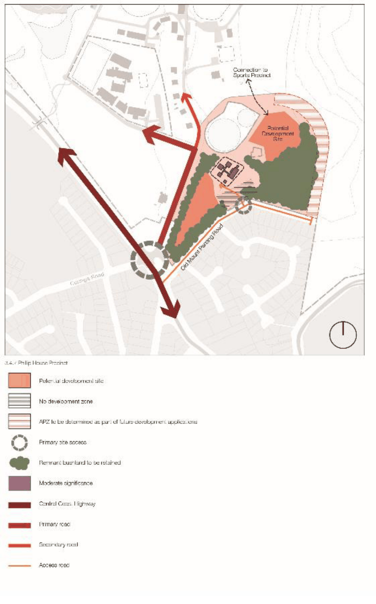

#### 5.3.4 DESIGN GUIDELINES

#### 5.3.4.1 Introduction

Mount Penang has a rich and varied character reflecting its diverse natural and cultural landscape, its history and range of uses. As a consequence, the site can be naturally divided into a number of precincts based on the physical characteristics of different parts of the site. The various characteristics of each precinct, including their opportunities and constraints, have suggested a range of appropriate potential uses and the desired future character of each precinct.

General guidelines provide controls that apply to all precincts. Precincts guidelines provide the detailed planning framework for the different precincts.

The precincts have been identified as follows:

a Kangoo Road Commercial Precinct b Highway Commercial Precinct c Festival / Gardens Precinct d Heritage Precinct e Baxters Track Mixed Use Precinct f Sports Precinct g Phillip House Mixed Use Precinct h Bushland Precinct

#### 5.3.4.2 General Built Form Guidelines

a Access and Car Parking

i Service and loading areas should be separated from general parking

ii Pedestrian and vehicular access to new building should be separated

iii All surface car parks are to be landscaped with screen planting and shade trees

b Heritage

All heritage buildings and landscape elements are identified on the relevant precinct drawings and are to be conserved in accordance with the current Conservation Management Plan for Mount Penang. The Conservation Management Plan provides detailed conservation policies for all heritage items.

i Heritage Buildings and structures should generally be conserved by:

▪ Ensuring that new uses for heritage buildings are compatible with the retention of significance of the buildings and the site as a whole;

▪ Minimising change to heritage buildings, such as the alteration of their external form, appearance and detail, unless to remove intrusive elements;

▪ Retaining the existing physical and visual relationship between groups or complexes of heritage buildings;

▪ Retaining the integrity of significant interiors, such as those of the existing dormitories;

▪ Ensuring the character of new development is generally restrained and satisfies established ‘infill’ principles;

▪ Additions to existing buildings, including buildings of low or negligible heritage significance, satisfy the following criteria to ensure a successful relationship with existing heritage buildings, the precinct and cultural landscape as a whole:

o Retention of the element which contributes to the heritage values of the existing buildings, and the precinct in which it is located:

o Retention of an appropriate curtilage or setting for the existing building, and surrounding heritage buildings;

o Appropriateness of siting and setbacks, including the retention of appropriate visual and spatial relationships;

o Compatibility with the existing scale, form, and character; and

o Harmony with existing materials and details.

ii New Buildings or Structures:

▪ New buildings shall not be located within groups of significant buildings, such as the cottages and dormitories;

▪ New buildings should respect the scale, form and character of significant buildings to which they relate, without imitating them;

▪ New buildings shall be subservient in scale and not dominate the existing heritage buildings to which they relate;

▪ New buildings will need to satisfy all of the following criteria to ensure that they are compatible with heritage buildings, the precinct and cultural landscape as a whole:

o Retention or enhancement of the characteristics which contribute to the heritage value of the precinct in which it is located;

o Retention of an appropriate curtilage or setting for surrounding heritage buildings;

o Appropriateness of siting and setbacks, including the retention of appropriate visual and spatial relationships;

o Compatibility with the existing scale, form, and character;

o Sympathy with existing materials and details; and

o Retention of significant view corridors.

iii The Non-Aboriginal archaeological potential of the site should be protected by:

▪ Undertaking work in accordance with the policies for potential archaeological values in the Conservation Management Plan for Mount Penang; and

▪ Obtaining an Excavation Permit prior to any disturbance of relics should the Archaeological Assessment determine that archaeological remains are present in the form of ‘relics’, as defined in the NSW Heritage Act 1977.

c. Building Heights

i Building heights are expressed in storeys. A storey is defined as one volume of habitable floor space between floor and ceiling. A minimum floor to ceiling height applies for new buildings:

▪ Commercial / public buildings:

3.3 metres – for ground floor

2.7 metres - for levels above ground

▪ Accommodation / non-public buildings/ kiosks and pavilions:

2.7 metres – for ground floor

ii Additional storeys will not be considered by reducing the floor to ceiling height. Mezzanines, habitable rooms in roof spaces and basements more than 1 metre above ground level will be counted as storeys.

iii Due to the location, separation and relatively unconstrained characteristics of the Kangoo Road Commercial and Highway Commercial Precinct, these two precincts are capable of accommodating substantial built form outcomes.

iv Maximum height limits also apply for each precinct. These heights vary across the site to reflect the variety of building types, building forms and desired future character for each precinct. Building heights are measured from natural ground level. On sloping sites, the maximum height is measured from any point within the building envelope at natural level.

d Building Setbacks

i All new buildings are to be setback from designated pedestrian paths and/or street alignments as indicated on the relevant precinct drawing. No part of a building or structure may encroach into a prescribed setback zone; and

ii The setback zone is to be a well-designed landscaped area that contributes to the amenity of the public domain as well as the building. The area should be predominantly planted with trees and shrubs. Paving should be minimal and limited to entrance paths and vehicular access.

e Building Envelope

i Building layouts should optimise natural light and cross ventilation;

ii The existing heritage buildings are typically no longer than 40 metres in length. To complement the existing building forms, to avoid long uninterrupted facades and to allow views between buildings the uniform façade length of new buildings in close proximity to existing heritage buildings should not overly exceed existing heritage building lengths along any frontage; and

iii Buildings that exceed this control must demonstrate how the bulk and scale of the building is minimised by providing modulation to the building facades.

f Building Expression

i Building elements that modulate the façade of a building, such as verandahs, balconies, terraces, bay windows, sun shading and the like are required on buildings;

ii Special attention to the design and detailing of the ground level, entrances and roofs of new buildings with a public interface. A regular rhythm of columns and windows is recommended to help modulate long facades;

iii Weather protection at entrances is recommended;

iv All buildings should be designed with openable windows to maximise natural ventilation;

v All facades, including rear facades must include fenestration (windows);

vi Verandahs should be designed consistently with heritage buildings; and

vii Plant equipment, lift overrun, communication devices, solar collectors and the like are to be integrated into the design of the building.

g Building Signage

i All signage is to be contained within the envelope of the building. No rooftop signs are permitted; and

ii Commercial signage is to be limited to identification signs. These may be located above entrances or suspended under verandahs or awnings.

h Building Construction and Materials

i Buildings should demonstrate ESD principles in construction, materials and operations;

ii Materials with a high thermal mass such as bricks, concrete and stone improve the energy efficiency of a building and are recommended for external walls;

iii External walls, floors, and roofs are to be insulated to improve energy efficiency; and

iv Curtain wall and mirror glass are discouraged.

i Solar Access and Overshadowing

i Buildings should be designed to optimise solar access to habitable rooms and open spaces and courtyards;

ii Appropriate external sun shading is required on all building windows that receive direct summer sun; and

iii Buildings are to be designed to minimise overshading of neighbouring buildings and open spaces particularly during the winter months.

j Water Conservation and Solar Energy Use

i Minimise the use of reticulated water on site through conservative practices and reuse of rainwater;

ii All new development is to include water saving devices such as dual flush toilets, tap aerators, spring return taps and low water use dishwashers and washing machines; and

iii Solar hot water heaters of the appropriate size should be integrated into all new development.

k Contamination

i All land within the site has the potential to be contaminated. It is a requirement that during the preparation of a development application that an initial evaluation be carried out (in accordance with the Land Guidelines) to establish whether there is a risk to health or environment caused by the proposed use on the subject land; and

ii Where contamination does exist and poses a risk to health or the environment, Council may only grant consent if it is satisfied that the land is suitable or can be made suitable through remediation for the proposed development.

l Infrastructure Provision

i Basic infrastructure and services, such as water, sewer, stormwater, power, telephone lines, gas and roads are outlined and to be delivered in accordance with the referenced servicing strategy reports.

ii Council will only consent to development where road infrastructure is in place that is a standard acceptable to Council to service a development.

iii The RMS is to be consulted for all new development that includes the addition of lettable floor space and provide specific advice on any impacts to the State Highway network in the vicinity of the development.

m Site Drainage and Stormwater Control

i The impact of development on the existing stormwater, water supply, sewerage and energy supply infrastructure is to be minimised through appropriate site planning, in particular in relation to the conserved bushland areas and watercourses;

ii Soil and water management measures should be minimise and control soil erosions and sediment transport;

iii Development is to be designed to ensure maximum rainwater infiltration on site by minimising paved areas and providing stormwater drainage systems that promote natural infiltration; and

iv Development sites should provide for on-site stormwater controls to ensure stormwater flows and stormwater quality are maintained at pre development conditions. Should infiltration devices be utilised to control stormwater then a geotechnical investigation should be submitted with any application for subdivision to demonstrate the capability of the soil to accommodate the infiltration devices.

n Waste Management

i All development should provide onsite storage for waste and recycling facilities.

o Building Services

i All new service elements such as aerials, vent pipes, hot water services, solar collectors, plant equipment and the like are to be concealed from public view and integrated into the design of the building; and

ii All hydraulic, electricity and other service lines are to be concealed from the public views. Services elements, such as radio mast should be located to minimise the visual and environmental impact of the installation.

#### 5.3.4.3 General Public Domain Guidelines

a Landscape Requirements

i A building setback for most new buildings requires a well-designed landscaped area that adds to the amenity of the precinct as well as the buildings. This area should be predominantly planting with minimal paving;

ii All streets and paths should be lined with tree planting. The scale and character of the planting may vary for each precinct to give local identity; and

ii Native species indigenous to the area should be used where practicable. Invasive exotic species should be avoided particularly in close proximity to the conserved bushlands.

b Paving

i Unit paving is standard for all footpaths; and

ii Accent paving is required at intersections of pedestrian and cycleway networks.

c Street Furniture

i All street furniture (bins, bollards, street signs, street lighting, benches, drinking fountains, bus shelters etc.) are to be coordinated with CCRDC.

d Street Signage

i All information, directional and identification signs are to be coordinated with CCRDC;

ii Street identification signs should be located at all intersections. Street identification signs may be mounted on buildings if possible to reduce clutter;

iii Traffic control signs should be limited to those essential for traffic and parking control; and

iv No private identification or advertising signage is permitted in the public domain.

e Street Lighting

i Street lighting should be coordinated and standardised through Mount Penang;

ii On major pedestrian routes and in key public spaces such as the village greens, the Mount Penang Gardens and the sporting precinct pedestrian lighting of the footpaths is to be provided; and

iii Buildings with verandahs should incorporate lighting such as wall mounted fittings (instead of pedestrian light standards) to light the verandah.

f Artwork

i The use of artwork, fountains and water elements is considered integral to the festival site providing a focus for the public domain. Water elements in particular should be incorporated into the design of the Mount Penang Gardens.

#### 5.3.4.4 Precinct Guidelines

#### 5.3.4.4.1 Kangoo Road Commercial Precinct

a Existing character

The precinct currently features gently sloping open grasslands, with pockets of dense bushland along the south-western edge of the adjoining Kangoo Road. The undeveloped and open character of the precinct sits in contrast to the relatively enclosed and densely vegetated landscape that sweeps between the various collections of buildings throughout the heritage core to the east.

b Desired Future Character

The Kangoo Road Commercial Precinct fronts Kangoo Road, forming the western edge of the site and the opportunity for large-format development plots suitable for bulky goods, research, information technology and office (Business Park). This precinct, being remote from the historic core of Mount Penang, has the potential for its own distinct identity and address, with the majority of the development sites to be accessed directly from Kangoo Road. Whilst the precinct is establishing new commercial development the site can continue to be used to support events being undertaken elsewhere in Mount Penang.

c Controls

In general, the following controls apply to all development in the Kangoo Road Commercial Precinct.

d Activities and Uses

i Employment uses such as research and development establishments, office/ commercial co-operative nurseries, workshops, laboratories, other business uses, showrooms, speciality retails, themed attractions, educational institutions, recreational uses, and related ancillary uses are allowed in the Kangoo Road Commercial Precinct;

ii Temporary uses associated with major events and festivities held in the Festival/Garden Precinct can be held in the designated area at the eastern boundary; and

iii Active Frontages that promote pedestrian activity such as building entrances, display windows are encouraged to animate the building frontage.

e Access and Car Parking

i The Kangoo Road Commercial Precinct is to be served by:

▪ Kangoo Road will provide direct access to properties within the precinct via driveways servicing individual sites, or via private access roads that serve a number of sites created by the subdivision of the precinct; and

▪ New site access at Baxter’s Track & Kangoo Road provides an alternative point of access and egress for properties located in the northern area of the precinct.

ii Car parking is provided in designated parking areas at a sufficient scale to meet the requirements of the corresponding land use. The parking is to be provided within the property boundary of that land use, and parking elsewhere in the precinct and site cannot be relied upon to meet parking requirements;

iii The visual presence of parking areas should be mitigated through the use of landscaped screening, which can also serve as shading elements for surface parking areas;

iv Car parking provided at or above ground level must be located behind the building line and screened from view;

v Car park or service entries should be minimised to reduce visual impact;

vi Parking provisions is to be in accordance with Councils current parking standards.

f Building Heights

i The building heights in the Kangoo Road Commercial Precinct should respond to the topography of the site, taking into consideration the location of landscaped features (both existing and proposed) and visual prominence when viewed from the Heritage Precinct to the

east. The south-western area of this precinct provides for an intermediate height of 3 storeys;

ii Typically, lower buildings should be positioned along the precinct’s eastern edge, whilst taller buildings are to be located along the Kangoo Road frontage along the western boundary of the precinct; and

iii Number of storeys for new buildings range from 2- 4 storeys:

Maximum building height:

▪ 2 storey buildings: 9 metres

▪ 3 storey buildings: 12 metres

▪ 4 storey buildings: 16 metres

g Building Setbacks

i The development building heights in the Kangoo Road precinct are to be setback from the designated street alignment as indicated on the precinct control drawings:

ii Minimum 20 metres from Kangoo Road, and

iii Minimum 10 metres from the secondary (private access) roads and side boundaries.

h Building Expression

i New buildings should be designed to minimise scale and bulk. All new buildings require significant articulation to modulate the facades, particularly where the facade addresses the Festival / Garden Precinct;

ii Building elements that modulate the façade of a building, such as windows, building openings, sun

iii shading, and the like are required. A regular rhythm of structure, openings and treatments is recommended to help modulate long facades;

iv Special attention to the design and detailing of the ground level, entrances and roofs of new buildings is required, particularly on larger new buildings with a public interface, to reduce the overall scale and bulk;

v Weather protection at entrances is recommended;

vi All building windows that receive direct summer sun are required to have appropriate external sun protection;

vii All facades, including rear facades must include fenestration (windows). Except for party walls, blank walls are not permitted. Concrete floor slabs are not to be expressed on the external face of the buildings;

viii Detailed modelling of parapet walls at the skyline is recommended;

ix Subdued colours and materials with low reflectivity are required to minimise the visual impact of buildings as viewed from the Heritage Precinct.

i Landscape Requirements

i The character of the remnant indigenous vegetation on the site should be supplemented and extended with local species around the perimeter of the site to provide a landscape setting for the buildings and a buffer to Kangoo Road;

ii Additional landscaping features are to be provided as part of the Street Hierarchy principles outlined in Section 2.0, which relate specifically to the quality and design of the streetscape; and

iii The assessment of each individual development application within the precinct will take into consideration the quality of the landscape proposed and its integration into the wider open space and landscape network for Mount Penang.

j Visual Impact

i All development proposals (including the combination of built form controls, building setback, building heights and screening) must be supported by a detailed visual impact assessment which demonstrates the visual impact of the development is minimised when viewed from the Garden / Festival and Heritage Precincts.

> [Picture on page 41: a picture, saved as a picture (images/ch-05-03-kariong-mount-penang-parklands-page-41-5.gif, 150 dpi).]

#### 5.3.4.4.2 Highway Commercial Precinct

a Existing Character

i The character of Highway Commercial Precinct, which runs along the site’s southern frontage to the Central Coast Highway between The Avenue and the Mount Penang Gardens is grassed paddocks with rows of trees that define spaces used for event parking and markets;

ii The area of vegetation along the southern frontage of the precinct increases in depth towards the fire station at the junction with The Avenue. Despite this landscape feature the precinct is highly visible from traffic moving along the Central Coast Highway; and

iii The precinct plays an important role as it occupies the key gateway to Mount Penang from the south, is the most visible from passing traffic, and provides an important transition between precincts, including the Heritage Precinct to the north, Festival/ Garden Precinct to the east, Phillip House to the west and Kariong High School to the north, and with which is shares access via Festival Drive.

b Desired Future Character

i The Highway Commercial Precinct plays an important role in defining the character of the entire Mount Penang site, due to its highly visible location along the Central Coast Highway, and gateway from the site’s primary entrance at The Avenue. The form, scale, quality and design of development within this precinct will influence perceptions of development and activities throughout the rest of the site, and must therefore be of the highest standard. All development must respond to the various interfaces acting on this precinct; addressing the Central Coast Highway, whilst gaining access from Festival Drive, and responding to the landscapes to the east (Phillip House) and west (Gardens).

c Controls - In general, the following controls apply to all development in the Highway Commercial Precinct.

d Activities and Uses

i Employment uses such as office/commercial, retail outlets, speciality retail, educational institutions, and related ancillary uses are allowed in the Highway Commercial Precinct;

ii Active frontages that promote pedestrian activity such as building entrances, display windows are encouraged to animate the building frontage of new festival buildings; and

iii Development should be orientated to the surrounding street frontages to provide activity, interest and surveillance. These frontages include the Central Coast Highway (south), Festival Drive (north), and The Avenue (west).

e Access and Car Parking

i The Highway Commercial Precinct is to be accessed via Mount Penang’s primary southern access point at the junction of The Avenue and the Central Coast Highway, which is located to the south of the precinct;

ii All servicing and parking access is to be gained from Festival Drive along the northern frontage of the precinct. No vehicular access is to be gained directly from the southern frontage to Central Coast Highway;

iii Due to the proximity of the Kariong High School, which is located immediately to the north of the precinct, servicing of any retail and commercial properties should be restricted during peak school periods (8am – 9:30am and 2:30pm – 4pm);

iv Car parking is provided in designated parking areas at a sufficient scale to meet the requirements of the corresponding land use. The parking is to be provided within the property boundary of that land use, and parking elsewhere in the precinct and site cannot be relied on to meet parking requirements;

v The visual presence of parking areas should be mitigated through the use of landscaped screening, which can also serve as shading elements for surface parking areas;

vi Car parking provided at or above ground level must be located behind the building line and screened from view;

vii Car park or service entries should be minimised to reduce visual impact;

viii Parking provisions is to be in accordance with Councils current parking standards; and

ix Car parking to the frontage of Central Coast Highway is discouraged and any parking in this area should ensure its visual presence is minimised.

f Building Heights

i The height of development along the Central Coast Highway frontage (up to 4 storeys) should provide a strong built edge to Mount Penang’s southern frontage, stepping up in height from the 2-storey limit along the Festival Drive frontage;

ii Variations in building height along the north-south and east-west axis is encouraged, as it provides interest and is likely to create taller elements that create legibility in the streetscape;

iii Taller buildings are to be located at the eastern and western edges of the Central Coast Highway frontage to create gateway markers for the site’s primary access at The Avenue and the pedestrian connection to Kariong;

iv The heights of buildings along The Avenue frontage should be reduced to a maximum of 2 storeys in order to respond to the existing built form and character of the Heritage Precinct to the north;

v Number of storeys for new buildings range from 2- 4 storeys:

Maximum building height:

▪ 2 storey buildings: 9 metres

▪ 3 storey buildings: 12 metres

▪ 4 storey buildings: 16 metres

vi Any development proposed along the eastern edge should respond to the existing built form and character of the Heritage Precinct to the north.

g Building Setbacks

i The height and scale of development in the Highway Commercial Precinct is to be setback from the designated street alignment as indicated on the precinct control drawings:

▪ Minimum 20 metres from Central Coast Highway, so that the existing vegetation can be protected and enhanced; and

▪ Minimum 10 metres from the secondary street frontages of The Avenue and Festival Drive.

h Building Expression

i New Buildings should be designed to minimise the scale and bulk of these buildings. All new buildings require articulation to modulate the facades of the buildings;

ii Building elements that modulate the façade of a building are required to create a regular rhythm that breaks-up potentially long facades;

iii Special attention to the design and detailing of the ground level, entrances and roofs of new buildings is required, particularly on larger new buildings with a public interface to reduce the overall scale and bulk;

iv Multiple building entrances and display windows are encouraged to animate the building frontage of new festival buildings;

v Weather protection at entrances is recommended;

vi All building windows that receive direct summer sun are required to have appropriate external sun protection;

vii All facades, including rear facades must include fenestration (windows). Except for party walls, blank walls are not permitted. Concrete floor slabs are not to be expressed on the external face of the buildings;

viii Detailed modelling of parapet walls at the skyline is recommended, with the use of elevated signage above the parapet or roofline to be avoided;

ix The visual prominence of development from the Central Coast Highway should be the subject of view analysis as part of any development applications within the precinct; and

x Building plant should be integrated into the design of the building facade.

i Landscape Requirements

i The character of the remnant indigenous vegetation on the site should be supplemented and extended with local species around the perimeter of the site to provide a landscape setting for the buildings and a buffer to the Central Coast Highway and The Avenue;

i Additional landscaping features are to be provided as part of the Street Hierarchy principles outlined in Section 2.0, which relate specifically to the quality and design of the streetscape;

ii The assessment of each individual development application within the precinct will take into consideration the quality of the landscape proposed and its integration into the wider open space and landscape network for Mount Penang; and

iii Any development proposals should minimise impact on the locally listed trees and maximise retention of these trees within retained landscape areas

> [Picture on page 45: a picture, saved as a picture (images/ch-05-03-kariong-mount-penang-parklands-page-45-1.gif, 150 dpi).]

#### 5.3.4.4.3 Festival / Gardens Precinct

a Existing Character

i This precinct forms the central green spine of the site. The gently sloping topography has been formed by Piles Creek, which flows through the Gardens into Brisbane Water National Park, and over time has formed a shallow valley separating the Heritage Precinct from the Festival / Gardens Precinct.

ii The landscape in the north of the precinct is characterised by a number of open paddocks, whose boundaries are defined by rows of vegetation and fence lines. The heritage listed McCabe House is located at the north-western edge of the paddocks, surrounded by groups of mature trees and accessed via McCabe Road.

iii The southern half of the precinct features the Mount Penang Gardens, which includes a series of dams, holding ponds and water gardens that are accessed via the kiosk and café on Parklands Road. The topography drops away to the south of the gardens towards the Central Coast Highway.

b Desired Future Character

i The precinct is to serve as a festival and events venue where the activities are integrated into the existing landscape, including the Mount Penang Gardens, which will continue to serve as a major attractor for the entire site. Over time the levels of activity within the precinct will expand and contract in order to meet the needs of the festival and event operators. During peak periods access will be gained via Kangoo Road and Baxter’s Track, whilst in those periods between events the precinct will reintegrate with those precincts to the east and south.

ii Permanent facilities may be developed to support and encourage use of the precinct for festivals and events, and may include new exhibition spaces, pavilions, museum and cultural centre. During event periods temporary structures, such as tents and marquees may be erected within the precincts. Overflow parking areas will be arranged on the paddock areas in the north of the precinct and on designated areas of surrounding precincts.

iii The Mount Penang Gardens will continue to feature a rich variety of permanent gardens located along the valley floor of the precinct, which will enhance the site’s image when viewed from the Central Coast Highway. The gardens will be focused around a series of water features and an outdoor amphitheatre. Small kiosks and pavilions may be located throughout the gardens. A range of passive recreational uses related to the gardens will be accommodated, and may include temporary garden themed events, or integration into larger events being undertaken throughout the site.

iv The design of this precinct will have regard to the environmental effects of noise and wind and will generally limit development adjacent to the water course. A comprehensive water management program based on ESD principles is also to be incorporated into the precincts.

c Controls - In general, the following controls apply to all development in the Festival / Gardens Precinct.

d Activities and Uses

i The Festival / Gardens Precinct can accommodate a range of land uses and activities associated with exhibitions, cultural festivals, and special events, which may include temporary and permanent garden displays, temporary exhibitions, festivals, entertainment, boating, amusements and rides complementary to the character of the Mount Penang Gardens;

ii Other permanent land uses may include specialty retail, food and beverage, cultural and educational activities, such as those currently being undertaken at the Mount Penang Gardens; and

iii McCabe Cottage may be used for a range of commercial uses including conference, exhibition, education and accommodation.

e Access and Car Parking

i The Festival / Gardens Precinct is to be a pedestrian-priority environment with access for servicing and parking limited to the periphery, including Parklands Road and Baxter Track;

ii Access to McCabe House will be taken from the access point at Kangoo Road and Baxter Track, transferring the existing McCabe Road to a pedestrian route through the precinct;

iii Permanent car parking is to be provided in designated areas at the periphery of the precinct and in adjacent precincts to protect the amenity of the gardens;

iv Overflow parking areas required during major events will be located in the north of the precinct, accessed directly from Kangoo Road via Baxters Track. The configuration and management of this areas must take into consideration the overland flow paths to Piles Creek, existing vegetation and curtilage of McCabe House;

v Additional commuter car parking, which can also serve as overflow parking during major events, is to be located at the southern edge of the precinct, directly abutting the existing commuter parking area at the junction of Kangoo Road and Central Coast Highway;

vi Pedestrian access to the precinct is from the eastern (Heritage Precinct) and southern frontages (Central Coast Highway and Southern Commercial Precinct);

vii Vehicular access to be taken from the precincts northern (Baxters Track) and western frontages, via Kangoo Road;

viii Additional pedestrian crossing over Piles Creek should be delivered at key points to reinforce the connections between event parking, designated festival areas, the gardens and permanent land uses (kiosk); and

ix The visual impact of car parking when viewed from the gardens should be minimised through screening.

f Building Heights

i Maximum 9 metres height for new buildings associated with the on-going operation of the Mount Penang Gardens and permanent buildings relating to the running of festivals, exhibitions and events.

ii Small viewing towers within the Mount Penang Gardens that exceed this height may be appropriate and will be assessed on their merits, and

iii Temporary structures associated with the operation of events, festivals and exhibitions may exceed the designated height limit and will be assessed on their merits, taking into consideration how long the structure will be standing, its location, scale, mass and proximity to the Heritage Precinct.

g Building Setbacks

i All new and temporary buildings in the precinct are to be setback from the designated pedestrian paths and street alignment:

ii Minimum 5 metres from pedestrian paths;

iii Minimum 10 metres from the street alignment; and

iv All new buildings in the precinct are to be setback a minimum of 20 metres from the watercourse, subject to the proper assessment of the impact on water quality.

h Building Expression

i McCabe cottage is to be conserved in accordance with the Conservation Management Plan; and

ii All new and temporary buildings should be designed to be small scale, with generous separation distances from other buildings, footpaths and roads, vegetation and water courses. Single contiguous built forms should be avoided.

i Building Materials

i Lightweight materials such as timber and plywood are preferred for all new and temporary buildings;

ii Roof materials should respond to the local architectural vernacular seen throughout the Heritage Precinct to the east, which include galvanised corrugated steel; and

iii Verandah posts and external windows and door joinery should be timber.

j Landscape Requirements

i The Mount Penang Gardens are to be developed around themed planting and a series of water features ranging from natural ponds, cascading basins to fountain and reflective pools;

ii A landscape masterplan for the Festival Garden Precinct should be prepared before any permanent work on the Gardens of the development of new buildings is undertaken, including a Management Plan for Piles Creek and associated water bodies;

iii New planting and landscaped zones should be used to reinforce pedestrian routes through the precinct and delineate the areas where overflow event parking and festival activities are to be undertaken; and

iv All individual and recurring events, festivals and exhibitions should take into account the rehabilitation of the landscape to its original/existing quality, and include measures to mitigate damage to vegetation, grassed areas and water courses.

> [Picture on page 49: a picture, saved as a picture (images/ch-05-03-kariong-mount-penang-parklands-page-49-1.gif, 150 dpi).]

#### 5.3.4.4.4 Baxter's Track Mixed Use Precinct

a Existing Character

i Baxter’s Track Precinct occupies the area between the existing Heritage Precinct and the Juvenile Justice Centre. Access to this area will be gained from either The Avenue or Kangoo Road, via Baxter’s Track. A range of activities and facilities can be accommodated within this precinct, including an extension of the existing grain and land uses from the Heritage Precinct to the south, sports and recreation activities integrated with the east, or the festival and event activities from the west.

b Desired Future Character

i The future character of this precinct must take into consideration the existing and desired future character of the precincts immediately to the west, east and south, and the Juvenile Correction Centre to the north. Development must be mixed and responsive to the changing needs and operation of the site. Fine grain development must reflect the existing heritage character and built form, whilst any new buildings should be designed to accommodate a range of uses and activities that complement neighbouring precincts; and

ii The pattern of development expressed in the Heritage Precinct to the south provides a strong reference for any future development within this precinct, with groups of buildings gathered around a central (village green) space.

c Controls

In general, the following controls apply to all development in the Baxter’s Track Precinct.

d Activities and Uses

i Permanent uses may include specialty retail, commercial, research, temporary accommodation, education, culture and recreation, all of which are associated with the existing activities in the adjacent Heritage and Sports Precincts;

ii Temporary uses may include exhibitions and events associated with those activities undertaken at the Festival/Gardens Precinct to the west; and

iii Active frontages that promote pedestrian activity such as building entrances, display windows are encouraged to animate the building frontage of new buildings, addressing pedestrian routes through the precinct and new spaces.

e Access and Car Parking

i The Baxter’s Track Precinct is predominantly a pedestrian environment, similar to the Heritage Precinct, where access for vehicles is limited to the periphery;

ii Car parking is provided in designated parking around the periphery of the precinct, the area accessed via The Avenue, Parklands Road and Baxter’s Track; and

iii Pedestrian and vehicular access to buildings should be separated.

f Building Heights

i Number of storeys for new buildings:

▪ Maximum 2 storeys; and

▪ Maximum building height: 9 metres

ii Generous floor to ceiling heights are required for new buildings to provide an appropriate scale compatible with the existing heritage buildings located to the south in the Heritage Precinct;

iii Temporary structures associated with the operation of events, festivals and exhibitions may exceed the designated height limit and will be assessed on their merits, taking into consideration how long the structure will be standing, its location, scale, mass and proximity to the Heritage Precinct.

g Building Setbacks

i All new building in the Baxter’s Track Precinct are to be setback from the designated routes by:

▪ Minimum of 10m from secondary roads, including Baxter’s Track;

▪ Minimum 5 metres from pedestrian paths; and

▪ Minimum 5 metres from the access ways, via Parklands Road and The Avenue.

h Building Envelope

i The maximum building depth of new buildings should not exceed 15 metres to ensure a compatible form and scale with the existing heritage buildings; and

ii Building layouts should optimise natural light and cross ventilation.

i Building Expression

i New Buildings should be compatible in form, scale and expression with the existing heritage buildings located to the south, in the Heritage Precinct. A distinct building expression of pitched roofs, simple, robust materials and detailing that responds to the rural architectural heritage of the area is recommended;

ii Building facades with a public interface or fronting village greens and paths should have verandahs along the length of these facades to provide shade and shelter;

iii Weather protection at entrances is recommended;

iv Verandahs should be continuous and relate to adjoining buildings in height and width. Verandahs should have hipped or skillion roofs at a shallower pitch than the main roof; and

v Windows and doors should have vertical proportions.

j Building Materials

i External walls should be painted, bagged or rendered masonry;

ii Lighter muted colours are preferred for external finishes;

iii Roofs should be galvanised corrugated steel (unpainted); and

iv Verandah posts and external window and door joinery should be timber (painted finish).

k Landscape requirements

i The character of the Village Greens in the Heritage Precinct should be reflected in the configuration and design of significant open spaces within the Baxter’s Track Precinct;

ii Additional landscaping features are to be provided as part of the Street Hierarchy principles outlined in Section 2.0, which relate specifically to the quality and design of the streetscape; and

iii The assessment of each individual development application within the precinct will take into consideration the quality of the landscape proposed and its integration into the wider open space and landscape network for Mount Penang.

> [Picture on page 52: a picture, saved as a picture (images/ch-05-03-kariong-mount-penang-parklands-page-52-1.gif, 150 dpi).]

#### 5.3.4.4.5 Heritage Precinct

a Existing Character

i The historic core of Mount Penang features a number of large single-storey dormitory buildings which address the narrow ridge that takes in views to Brisbane Water and which defines the eastern boundary of the precinct. Two rows, or fingers of dormitory buildings; run perpendicular from the ridge and around Village Greens No. 1 and No. 2, which are the prominent feature along the western edge of the precinct. All the existing buildings are either orientated towards the views in the east or the village greens to the west. A network of pedestrian routes provides connections between the clusters of car parking and dormitory buildings, which are accommodated by a range of commercial, recreational, cultural and educational uses.

b Desired Future Character

i As the historic and activity centre of the site, the future character of this precinct must respect and enhance the established heritage and landscape values as part of any future development. The existing relationship of the dormitory buildings with the main oval and the village greens is a key feature of the site that should be maintained and enhanced. It is appropriate to make minor modification and extensions to the ridge road to enhance the character and develop the road as the ‘minor spine’ of the site;

ii The historic core of site is to be revitalised as a mixed use precinct incorporating speciality retail, restaurant, and commercial businesses and accommodation. The heritage buildings are to be conserved and refurbished to meet the requirements of potential tenants, and new buildings that complement the heritage and character of the precinct are to be developed to address tree lined paths, gardens and Village Greens;

iii The revised Heritage Register Boundary encompasses this precinct and the majority of the adjoining Sports Precinct to the east.

c Controls

In general, the following controls apply to all development in the Heritage Precinct.

d Activities and Uses

i Allowable uses in this precinct may include specialty retail, commercial, research, temporary accommodation, education, culture and recreation, all of which are to complementary with the existing uses and activities being undertaken in the precinct and the adjacent Sports Precinct;

ii Temporary uses may include exhibitions and events associated with activities undertaken at the Festival and Garden Precinct to the west;

iii Active frontages that promote pedestrian activity such as building entrances and display windows are encouraged to animate the building frontage of new festival buildings;

iv Active frontages should make up a minimum of 30% of the building frontages addressing the village green, streets and pedestrian routes. Outdoor cafes and restaurants are also encouraged in these locations; and

v Active frontages that promote pedestrian activity such as building entrances, display windows are encouraged to animate the building frontage of new buildings, addressing pedestrian routes through the precinct and new spaces.

e Access and Car Parking

i Access to the precinct will be gained via The Avenue and the junction with the Central Coast Highway. Secondary access can be gained via Parklands Road along the western boundary of the precinct, however, this is to be avoided where possible;

ii The Heritage Precinct is predominantly a pedestrian environment with limited access for service vehicles;

iii Car parking is to be provided in designated parking areas so that the amenity of the pedestrian environment can be maintained;

iv Parking spaces should be clustered into groups and located in close proximity to the buildings, avoiding large expanses of surface parking.

f Building Heights

i Number of storeys for new buildings:

▪ Maximum 2 storeys; and

▪ Maximum building height: 9 metres

ii Generous floor to ceiling heights are required for new buildings in the Heritage Precinct to provide an appropriate scale compatible with the existing heritage buildings.

g Building Setbacks

i All new building in the Heritage Precinct are to be setback from the designated routes by:

▪ Minimum 5 metres from pedestrian paths; and

▪ Minimum 5 metres from all vehicular routes (primary, secondary and access)

h Building Envelope

i The maximum building depth of new buildings should not exceed 15 metres to ensure a compatible form and scale with the existing heritage buildings;

ii Building layouts should optimise natural light and cross ventilation.

i Building Expression

i Existing buildings (dormitories) are to be conserved in accordance with the Conservation Management Plan. Acceptable alternations may include internal alternations, new external openings and rear additions. Alterations and additions mush demonstrate compatibility with the existing scale, form and character; and harmony with existing materials and details;

ii New buildings and alternations and additions to non-heritage buildings in the heritage precinct should be compatible in form, scale and expression with the existing heritage buildings. A distinct building expression of pitched roofs, simple, robust materials and detailing that responds to the rural architectural heritage of the area is recommended;

iii Building facades with a public interface or fronting village greens and paths should have verandahs along the length of these facades to provide shade and shelter;

iv Weather protection at entrances is recommended;

v Verandahs should be continuous and relate to adjoining buildings in height and width. Verandahs should have hipped or skillion roofs at a shallower pitch than the main roof;

vi Roofs to new buildings should be hipped or Dutch gabled and have a pitch of between 30 degrees and 40 degrees;

vii Windows and doors should have vertical proportions.

j Building Materials

i External walls should be painted, bagged or rendered masonry;

ii Lighter muted colours are preferred for external finishes;

iii Roofs should be galvanised corrugated steel (unpainted); and

iv Verandah posts and external window and door joinery should be timber (painted finish).

k Requirements

i The Village Greens must be retained in their current location, setting and landscape quality, with buildings orientated towards these spaces and pedestrian routes aligned with their edges;

ii Additional landscaping features are to be provided as part of the Street Hierarchy principles outlined in Section 2.0, which relate specifically to the quality and design of the streetscape; and

iii The assessment of each individual development application within the precinct will take into consideration the quality of the landscape proposed and its integration into the wider open space and landscape network for Mount Penang.

> [Picture on page 56: a picture, saved as a picture (images/ch-05-03-kariong-mount-penang-parklands-page-56-1.gif, 150 dpi).]

#### 5.3.4.4.6 Sports Precinct

a Existing Character

i This area is located below the ridge road in the heart of the site. The position affords a protected easterly aspect with framed views to Brisbane Water. The steep topography has been terraced to accommodate 3 full size sports fields and other recreations facilities including pools and tennis courts. The top oval, framed by some significant planting, has strong formal association with adjoining ridge roads and historical buildings. In the north of the precinct the Sculpture Park is located on the natural sandstone ledges which overlook the sporting fields and Bushland Precinct.

b Desired Future Character

i The Sports Precinct encompasses the existing ovals and sports facilities located to the east of The Avenue, an area that enjoys view to the east and potential integration with the activities being undertaken in the precincts to the west, including Kariong High School. The refurbishment of existing and development of new facilities must be complementary to the needs of the Central Coast to support a range of indoor and outdoor sporting activities, supplemented by the business activities currently being undertaken in the Heritage Precinct (International Football School). The southern lawn will be dedicated to passive recreation, featuring barbeques and a picnic area. Access to the Bushland Precinct to the east is to be gained through this precinct.

c Controls

In general, the following controls apply to all development in the sports precinct.

d Activities and Uses

i Outdoor uses and activities to be undertaken in the Sports Precinct include organised sports, such as Australian Rules Football (AFL), cricket, tennis, football (soccer), basketball and swimming, as well as passive recreational opportunities for picnic and barbeques; and

ii The existing buildings and new facilities will incorporate a range of uses including sport camp accommodation, catering facilities, gymnasiums, clubhouse and a new grandstand.

e Access and Car Parking

i The Sports Precinct is predominately a pedestrian environment with limited access for service vehicles, loading and parking;

ii Vehicular access will be gained from The Avenue at the junction with Carinya Road,

iii Additional vehicular access to designated parking areas and facilities is gained directly from The Avenue, such as swimming pool complex in the north of the precinct;

iv Designated pedestrian routes are required to supplement the existing access roads. These will be integrated into the wider site movement network and link with key buildings and facilities in the Heritage and Mixed Use Precincts to the west;

v Car parking is to be provided in designated parking areas along The Avenue, so that they are shared between the Heritage and Sports Precincts; and

vi Overflow parking for major events will be provided in the lowers sports field, located in the east of the precinct adjacent to the bushland.

f Building Heights

i Number of storeys for new buildings:

▪ Maximum 2 storey;

▪ Maximum building height: 9 metres, so allow indoor sports facilities to be developed within the precinct; and

▪ The maximum height for a new grandstand is not to exceed the existing height of the trees on the adjoining embankment to protect views to Brisbane Water from the Avenue.

g Building Setbacks

i Any new buildings and structure in the Sports Precinct are to be setback a minimum of 5 metres from any paths or roads;

ii The new grandstand is to be setback a minimum of 5 metres from the cricket (main) oval.

h Building Expression

i New buildings such as pavilions and kiosks should be small scale with generous pitched roofs and overhangs compatible in form, scale and expression with the existing heritage buildings;

ii Outdoor areas, such as verandahs, decks and terraces are encouraged to extend the indoor area and create an interface with the surrounding open spaces;

iii More significant developments, such as indoor sports facilities, should be located in the lower (eastern) areas of the site where the impacts on views from The Avenue can be mitigated;

iv Alternations and additions to existing non-heritage buildings in the Sports Precinct should not exceed the existing height, and should be compatible with the form, scale, and expression of the heritage dormitory buildings and cottages located in the Heritage Precinct.

i Building Materials

i New Buildings

▪ Lightweight materials such as timber and plywood are preferred for pavilions and kiosks;

▪ Roofs should be galvanised corrugated steel;

▪ Verandah posts and external windows and door joinery should be timber (painted).

ii Existing Buildings

▪ Alternations and additions to existing non heritage buildings should be consistent with the existing fabric of the buildings and/or use materials as specified for new buildings.

j Grandstand

i Lightweight materials such as timber and steel are preferred for the new grandstand;

ii The roof may be galvanised corrugated steel or colorbond;

iii Subdued colours are recommended to minimise the visual impact of the building when viewed from above and below the escarpment; and

iv Non reflective materials and finishes are preferred.

k Landscape Requirements

i Screen planting along the high side of the new oval, the grandstand and parking area to screen this area from the historic core is required.

> [Picture on page 59: a picture, saved as a picture (images/ch-05-03-kariong-mount-penang-parklands-page-59-3.gif, 150 dpi).]

#### 5.3.4.4.7 Phillip House Precinct

a Existing Character

i Phillip House precinct is the southern most precinct and is largely isolated from the majority of the site in terms of visual and movement connections, activities and operations. Development opportunities may be limited due to the quality and coverage of native vegetation, retention of Phillip House and the water tanks. Phillip House provides a number of important community services to the children and families on the Central Coast.

b Desired Future Character

i Phillip House is the central focus of this precinct. Sitting within a native landscape, surrounded by indigenous vegetation, the property will continue to provide valuable community services to the people of the Central Coast. Any new development around Phillip House will be sensitive to its architectural character, form and siting, to ensure the visual prominence of the existing building remains unaffected when viewed from Old Mount Penang Road. Opportunities for additional development in the north of the precinct for eco-tourism or accommodation associated with activities elsewhere in Mount Penang must pay careful consideration to the risk of bushfires and the potential impact on native flora and fauna.

c Controls

In general, the following controls apply to all development in the Phillip House Precinct.

d Activities and Uses

i New development allowed in the precinct may include such land uses as eco-tourism accommodation, linked to the Bushland Precinct, or temporary boarding accommodation linked to the activities undertaken in the Sports Precinct; and

ii Phillip House and any new associated buildings may incorporate community facilities, such as childcare and counselling services.

e Access and Car Parking

i Access to the Phillip House Precinct will be gained from the Central Coast Highway via Old Mount Penang Road;

ii All servicing, loading and limited parking will be undertaken in the designated parking areas, located in the grounds immediately surrounding Phillip House;

iii Hard surface parking areas should be limited in their size to reduce the visual impact and to better manage rainwater run-off and landscaped areas;

iv Access to the potential development site in the north of the precinct will be gained from Old Mount Penang Road, via the shared access point with Phillip House; and

v Pedestrian connections to the Bushland and Sports Precinct, and the remainder of the Mount Penang site can be made to the north.

f Building Heights

i Number of storeys for new buildings:

▪ Maximum 2 storeys

▪ Maximum building height: 9 metres, which can accommodate a typical two-storey development or a single storey building with greater internal volumes.

g Building Setbacks

i New Development:

▪ Any new buildings are to be setback a minimum of 10 metres from access roads.

▪ Phillip House:

▪ Any new buildings within close proximity to Phillip House should be setback a minimum of 20 metres and not be located between Old Mount Penang Road and Phillip House.

▪ Asset Protection Zones:

▪ Due to the close proximity of existing and potential development to native vegetation there is a threat of bushfires in this precinct, and throughout Mount Penang, that must be carefully considered and addressed via Bushfire Assessments as part of any development applications.

h Building Zone

Generally,

i New development and additions to existing buildings should respect the topography and minimise cut and fill;

ii New development within the area will have regard to the shallow soils that are easily eroded with sandstone close to the surface and resultant drainage problems;

iii Any new buildings and structures are to be limited to the building zone indicated on the attached precinct plan;

iv To ensure that daylight access is provided to all habitable rooms and to improve energy efficiency and cross ventilation a maximum building depth of 15 metres is required;

v The maximum internal floor area of accommodation cabins or any other new buildings may not exceed 50 square metres. No more than 20 cabins are allowed;

vi Alternations and additions to Phillip House should not exceed the existing building height. Additions should not exceed 30% of the internal floor area of the building;

vii Any new buildings and structures in the vicinity are to be compatible in form and scale with Phillip House.

i Building Expression

i New buildings, such as cabins and associated facilities, should be small in scale buildings with generous pitched roofs and overhangs with simple, robust materials and detailing; and

ii New buildings within close proximity of Phillip House should be compatible with the character, form and architectural details of the existing building.

j Building Materials

i New Developments

▪ Lightweight materials such as timber and plywood are preferred for smaller pavilion and cabin developments;

▪ Roofs should be galvanised corrugated steel should be used throughout the precinct.

ii Phillip House

▪ Alternations and additions to Phillip House should be consistent with the existing fabric of the buildings and/or use materials as specified for new buildings;

▪ Roofs should be galvanised corrugated steel; and

▪ Subdued colours and non-reflective materials and finishes are required.

k Landscape Requirements

i Vegetation along The Avenue entrance road is to be retained and supplemented by additional planting in keeping with the existing vegetation.

> [Picture on page 63: a picture, saved as a picture (images/ch-05-03-kariong-mount-penang-parklands-page-63-1.gif, 150 dpi).]

#### 5.3.4.4.8 Bushland Precinct

a Existing Character

i Bushland Precinct is located in the east of Mount Penang and features a steeply sloping landscape covered in native vegetation that extends into the Brisbane Water National Park. With the exception of several fire trails the area is completely untouched by development and possesses significant flora and fauna value. In addition, the area has been found to contain Aboriginal archaeological sites.

b Desired Future Character

i The Bushland Precinct will remain an important natural component for both Mount Penang and the entire Brisbane Water area. The separation of this precinct from the remainder of Mount Penang is reinforced by its appearance, natural values and location. There is opportunity to use this area for a range of ecotourism, cultural and educational activities, which may relate to businesses and facilities elsewhere in Mount Penang.

c Controls

In general, the following controls apply to all development in the Bushland Precinct.

d Activities and Uses

i Outdoor uses in the Bushland Precinct may include passive recreation such as bushwalking on established tracks and field studies; and

ii New facilities in the precinct may incorporate a range of uses, including a field studies (education/research) centre, cultural or visitor centre, whether for eco-tourism or the activities occurring elsewhere in Mount Penang.

e Access and Car Parking

i Access to the Bushland Precinct will be gained by entering off the Central Coast Highway along The Avenue through the Heritage and Sports Precincts;

ii Additional access to fire trails and service routes will be taken from Debenham Road South in the north, and Old Mount Penang Road to the south;

iii The precinct is predominately a pedestrian environment with limited access for vehicles. Parking will be located at the periphery of the precinct and shared with those activities being undertaken in the Sports and Heritage Precincts; and

iv No designated (hard surface) parking areas are to be provided in the Bushland Precinct.

f Building Heights

i Development is to be limited within this precinct. Where it does occur, the allowable number of storeys for new buildings:

▪ Maximum 1 storey:

ii Maximum building height: 5 metres

g Building Zone

Generally,

i Any new development should respond to the topography and sit above ground on piles or stilts, reducing the need for concrete slabs, and cut and fill techniques to level the site;

ii New development within the area will have regard to the shallow soils that are easily eroded with sandstone close to the surface and resultant drainage problems;

iii Any new buildings and structures must be the subject of a detailed bushfire risk assessment and appraisal of the local flora and fauna to ensure the risks to the building and the local environment are properly addressed;

iv In relation to eco-tourism accommodation a maximum internal floor area of any central facility including visitor reception, dining/ lounge area etc., is not to exceed 100 square metres;

v The maximum internal floor area of accommodation cabins or any other new buildings may not exceed 50 square metres.

h Building Expression

i New buildings, such as cabins and associated facilities, should be small in scale buildings with generous pitched roofs and overhangs with simple, robust materials and detailing;

ii Outdoor areas such as verandahs, decks and terraces are encouraged to extend the indoor area;

iii Verandahs should have hipped or skillion roofs at a shallower pitch than the main roof.

i Building Materials

i Lightweight materials such as timber and plywood are preferred for pavilions and kiosks;

ii Roofs should be galvanised corrugated steel;

iii Verandah posts and external windows and door joinery should be timber (natural or painted).

j Landscape requirements

i The quality and coverage of the native landscape should be protected as part of any development within this precinct. Any additional planting should carefully consider the native indigenous species selected by a qualified arborist.

#### Reference Documents

Draft Transport Assessment, AECOM, November 2013. Refer Gosford City Council Document No. 19486945

Water and Sewer Servicing Strategy. ADW Johnson, November 2013. Refer Gosford City Council Document No. 19486945

Roads, Stormwater and Utilities Servicing Strategy, ADW Johnson, November 2013. Refer Gosford City Council Document No. 19486945

Flora and Fauna Assessment, Mount Penang Parklands, Travers Bushfire and Ecology, February 2014. Refer Gosford City Council Document No. 19486945

Bushfire Protection Assessment, Mount Penang Parklands, Travers Bushfire & Ecology, February 2014. Refer Gosford City Council Document No. 19486945
