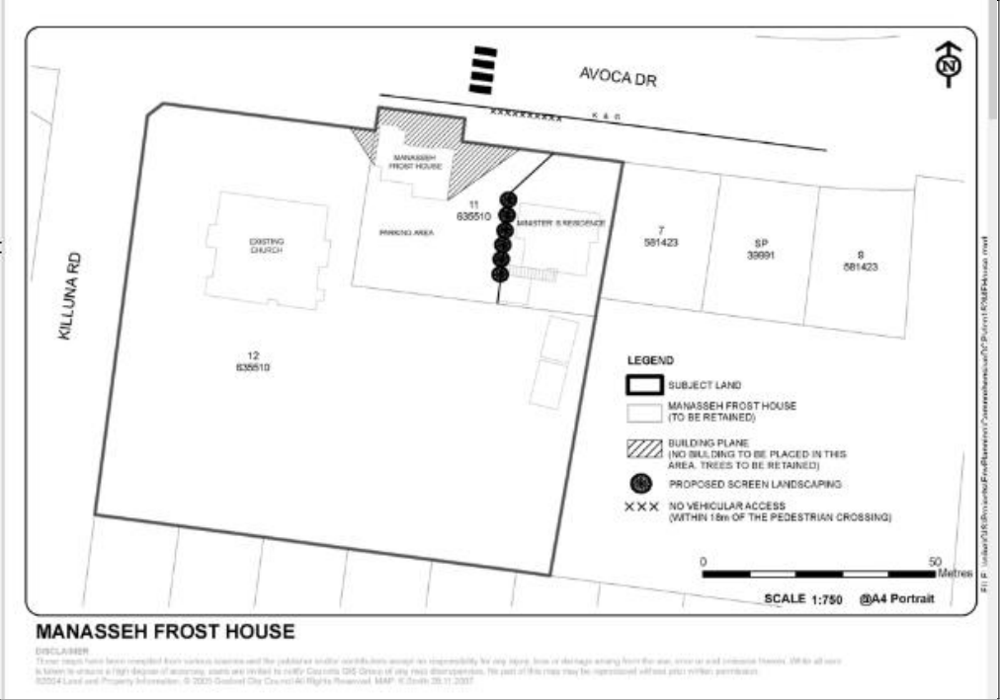

#### Chapter 5.4 Kincumber, Avoca Drive (Manasseh Frost House)

### CHAPTER 5.4 KINCUMBER, AVOCA DRIVE

### (MANASSEH FROST HOUSE)

#### 5.4.1 LAND TO WHICH THIS CHAPTER APPLIES

Manasseh Frost House is located on part of Lot 112 DP 1124060 (previously Lot 11 DP 635510) Avoca Drive, Kincumber as indicated in figure 1.

> [Picture on page 1: a picture, saved as a picture (images/ch-05-04-kincumber-avoca-drive-manasseh-frost-house-page-1-9.gif, 150 dpi).]

#### Figure 1 – Land to which this Chapter applies

#### 5.4.2 PURPOSE OF THIS CHAPTER

The purpose of this chapter is to provide more detailed guidelines for the development of the land, having regard to Manasseh Frost House being an item of environmental heritage.

#### 5.4.3 OBJECTIVES

The objectives of this chapter are as follows:

▪ To protect the historical value of the weatherboard cottage

▪ To guide restoration of the cottage

▪ To facilitate traffic management and safety

Development Control Plan 2022 – Development Controls Central Coast

Part 5

Location Specific Development Controls
