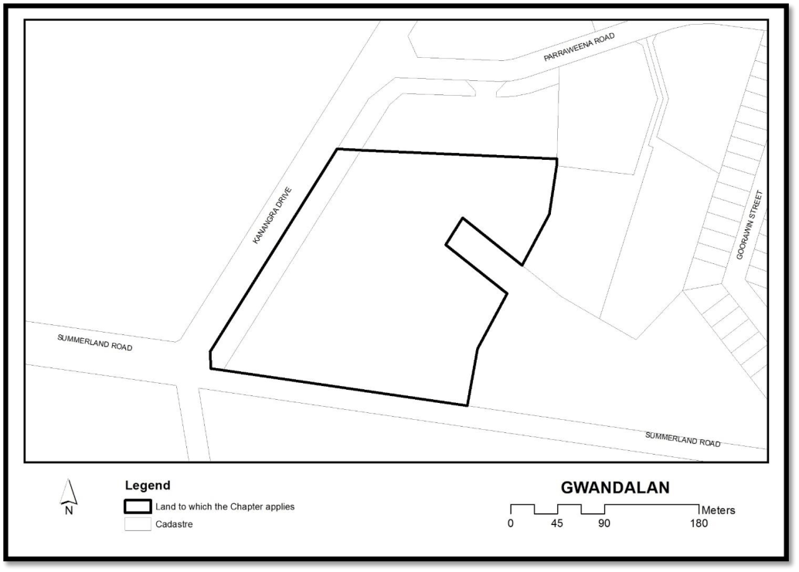

#### 5.5.1 INTRODUCTION

The purpose of this Chapter is to provide site specific guidelines for the carrying out of centre development on land to which this Chapter applies.

The site is located along Kanangra Drive, Gwandalan on the corner of Summerland Road. The North Wyong Shire Structure Plan identified a potential new centre in this area, subject to local planning and the site is located in close proximity to a number of proposed residential subdivisions. The centre will contain a mix of uses including commercial, retail, community and residential uses to service the increased population.

This Chapter has been prepared to provide guidance for the development of the site in a manner consistent with the North Wyong Shire Structure Plan and Council’s Community Strategic Plan.

#### 5.5.1.1 Objectives of this Chapter

▪ To provide site specific development controls for the development of a new centre on the subject land comprising commercial, retail, community and residential uses.

▪ To encourage the orderly development of the land for the purposes permitted under B2 Local Centre Zone, R1 General Residential Zone, and R2 Low Density Residential Zone

▪ To guide new centre development while reinforcing the existing hierarchy of commercial centres

▪ To ensure development responds to the environmental characteristics of the area

▪ To control the siting and scale of development on the land, and provide adequate service areas

▪ To ensure traffic and transport arrangements provide for the safe and efficient movement of vehicles

▪ To provide for adequate service areas

▪ To provide a mix of dwelling types that are compatible with centre development

▪ To ensure that the land is adequately serviced

#### 5.5.1.2 Land to which this Chapter Applies

a This Chapter applies to land as shown edged heavy black on Figure 1.

> [Picture on page 2: a picture, saved as a picture (images/ch-05-05-gwandalan-centre-page-2-1.gif, 150 dpi).]

#### Figure 1- Land to which this Chapter applies

#### 5.5.1.3 Relationship to other Chapters and Policies

This Chapter should be read in conjunction with other relevant Chapters of this Development Control Plan and other Policy Documents of Council, including but not limited to:

• Chapter 2.1 – Dwelling Houses, Secondary Dwellings and Ancillary Development

• Chapter 2.3 – Dual Occupancy and Multi Dwelling Housing

• Chapter 2.4 – Subdivision

• Chapter 2.5 – Commercial Development

• Chapter 2.13 – Transport and Parking

• Chapter 2.14 – Site Waste Management

• Chapter 2.15 –Signage and Advertising

• Chapter 3.5 – Tree and Vegetation Management

• Council’s Civil Works Specification
