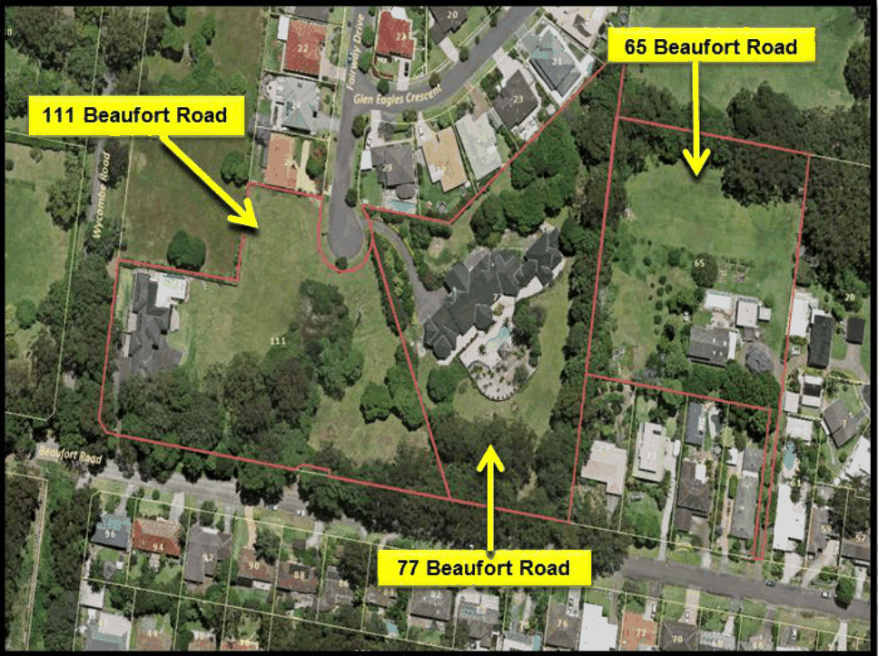

#### 5.7.1 LAND TO WHICH THIS CHAPTER APPLIES

This plan applies to Lot 5 DP 207799 (No. 65), Lots 1022 (No. 77) and 1023 (No. 111) DP 1054632, Beaufort Road Terrigal, as shown on the Plan 1 below.

> [Picture on page 1: a picture, saved as a picture (images/ch-05-07-terrigal-beaufort-road-page-1-5.gif, 150 dpi).]

#### Figure 1 - Subject land
