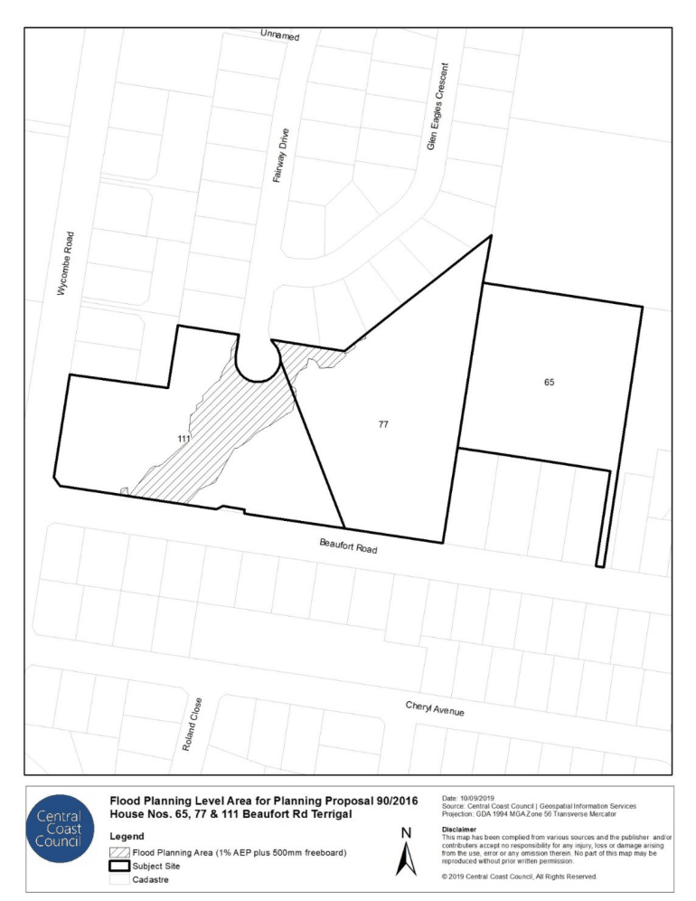

#### 5.7.9 FLOODING AND DRAINAGE

#### OBJECTIVES

▪ To ensure existing and future development is not adversely impacted by flooding and stormwater flows and to cater for flooding and stormwater flows.

▪ To ensure development is designed in accordance with water sensitive urban design guidelines and NSW Government’s Flood Prone Land Policy and the principles of the Floodplain Development Manual 2005.

#### DEVELOPMENT CONTROL

a All development is to be designed using the principles outlined in the DCP Chapter relating to Water Cycle Management including flooding and drainage requirements.

b All new development is not to adversely impact adjoining properties or impede defined overland flow paths.

c All flooding and stormwater flows are to be catered for onsite with due consideration given to the proposed implementation of the VMP & LP required by this DCP as part of the development.

d Figure 2 outlines the current Flood Planning Level (FPL) area and no development other than stormwater mitigation is to occur in this area.

e Flood modelling required to support future development proposals shall:

i consider 1987 Rainfall intensities and impact of adopting the 2019 IFDs

ii plot Hazard as H1- H6

iii provide a plot of the values of VxD (Momentum)

iv identify the assumed capacity of the existing drainage system capacity and justify conclusions

v consider ameliorating the continuing risk during storm events

vi model the likelihood and impact for system blockage

vii discuss TUFLOW modelling

viii justify the capacity of the system as modelled

ix provide details of the OSD performance showing flows into and out of the OSD and the peak volume for each event modelled

x identify the potential vegetative loss and the impact on the hydrologic response of the catchment

xi identify the parameters used in the model

xii identify and describe inlet capacities

xiii detail overland flood modelling including ground slope, water surface slope, flow regime and identify the Froude Number

> [Picture on page 6: a picture, saved as a picture (images/ch-05-07-terrigal-beaufort-road-page-6-1.gif, 150 dpi).]

#### Figure 2 Flood Planning Level Area
