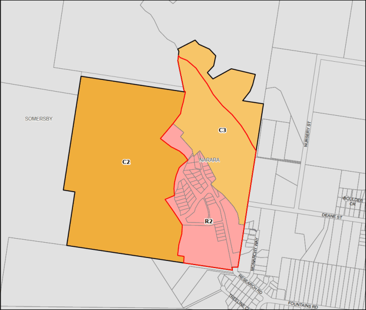

#### 5.8.1 LAND TO WHICH THIS CHAPTER APPLIES

This chapter applies to the land currently identified as Lots 1-35, 38-39, and 40-49, 51-93 and 95 in DP270882, and SP103399 as per Figure 1. The R2 – Low Density Residential zoned land within the site was formerly used as Gosford Horticultural Institute and is now known as Narara Eco-Village.

> [Picture on page 1: a picture, saved as a picture (images/ch-05-08-narara-eco-village-page-1-6.gif, 150 dpi).]

#### Figure 1 – Land to which this chapter applies
