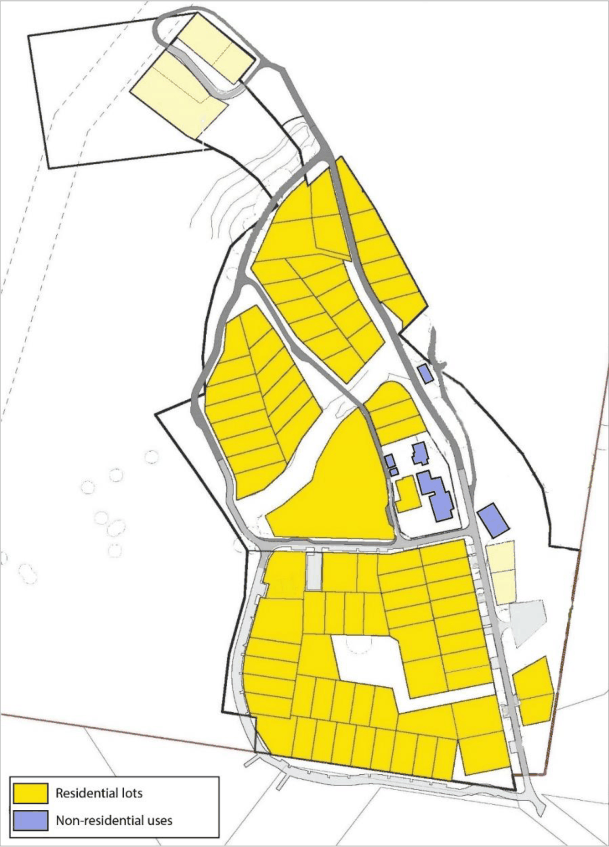

#### 5.8.4 REQUIREMENTS

#### 5.8.4.1 Land Use

a) In accordance with Clause 26 of Central Coast Local Environmental Plan 2022, development for the purposes of ‘restaurants or cafes’, ‘take-away food and drink premises’, ‘shop’, ‘markets’ and ‘business premises’ is permitted with consent on land currently identified as Lot 49 DP270882 and the R2 zoned portion of Lot 95 DP270882 (and any future subdivided land); however must not exceed 1,500 square metres of gross floor area (GFA) including 200 square metres of GFA for food and drink premises.

b) Development for the purposes identified in Clause (a) above is to be generally located in accordance with Figure 2 (see ‘non-residential uses’ and is to consider the adaptive re-use of the existing buildings where appropriate.

c) Replacement, alterations and/or additions to the buildings are permissible however the gross floor area must not exceed 1,500 square metres of GFA including 200 square metres of food and drink premises.

d) In accordance with Clause 26 of Central Coast Local Environmental Plan 2022, development for the purposes of ‘multi-dwelling housing’ and ‘attached dwellings’ is permitted with consent on the R2 zoned land i.e. Lot 1, 2, 3, 4, 5, 6, 7, 8, 9, 10, 11, 12, 13, 14, 15, 16, 17, 18, 19, 20, 21, 22, 23, 24, 25, 26, 27, 28, 29, 30, 31, 32, 33, 34, 35, 40, 41, 42, 43, 44, 45, 46, 47, 48, 49, 51, 52, 53, 54, 55, 56, 57, 58, 59, 60, 61, 62, 63, 64, 65, 66, 67, 68, 69, 70, 71, 72, 73, 74, 75, 76, 77, 78, 79, 80, 81, 82, 83, 84, 85, 86, 87, 88, 89, 90, 91, 92, 93 in DP270882, Part Lot 95 in DP270882 and SP103399 (including any future subdivided land).

e) Development for the purposes of multi-dwelling housing must not exceed 15 dwellings.

f) Development for the purposes identified in Clause (e) above are to comply with the requirements in Chapter 2.2 Dual Occupancy and Multi Dwelling Housing of CCDCP 2022.

> [Picture on page 3: a picture, saved as a picture (images/ch-05-08-narara-eco-village-page-3-11.gif, 150 dpi).]

#### Figure 2 – Location of additional permitted uses

#### 5.8.4.3 Traffic Management

The site is located at the end of Research Road within the upper reaches of the Narara Valley. Consideration needs to be given to connection to the existing road network and internal vehicular circulation systems within the subdivision/development to ensure a cohesive and integrated road network that facilities external flood free vehicular access, if possible, public transport, and encourages walking and cycling.

a The major vehicular access point to the subdivision/development is to be located at the south-eastern corner of the land in the immediate vicinity of Research Road and Syncarpia Crescent.

b Improvements to the local road network outside of the site may be required as a consequence of this residential subdivision/development. Such works are to be determined at the Development Application stage and are to be undertaken at no cost to Council.

c All internal roads within the subdivision/development are to be designed in accordance with Council and Transport for New South Wales (TfNSW) accepted engineering design standards and relevant Australian Standards and/or Austroads and to be determined at the Development Application (DA) stage.

d The development application for the subdivision/development of the land is to be referred to TfNSW for comment.

#### 5.8.4.4 Environmental Protection

Investigations have identified threatened species exist on the land. Species include Syzygium paniculatum (Magenta Lily Pilly), Rhodamnia rubescens (Scrub turpentine), Pteropus poliocephalus (Grey Headed Flying Fox), Petaurus Australis (Yellow Bellied Glider), Miniopterus schreibersii oceanenisis (Large bent-winged bat -eastern subspecies) Tyto tenebricosa (Sooty Owl) and Ninox Strenua (Powerful owl). Further consideration may be required to be given to impacts on Threatened Species as part of the Development Application process.

a The locations of all Rhodamnia rubescens (Scrub turpentine) specimens are to be fixed by land survey and plotted on any future development application for subdivision/development.

b The locations of all Syzgium paniculatum (Magenta Lily Pilly) specimens are to be fixed by land survey and plotted on any future development application for subdivision/development.

c A 30 metre exclusion zone is to be created around the threatened flora species Syzgium paniculatum (Magenta Lily Pilly) and Rhodamnia rubescens (Scrub turpentine) specimens, with the details to be determined at the development application stage.

d Any future development application for subdivision/development or future dwellings is to be designed so as to not result in the removal of any hollow-bearing trees or roosting or nesting habitat for threatened owl species.

e Any future subdivision/development layout shall be designed so as to not result in the removal of any actual yellow bellied glider sap trees.

f Any future subdivision/development layout shall be designed in such a way to prioritise the retention of any Koala feed trees.

g Plant species used for landscaping should be restricted to locally occurring native species especially those commensurate with the Plant Community Type 1566 - White Mahogany - Turpentine moist shrubby tall open forest.

h External night lighting associated with any future subdivision/development layout will be designed to reduce light spillage into adjacent forested areas.

i If required by Council, A Plan of Management shall be prepared / updated for any future subdivision/development application. The Plan of Management will provide a prescriptive framework for the management of threatened species habitat, weed management, mitigate potential indirect impacts associated with any future subdivision/development and provide strategies for the on-going management of the site.

j Consideration should be given to the retention of any Toona ciliate (Red Cedars).

#### 5.8.4.5 Bushfire Protection

The land, including the area proposed for residential subdivision/development, has been mapped as being Category 1 and Category 2 Bushfire Prone Land together with bushfire buffer areas. Due to the relative physical inaccessibility of the site (with only one road access) future development needs to have due regard to requirements in relation to bushfire protection. It is noted that a review is being undertaken of a triangular section of land located to the immediate east of the existing access driveway that may need to be taken into consideration in future planning for bushfire protection.

a Any future development application is to be referred to the NSW Rural Fire Service (RFS) for consultation and will be required to comply with any requirements of the RFS.

b Subdivision/development design and layout is to be designed in accordance with NSW Rural Fire Service Planning for Bushfire Protection 2019 and have regard to the Development Control Practice Notes issued.

c Due to the environmental values of the land, bushfire asset protection zones for Bushfire Prone land shall be measured from the edge of existing areas of remnant native vegetation and will not result in the removal or modification of any remnant vegetation (as required by Council's Environmental Officer).

#### 5.8.4.6 Flood Liable Areas, Flooding and Drainage Issues

The following section applies to all flood liable land within the site. Flood liable land is defined as land susceptible to flooding by the PMF event (Flood Risk Management Manual (FRMM) (NSW Government, 2023).

A significant part of the land within the C3 Environmental management zone has been identified as being flood liable. C3 Environmental Management land on the eastern side of Narara Creek does not currently have flood free access and would be isolated in the event of flooding in the vicinity of Hanlan Street.

a Any drainage and/or filling works on flood liable land (including access to the C3 land in the eastern section of the site) must not result in any adverse upstream or downstream flooding impacts.

b The developer is to be responsible for the design and construction of all internal and external drainage works required for the development.

c No residential lots are to be created on land that falls below the 1%AEP line.

d Catchment flood flows and any flows that may be associated with dam failure are to be contained and passed safely through the developed areas and discharged appropriately in accordance with Council's standards for development. Any increase in stormwater flows is to be detained on site to ensure that there is no chance of increase in downstream flooding.

e In the vicinity of flood liable land, an adequate building curtilage to accommodate a rural residential dwelling and associated activities above the Probable Maximum Flood line is to be identified at the time of subdivision/development.

f All land use activities, including fencing, landscaping etc. associated with rural residential living are not to impact on the flow of floodwaters either up or downstream.

#### 5.8.4.7 Environmental Heritage

The site has a played a significant role in the development of agricultural and horticultural research on the Central Coast. Consultant studies have been prepared in relation to the heritage values of the land. Some buildings and elements on the land have been identified in Central Coast LEP 2022 for listing as Heritage

Items under Schedule 5 of the Central Coast LEP 2022 Council's Heritage Inventory Sheets are required to be updated to include these additional items. This chapter provides further guidelines for these items.

a As per the Central Coast LEP 2022, Table 1 lists items of environmental heritage.

| Item | Location |
|---|---|
| Manager's Cottage, Hen House (former Shower Block) and curtilage | Located in the centre of the site to the west of the existing access road |
| Former Grafting Shed/Administration Block and curtilage | Two storey weatherboard building located on low side of the existing main access road in the centre of the site |
| Group of Taxodium distichum (Bald Cypress) | Located at the entrance of the site on the eastern (low) side of the existing main access road |
| Specimen of Syncarpia glomulifera (Turpentine) | Located on the eastern boundary near the entrance to the site |
| Group of Araucaria cunninghamii (Hoop Pines) | Located to the west of row of callery pears and on the western side of the existing internal access road |
| Plantation of Carya illinoensis (Pecan) | Located to the east of the dam wall and south of the dam overflow |
| Row of Pyrus calleryana (Callery Pear), | Located to the east of the main access road on the flood plain on land to be zoned C3 |
| Type of specimen of Pyrus calleryana (Callery Pear) strain D6 | Located to the north west of the main existing building complex |
| Main Entrance Gate Posts | Located at the main entrance to the site at the terminus of Research Road |

b The provisions of Clause 5.10 of the Central Coast LEP 2022 are required to be considered in respect to any of the above items of environmental significance in relation to any future Development Applications.

c All heritage items are to be used and managed in accordance with the relevant Heritage Inventory Data sheets held in the office of the Council and the Conservation Management Plan Review prepared by David Scobie Architects for the site .

d The Main Entrance gates, Syncarpai glomulifera (Turpentine) and Taxodium distichum (Bald Cypress) are to be retained and incorporated into an entrance statement for the subdivision/development, with consideration for interpretative signage.

e The functional importance of the layout of the place should be maintained and / or interpreted by:

i maintaining the significant visual and physical links between the place and the surrounding countryside;

ii conserving the significant built and landscape elements and their settings; and

iii investigating, recording and interpreting, where appropriate, the archaeological evidence of the original / earlier site development.

f        The following criteria will need to be satisfied in order to conserve existing significant fabric, and ensure that any new development relates sympathetically to significant built and landscape heritage elements and the significance of the site as a whole:

i New uses for any part of the site should be compatible with the retention of the significance of the elements to be retained and the site as a whole.

ii Change to significant built elements, such as the alteration of their external form, appearance and detail, should be minimised except where it involves removal of intrusive elements.

iii The significant physical and visual relationships between the place and its heritage landscape setting should be retained.

iv Significant built fabric should be protected from damage which may arise from visitor impact, management interventions to facilitate or control visitation, and installation of fixed interpretation media. Any new developments e.g. interpretation devices should sustain the heritage significance of the site.

v Any new developments should be appropriate in terms of siting and setbacks, including the retention of appropriate visual and spatial relationships. They should also be compatible with the scale, form and character of existing landscape elements and harmonise with existing colour schemes and materials.

#### 5.8.4.8 Best Practice Management

Given the scale of the development, there is opportunity to implement total water cycle management including the integration between stormwater, potable water and possible grey water re-use, as well as rainwater harvesting to water street trees and the like. The site could be used to showcase best practice management and set a leading example of sustainable urban development.

a All stages of the development are to be designed in accordance with the requirements of Council’s Civil Works Specification to ensure an integrated approach to water management, nutrient control and embodies best practice water sensitive urban design.

b All stages of development, including site preparation, subdivision/development and building works, shall incorporate soil conservation measures to minimise soil erosion and siltation during and upon completion of all works. Measures to be employed are to comply with the Erosion and Siltation Control provisions of Council’s Civil Works Specification.

#### 5.8.4.9 Site Contamination

Due to the history of land use, State Environmental Planning Policy (Resilience and Hazards) 2021 Chapter 4 Remediation of Land needs to be considered. Preliminary assessments and further site contamination investigations were undertaken and concluded that the land was suitable for rezoning to residential purposes subject to additional matters as required below.

a A Site Remediation Action Plan is to be prepared and implemented in accordance with State Environmental Planning Policy (Resilience and Hazards) 2021 and the document Managing Land Contamination - Planning Guidelines.

b A Site Validation Report be prepared and implemented in accordance with State Environmental Planning Policy (Resilience and Hazards) 2021 and the document Managing Land Contamination - Planning Guidelines.

c Prior to the issuing of a construction certificate/releasing engineering plans for future subdivision/development works, Council shall be issued with a Site Audit Statement by an accredited Department of Environment and Conservation (former EPA) Auditor stating the land is suitable for its intended uses.

d A Phase 2 Contamination Assessment is required to be submitted with any future development applications for development within the proposed Stage 3 development as shown in Figure 1 (see Stage 3). Any remediation or management of contaminated areas, if identified during the Phase 2 assessment, must be conditioned to be complied with.

#### 5.8.4.10 Residue C2 - Environmental Conservation Allotment

The residue C2 - Environmental Conservation lot in the western section of the site has very high environmental and scenic qualities that need to be protected in the long term. There is only a limited area available for the erection of a dwelling and the undertaking of other private land use activities. The remainder of the lot is to be protected to maintain its environmental and scenic qualities. In addition to other matters specified in this chapter, the following matters apply specifically to this proposed lot.

a The dwelling house and associated landscaping/rural residential activities are to be located in the cleared area in the location shown on the attached plan.

b a Bushland Management Plan for the land is to be prepared and agreed to by Council and the owners in relation to managing and protecting the high environmental qualities of this lot for the long term.
