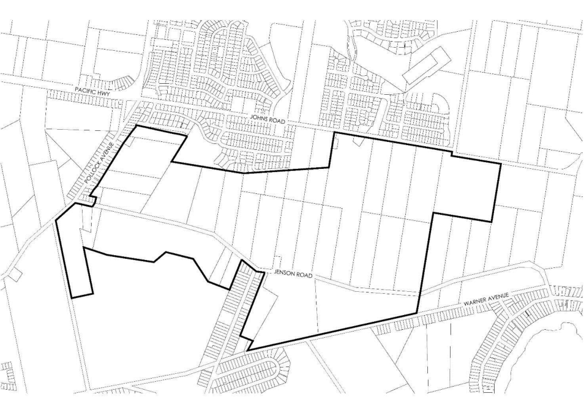

#### 5.9.1 INTRODUCTION

The purpose of this Chapter is to provide guidance in the preparation of proposals to develop the land to which this Chapter applies.

#### 5.9.1.1 Objectives of this Chapter

▪ To provide a high quality and varied residential environment with accessible open space and community facilities

▪ To provide attractive streetscapes which reinforce the function of a street and enhance the amenity of dwellings

▪ To provide opportunity for a variety of housing types

▪ To provide a self-informing, coherent, safe and efficient system of roads and pathways for vehicular, pedestrian and cycle movements (this includes shared path bridges)

▪ To protect and enhance significant environmental features of the area

#### 5.9.1.2 Land to which this Chapter Applies

This Chapter applies to land as shown in Figure 1.

> [Picture on page 1: a picture, saved as a picture (images/ch-05-09-wadalba-south-urban-release-area-page-1-17.gif, 150 dpi).]

#### Figure 1 Land to which this plan applies – Wadalba South Urban Release Area

#### 5.9.1.3 Relationship to other Chapters and Policies

All development proposals must consider all relevant Council and State Government Policy including but not limited to State Environmental Planning Policy (Resilience and Hazards) 2021, Planning for Bush Fire 2019, Section 1.7 of the Environmental Planning and Assessment Act 1979 and the Biodiversity Conservation Act 2016. All development application MUST be accompanied with the required assessments under the relevant State Government Policy and Council policy.

This Chapter should be read in conjunction with other relevant Chapters of this Development Control Plan and other Policy Documents of Council, including but not limited to:

▪ Chapter 2.1 – Dwelling Houses, Secondary Dwellings and Ancillary Development

▪ Chapter 2.3 – Dual Occupancy and Multi Dwelling Housing

▪ Chapter 2.4 – Subdivision

▪ Chapter 2.13 – Transport and Parking

▪ Chapter 3.1-Floodplain Management

▪ Chapter 3.5 – Tree and Vegetation Management

▪ Chapter 3.6 - Heritage Conservation

▪ Council’s Civil Works Specification
