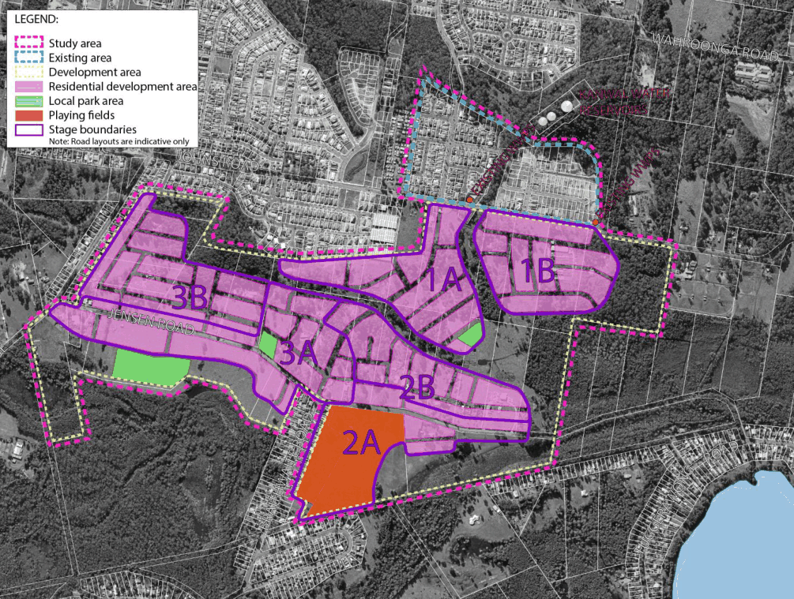
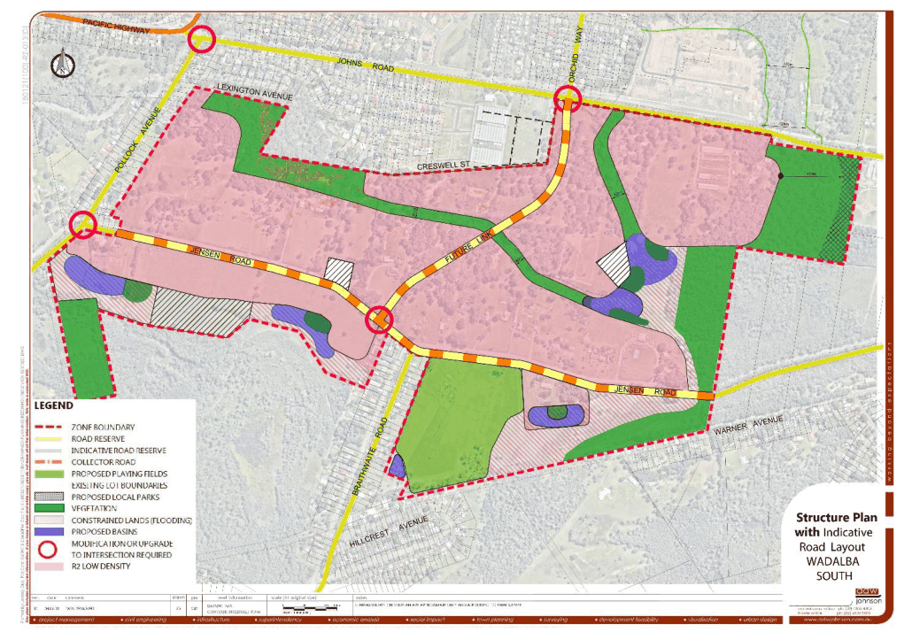
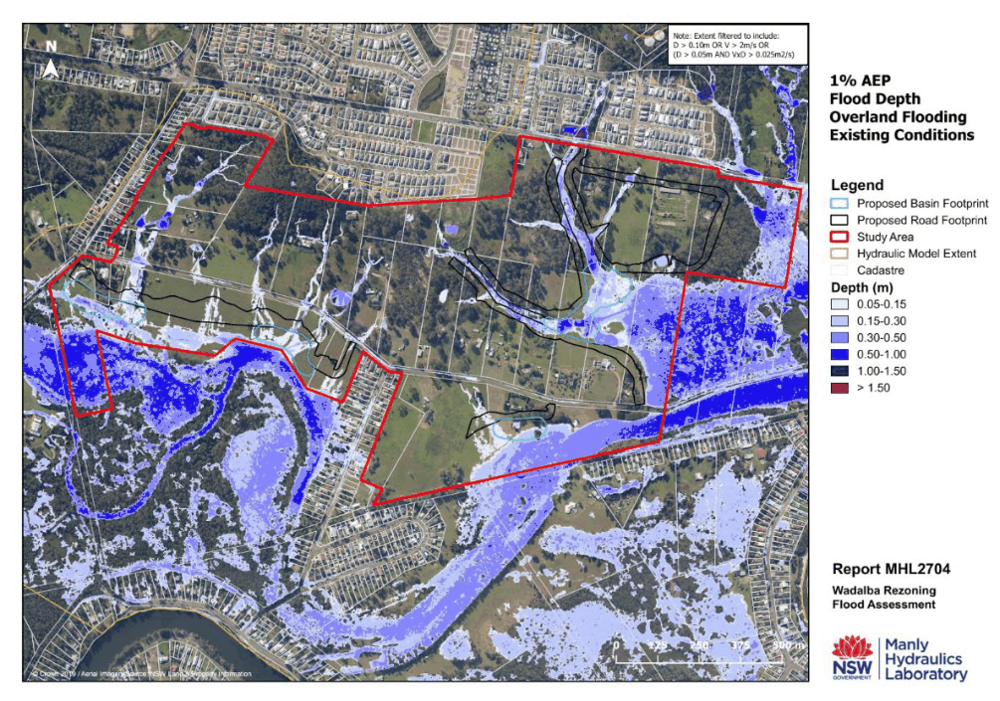

#### 5.9.2 SUBDIVISION DESIGN AND ENVIRONMENTAL CONSIDERATIONS

#### 5.9.2.1 Character Consideration – Subdivision & Provision of Open Space

Appropriate open space and natural parkland areas are significant contributors to establishing a distinctive character for a locality. Opportunities exist to incorporate a wide range of interesting and diverse open spaces and natural parklands which will together create a unique location.

Areas of high ecological and visual amenity are located within the area; the extension and protection of the Wadalba Wildlife Corridor, the creation of nominated green corridors and protection of coastal wetlands are all key principles to enhance the ecological and visual qualities of this area so they can be enjoyed by all.

The residential Precincts will be partially surrounded and bisected by nature and landscaping and will create a healthy built environment. The provision of open space areas and natural parkland will range from small formalised local parks including play equipment, shade structures and seating to natural parkland incorporating grassland, existing trees and regenerated bushland areas.  An area has been identified for a large park with sporting facilities on the southern side of Jensen Road.  Dedicated bicycle and pedestrian networks are to connect the open spaces to ensure accessibility and amenity for all residents.

#### 5.9.2.2 Subdivision – General

#### OBJECTIVES

▪ To encourage subdivision design of high quality, which controls and mitigates the potential environmental impacts arising from development

▪ To ensure the development of the site is undertaken in an orderly and sustainable fashion

▪ To provide a self-informing, legible, safe and efficient system of roads and pathways for vehicular, pedestrian and cycle movements (this includes a shared path bridge)

▪ To ensure the economic and orderly development and servicing of land

#### REQUIREMENTS

a The development is to be staged generally in accordance with the Water and Wastewater Servicing Strategy- see Figure 2 for staging plan. Out of sequence staging may occur if provision of infrastructure is provided by proponent.

> [Picture on page 3: a picture, saved as a picture (images/ch-05-09-wadalba-south-urban-release-area-page-3-13.gif, 150 dpi).]

#### Figure 2 Indicative staging plan

b Any application for the subdivision of the land must be accompanied by a Masterplan for each stage. The Masterplan is to identify and demonstrate compliance and/or management of the following:

i. Identification of locations and lot layouts for future land uses considering scenic amenity, natural topography of the land, open space areas and wildlife corridors;

ii. Location of riparian/and or green corridors and/or areas proposed for environmental conservation;

iii. Identification of street layouts and hierarchies.  The road layout (horizontal and vertical) shall consider the final development upon the land in regard to flood storages, floodway cross sectional area within the watercourses and flow paths;

iv. Location of pedestrian and cycleways and linkages within and around the area to connect to open space and the surrounding residential area;

v. Active and passive open space areas;

vi. Internal linkages (between residential areas within stages 1,2 and 3 – shared paths & shared path bridges) and external linkages (to facilities and services within & beyond the URA); and

vii. Locations of proposed drainage/riparian corridors and flow paths that include WSUD technologies to ensure treatment of stormwater in accordance with Council’s Civil Specifications and Australian Runoff Quality: A Guide to Water Sensitive Urban Design stormwater treatment objectives and targets.

viii. Details of any cut, fill and retaining to be indicatively shown on the masterplan.

#### 5.9.2.3 Open Space

#### OBJECTIVES

▪ To provide a range of public open spaces, sufficient for the active and passive recreation needs of residents

▪ To provide linkages between open space, streets, significant places and drainage features to create a distinguishable public domain

▪ To enhance the appearance and amenity of urban development through integrated open space and landscape design

▪ To enable multiple use of open space and open space corridors for recreation, conservation, access and drainage without diminishing the recreation or conservation values of that space

▪ To provide safe and convenient pedestrian and cycleway networks with clear internal links and connections to external regional network and nodes of importance within the area such as the , shops, schools and sports fields

▪ To provide sporting fields and other community facilities to service the future residential population of Wadalba South

#### REQUIREMENTS

a Local open space shall be provided generally in accordance with locations identified in Figure 3. Minor variations in the location and configuration of open space, as a result of subdivision design may be acceptable, subject to justification for the proposed change.

b Open space is to be established in areas zoned RE1 Public Open Space, these lands are to be dedicated at no cost to Council once embellishment to Council’s requirements and satisfaction has occurred.

c Landscaping of open space should utilise winter flowing trees and shrubs endemic to the local area.

d Residents should have access to, at minimum, a formalised small neighbourhood park within 400m of their residence.

> [Picture on page 5: a picture, saved as a picture (images/ch-05-09-wadalba-south-urban-release-area-page-5-1.gif, 150 dpi).]

#### Figure 3 Indicative road layout and structure plan

#### 5.9.2.4 Road Layout and Hierarchy

#### OBJECTIVES

▪ To establish a hierarchy of streets which maximises convenience, amenity and safety for vehicles, pedestrians and cyclists

▪ To provide a legible, connected and permeable grid of local streets that are sympathetic to the topography and natural assets

▪ To protect conservation areas through the appropriate location of roads, paths and developable area

#### REQUIREMENTS

a Design plans are to be approved by Council as part of the appropriate subdivision application and staging will occur in accordance with the relevant Section 7.11 Contribution Plan.

b All park edge streets are to have the cycleway/footpath located on the park side of the road.

c Four-way uncontrolled (signage not accepted) intersections on collector roads will not be permitted.

d Safe Systems Assessments together with Road Safety Audits will be required to be carried out to assist in the development of a safer environment for all road users. It is recommended that Road Safety Assessments be undertaken early in the development of proposals as early intervention proves to be most beneficial.

e Any roads within the subdivision development identified as a local bus route must be designed to cater for large and rigid vehicles, having regard for grade, sight-lines and avoidance of lane departure during turning movements.

f Provide a safer street environment by ensuring appropriate lighting and using crime prevention through environmental design principles.

g Road geometry such as steep roads, combined horizontal & over vertical curves, long straight streets, smaller radii curves with adverse crossfall, lot accesses in close proximity to the entry & departures of roundabouts, etc that contribute to increased crash risk are to be avoided.

h Provide roads at the perimeter of all open spaces to maximise the public amenity and access to these areas.  Ensuring lots do not back onto the open spaces increases amenity and safety within those spaces.

i Provide roads at the perimeter of all wildlife corridors to provide adequate urban interface with these areas.

j All servicing & utilities are to be underground

#### 5.9.2.5 Pedestrian and Cycleway Routes

#### OBJECTIVES

▪ To provide linkages between open space, streets and drainage features to create a clearly distinguishable public domain

▪ To provide safe and convenient pedestrian and cycleway networks with clear internal links and connections to external regional network to promote healthy lifestyle choices

#### REQUIREMENT

a Shared paths/footpaths and cycleways are to be designed and constructed in accordance with the Central Coast Council’s Civil Works – Design Guideline and Construction Specification.

b All park edge streets are to have the cycleway/shared footpath located on the park side of the road.

c The provision of Active Transport infrastructure and facilities, bike lanes, shared paths, footpaths and kerb ramps etc. will consider and align with the vision, aims and objectives of the Central Coast Bike Plan and Pedestrian Access and Mobility Plan (PAMP), and provide safety and connectivity to all existing and proposed bicycle and pedestrian routes in accordance with the Prioritisation Criteria and the required Standards as outlined in the document Action Plans.

#### 5.9.2.6 Public Transport

#### OBJECTIVES

▪ To make provision for convenient local transport links and stops

▪ To consult with local public transport providers to ensure optimum delivery of public transport infrastructure.

#### REQUIREMENT

a Any masterplan application for any stage is to provide evidence documenting the outcomes of discussions with local public transport providers, specifically local bus service providers regarding proposed routes to and within the subdivision development.

b Bus stops are to be provided along approved bus routes, no greater than 400 metres apart.

#### 5.9.2.7 Ecological Issues

The subject lands contain areas of high conservation value that are known habitat for threatened species.  The subject lands have been rezoned without having an approved environmental offsets strategy to achieve an “improve/maintain outcome”.  Impacts arising from developing the residential zoned land will need to be assessed at the development application stage and address relevant requirements under the Environmental Planning and Assessment Act 1979 and the Biodiversity Conservation Act 2016.

#### OBJECTIVES

▪ To protect wildlife corridors, threatened species and their habitats within areas identified for protection on conservation and recreation zoned land

▪ To ensure that development and future interaction within and in the vicinity of the Wadalba Wildlife Corridor does not interfere with the integrity of the Corridor

▪ To protect, restore and enhance the environmental values and functions of watercourses and floodplains

#### REQUIREMENT

a Any application lodged for the development and/or subdivision of the subject land must comply with the requirements of the Biodiversity Conservation Act, 2016.

b Any development application for subdivision for lands adjoining the east-west wildlife corridor must demonstrate maintenance and/enhancement of east-west population connectivity for the Squirrel Glider through the following mechanisms:

• All land zoned C2 in this locality must be retained in common ownership and subject to a permanent “in perpetuity” conservation arrangement.  This may include a single development allotment, unless other arrangements are made.

• The installation of glider crossing poles on any road that bisects potential east-west population movement

• The planting of local native trees along any road that bisects potential east-west population movement to function as an informal wildlife corridor

• Develop and implement a Vegetation Management Plan (VMP) as approved by Council at subdivision stage. The VMP objective is to increase east-west connectivity towards the existing Wadalba Wildlife Corridor and habitat viability for Squirrel Gliders.

• The VMP must be in place for a period of no less than five years covering any area of C2 Environmental Conservation zoned land.

• Enhancement of the availability of hollows for the Squirrel Glider within retained habitat through the relocation of removed tree hollows or the creation of artificial hollows, supported by appropriate research and monitoring of the effectiveness of these strategies.

c Development on land that adjoins that land zoned C2 Environmental Conservation or other lands that retain vegetation must ensure that there are no significant direct or indirect detrimental impacts to the value of the retained vegetation in allowing for the long-term conservation of the local Squirrel Glider population.

d Any application for development and/or subdivision that does not require the preparation of a Biodiversity Development Assessment Report (BDAR) under the provisions of the Biodiversity Conservation Act, 2016 must include a comprehensive Flora and Fauna Assessment prepared in accordance with Council’s ‘Flora and Fauna Guidelines for Development’. The Assessment must:

i. identify the location of vegetation communities, threatened flora and fauna species and/or habitat of local, state or Federal significance; and

ii. recommend appropriate strategies and/or requirements to ensure the protection and integrity of all significant habitats and vegetation, within and adjoining the site, consistent with relevant legislation and best practise methodologies.

e Where possible, large logs generated from clearing of land should be relocated to adjacent retained

C2 Environmental Conservation zoned areas as supplementary fauna habitat.

f Native trees and other vegetation are to be retained where possible by subdivision design that incorporates this vegetation into areas such as road reserves and private or communal open space. The selection of trees and other landscaping plants is to utilise locally indigenous drought tolerant species and include winter flowing trees and shrubs.

g Any facilities within the environmental corridor including, but not limited to roads, drainage works and small parks should:

i. not result in the clearing or significant fragmentation of the area

ii. services such as water, power and telecommunications that are unavoidably requires to be located within the wildlife corridor are to be sensitively placed so as to avoid, protect or retain known habitat features (e.g. hollow bearing trees, dams, drainage lines) and avoid vegetation clearing where possible;

iii. retain corridors of vegetation around and where possible over, the proposed facility;

iv. not impact on the necessary glide angles and widths in relation to the squirrel glider; and

v. not compromise the value and connectivity of the environmental corridor

h No fencing which would prevent movement of ground dwelling mammals, including ground dwelling medium sized mammals, should be erected within the identified environmental corridors.

i There is to be minimal use of overhead lighting in or within proximity to the environmental corridor (to ensure nocturnal movement of native species along fauna corridors is not interrupted by lighting).

j All necessary fire protection measures (asset protection zones, fuel free and fuel reduced zones) are not to be located within Environmental Corridors.

#### 5.9.2.8 Heritage

Archaeological Investigation undertaken in association with the planning proposal identified the likelihood of indigenous sites and artefacts being discovered within the study area during excavation of surface soils.

An item of local heritage significance, a dwelling, located at 70 Jensen Road Wadalba and must be considered in all future planning of the site.

#### OBJECTIVE

▪ To ensure adequate consideration of Indigenous Cultural Heritage values are incorporated into all future applications for subdivision, including those for infrastructure.

▪ To ensure adequate consideration of other heritage values is incorporated into all future development applications for subdivision, including those for infrastructure.

#### REQUIREMENT

a Any application for development and/or subdivision which is in the vicinity of a listed Heritage Item must address the requirements of Chapter 3.6-Heritage Conservation.

b A curtilage study is to be undertaken for listed heritage items to determine appropriate curtilage.

c Roads and intersection on or in the vicinity of heritage items will require consideration of the curtilage study and must be designed and located to ensure mitigation and conservation of the identified heritage significance.

d Development in the vicinity of or on the heritage item must be accompanied by a Statement of Heritage Impact outlining potential impacts, and the mechanisms proposed to mitigate them.

Note: This is supplementary information provided for applicants and landowners. All development proposals must consider all relevant Council and State Government Policy. Consultation of the AHIMS does not assume other cultural or archaeological evidence does not occur within the Study area and does not relieve the applicant of the need to undertake appropriate additional investigations and studies where required.

#### 5.9.2.9 Flooding and flood risk management

Flood studies undertaken for the proposed rezoning of Wadalba South did not at the point in time consider the Probably Maximum Flood extent (PMF) therefore any proposed development application for lands within areas affect by flood planning levels will need to consider all requirements below.

> [Picture on page 9: a picture, saved as a picture (images/ch-05-09-wadalba-south-urban-release-area-page-9-18.gif, 150 dpi).]

#### Figure 4 - 1% AEP Flood Depth and Overland Flooding Existing Conditions

#### OBJECTIVES

▪ To acknowledge that flood prone land includes all land inundated to the PMF extent

▪ To recognise and plan for the differing level of flood potential and hazard across the site associated with both overland flooding and inundation as depicted in Figure 4

▪ To manage the risk to human life, damage to property and provision of essential services by ensuring development on all areas of the site is appropriately sited and designed such that it is compatible with the flooding potential and hazard.

▪ To ensure negligible flood impacts on adjoining property or infrastructure as a result of any development or work on site.

▪ To ensure an adequate interface between subdivision infrastructure and the flood plain occurs in order to minimise erosion and sediment transport and mitigate impacts on the hydrology, geomorphology and ecology.

▪ To regulate development that may reduce the ability of the flood plain to carry water and so increase the flood hazard.

#### REQUIREMENTS

a Any application for the subdivision of the site must demonstrate that the subdivision design incorporates measures to mitigate against potential extreme floodway hazard conditions.

b Any application for subdivision or development of the land must demonstrate compliance with the provisions of Chapter 3.1 Floodplain Management of this DCP where they expand on or require further investigations and/or reports not specifically addressed by this Chapter.

c Any development application for the subdivision of the site must be supported by flood modelling which demonstrates the mitigation strategy adopted to address more extreme flood events will have a negligible impact (less than 20mm) on adjoining and/or downstream properties.

d Any development proposal or subdivision of the site is to be supported by a performance-based assessment demonstrating that the proposed development is compatible with the flood characteristics at all locations within the site.

e With regard to the Flood Prone Land:

i. No Filling of Flood Prone land is to be undertaken without hydraulically equivalent compensatory cut and assessment of impacts

ii. No development will be approved that impacts land not in the immediate control of the developer.

f A detailed site-specific overland flood study and flood impact assessment of any proposed development is required. The flood study and flood impact assessment must:

i. Be based on recently acquired ground survey data acquired via traditional ground survey or GPS (less than 2 years from date of lodgement of a development application)

ii. Be produced from a two-dimensional (2D) flood model (such as TUFLOW, SOBEK or MIKE-21)

iii. Assess various flood sizes, including at least 10% AEP, 1% AEP, 0.5% AEP and PMF

iv. Assess various flood durations to determine critical duration for flooding at various locations; include longer duration flood events as part of the consideration of any retarding basins

v. Be prepared consistent with the most recent NSW Office of Environment & Heritage Consultant Flood Study Brief, the Floodplain Development Manual (2005) and related Guidelines, Australian

Rainfall and Runoff (2001), and Council’s Civil Works Design Guidelines (specifically Part 10) unless directed otherwise by this Chapter or any other Chapter of Central Coast DCP 2022.

vi. Be inclusive of a written report with mapping, plans and figures detailing:

▪ All data, parameters, and any assumptions, including Model data input files and run log files for error checking

▪ Hydrologic results from at least two methods, including sub-catchment layout, including contribution of the area, and peak flow comparisons at several locations.

• Figures and tables (showing comparisons of results at several locations) of Flood extents, velocities, depths, and hazards for each sized flood (up to the PMF), both for predevelopment and post-development, and for the relative differences, both on the site and beyond.

Note: The NSW Floodplain Development manual defines the Floodplain as the area inundated by floods up to and including the PMF. Categorisation of hazards must be undertaken in accordance with Handbook 7 H1 to H6.

#### 5.9.2.10 Stormwater and drainage

#### OBJECTIVE

▪ To minimise the impacts of development on the Tacoma Wetland and hydrologically sensitive ecosystems

▪ To provide water quality and quantity control measures that are cost effective and affordable, with consideration to ongoing maintenance costs

▪ To safeguard the environment by improving the quality of stormwater runoff to achieve best practise standards

▪ To limit erosion of watercourses, slopes and banks due to runoff from impervious areas within the development

#### REQUIREMENTS

a Any application for subdivision is to include a Stormwater Management Plan. The plan is to be included in a written report with plans detailing stormwater quality control measures, management of stormwater runoff, hydrology management measures, waterway stability management measures and potable water saving measures that are to be implemented on the site. Such measures and management techniques/routines are to be designed and sized to a standard acceptable to Council.

The report is to include the following:

i. details and hydraulic assessment of the pre-development site, including existing drainage pattern, identify receiving environments, flow details, all natural water courses and channels on site,

ii. description and illustration of the proposed development.  If considered a large water user, details of expected usage, peak visitation periods etc;

iii. the location of all points of discharge from the site, overflows and pipes;

iv. evaluation of site conditions e.g. soils, groundwater, vegetation etc and documentation of constraints and opportunities;

iv. the extents of 1% ARI flood affectation from internal or external waterbodies, gullies, creeks and waterways

vi. modelling and concept design of stormwater quality, hydrology and waterway stability measures. Location, size and configuration of stormwater treatment elements are to be specified together with the proposed or altered drainage pattern. Areas bypassing treatment are to be clearly identified;

vii. identification of maintenance requirements for the components including: maintenance frequency, safety issues, equipment required, vehicular access and maintenance cost estimates; and

viii. modelling, design and construction of any stormwater management systems is to be in accordance with Council’s Civil Works Design Guidelines and Construction Specifications; and a Details of any proposed detention basins which may incorporate pollution retention systems provided it is demonstrated that the basin is sized appropriately and achieves the minimum pollutant reduction targets of stormwater as determined by Council
