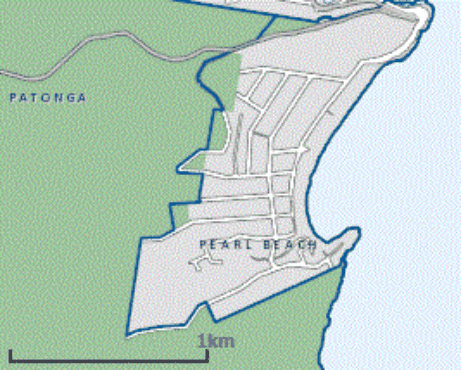

#### 5.10.4 LAND TO WHICH THIS CHAPTER APPLIES

This chapter applies to all properties in the village of Pearl Beach (Figure 1). a The chapter applies to proposals for new buildings and to alterations and additions to existing

buildings.

b All development proposals must be prepared with consideration to all aspects of this plan. Note: Certain minor works and activities may be carried out as exempt development (i.e. without need for

consent of any type). Other works and activities may be carried out as complying development, in which case a

complying development certificate is required. Applicants are advised to consult with the Council’s policies on

exempt and complying development and under the Environmental Planning and Assessment Act, State

Environmental Planning Policy (SEPP) (Exempt and Complying Development Codes) 2008. Amendments may

occur to the planning instrument and to the policies on exempt and complying development from time to time

and therefore applicants are advised to consult with Council or the State Government website for SEPPs to

obtain the up-to-date information. The notes within this plan are provided to assist with interpretation. They do not form part of the approved

plan and may be changed and added to from time to time.

> [Picture on page 3: a picture, saved as a picture (images/ch-05-10-pearl-beach-residential-development-page-3-1.gif, 150 dpi).]

#### Figure 1 Pearl Beach
