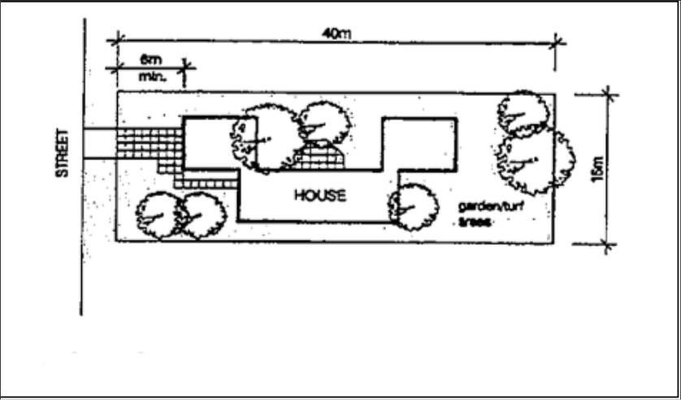
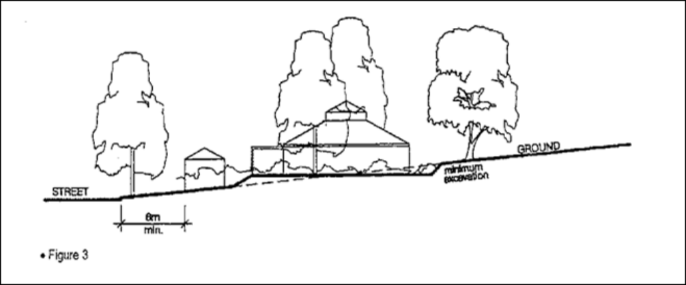

#### 5.10.7 SITE DEVELOPMENT

#### OBJECTIVES

To maintain the natural character of the locality by reserving a significant portion of the site for

landscaping. Prominence to be given to the natural environment over the built environment To minimise intrusion of buildings into the landscape by distributing landscaped areas in such a way

as to screen and break up the bulk of the buildings. Take account of appearance from the street,

from surrounding properties, public places and surrounding National Park (Figure 2) To retain sufficient unsurfaced area for site absorption of rain water to minimise the effect of run-off

on neighbouring properties, on the creek systems and ultimately on the frontal dune and the beach

itself

> [Picture on page 4: a picture, saved as a picture (images/ch-05-10-pearl-beach-residential-development-page-4-24.gif, 150 dpi).]

#### Figure 2 Building design to screen and break up the bulk of the buildings

#### REQUIREMENTS

a Site coverage is not to exceed 40% of the total site area. b The open space area shall not be less than 50% total site area. c The floor space ratio of the development on the land is not to be more than 0.4:1 where not otherwise

identified in Central Coast Local Environmental Plan 2022.

d A balance between hard surfaces and soft landscaping areas is necessary to maintain the bushland

character of the area. Hard surfaces should therefore be kept within the range of 10% of the site area.

e The maximum site coverage is limited to 300m2 on any site. Figure 2 illustrates the application of these criteria.

#### 5.10.7.1 Site Disturbance

a Site disturbance must be kept to an absolute minimum, trees and ground cover vegetation must be

retained and further erosion control measures may be required by Council.

b Developments that extensively change natural ground levels, erase natural topography and vegetation,

or disrupt natural water run-off and require costly soil stabilisation measures will not be approved.

c Council will refuse an application where it considers excessive site disturbance may result. d Buildings and driveways will be sited and designed to keep site disturbance to a minimum (Figure 3). e Earthworks shall be no more than one metre cut or one metre depth of fill. f Restoration of all site disturbances will be required prior to occupation of buildings.

#### 5.10.7.2 Erosion Control

Details of erosion and sedimentation control measures are to be provided in accordance with Council’s

requirements.

> [Picture on page 5: a picture, saved as a picture (images/ch-05-10-pearl-beach-residential-development-page-5-22.gif, 150 dpi).]

#### Figure 3 Avoidance of site disturbance – limiting cut and fill
