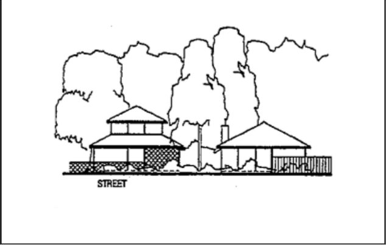

#### 5.10.10 BUILDING STYLES

#### OBJECTIVES

To protect and promote: compatibility with the scale and character of development in Pearl Beach the streetscape amenity a sympathetic standard of building design

#### REQUIREMENTS

a The form of new buildings shall harmonise with existing development in Pearl Beach as a whole in

respect of size, shape and configuration.

b Buildings should be articulated by breaking up the building mass to reduce their apparent size. The

incorporation of verandahs and other outdoor living areas is an appropriate means to reduce building

bulk and contribute to the character of Pearl Beach.

#### 5.10.10.1 Sympathetic Development

a Proposed development should not disrupt the streetscape or the unity of a group of buildings or

cause loss of built heritage and environmental amenity such as adjoining owners’ privacy and sunlight

(Figure 4).

b New work shall respect view corridors and the scale and form of existing buildings in the street.

> [Picture on page 8: a picture, saved as a picture (images/ch-05-10-pearl-beach-residential-development-page-8-1.gif, 150 dpi).]

#### Figure 7: Proposed development should not disrupt the streetscape
