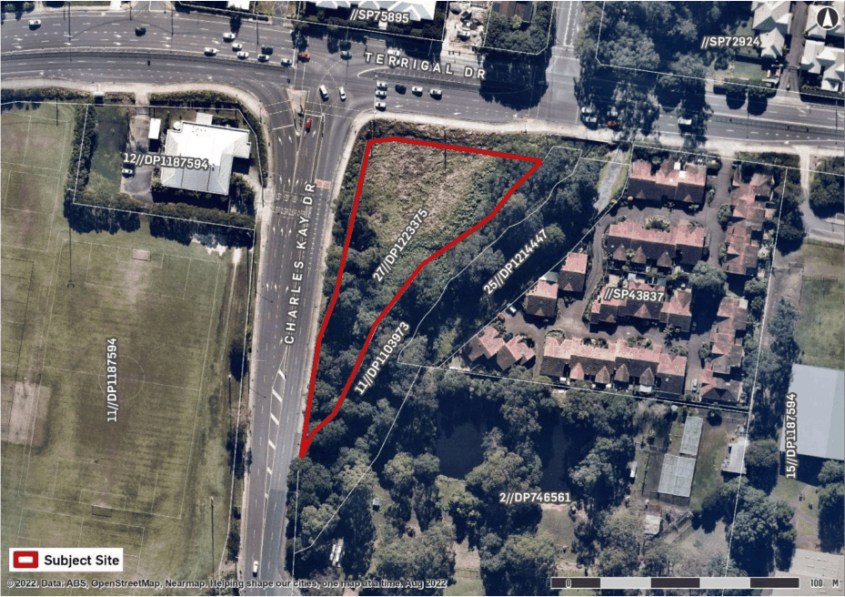

# Central Coast Development Control Plan 2022 - Chapter 5.11 Terrigal Corner Charles Kay Drive

Source PDF: [5.11-Terrigal_-Corner-Charles-Kay-Drive-and-Terrigal-Drive.pdf](5.11-Terrigal_-Corner-Charles-Kay-Drive-and-Terrigal-Drive.pdf)

### CHAPTER 5.11 TERRIGAL, CORNER CHARLES KAY

### DRIVE AND TERRIGAL DRIVE

#### 5.11.1 INTRODUCTION

The purpose of this Chapter is to provide more detailed controls for the development of the land to which this

Chapter applies.

#### 5.11.1.1 Objectives of this Chapter

To ensure the land is adequately serviced. To provide a high-quality residential development within a landscaped setting. To activate the streetscape through the introduction of a retail offering. To ensure that the building design considerations have regard to the location of the land at the

intersection of two major roads. To protect and enhance the environmental features of the site. To ensure that development of the site occurs in a manner which is sensitive to the environmental

characteristics of the site and surrounding land uses including but not limited to existing vegetation,

habitat, and riparian corridors. To ensure that the development of the site is integrated into the local road network and that safe

access is provided to the site from Charles Kay Drive having regard to existing grades and sight lines. To allow development that is compatible with the flood hazard of the land.

#### 5.11.1.2 Land to which this Chapter applies

This Chapter applies to Lot 27 DP 1223375, located at the corner of Terrigal Drive and Charles Kay Drive,

Terrigal, as shown in Figure 1.

#### Central Coast Development Control Plan 2022

> [Picture on page 2: a picture, saved as a picture (images/ch-05-11-terrigal-corner-charles-kay-drive-page-2-1.gif, 150 dpi).]

#### Figure 1 Land to which this Chapter applies

#### 5.11.1.3 Using this Chapter

All development applications MUST be accompanied by the required assessments under the relevant State

Government Policy and Council policy. This Chapter should be read in conjunction with other relevant Chapters of this Development Control Plan

and other Policy Documents of Council, including but not limited to:

### 2.3 Residential Flat Buildings

### 2.5 Commercial Development

### 2.13 Transport and Parking

### 2.14 Site Waste Management

### 3.1 Floodplain Management and Water Cycle Management

### 3.2 Coastal Hazard Management

### 3.5 Tree and Vegetation Management

Where there is a discrepancy between this Chapter and other relevant Chapters, the controls within this

Chapter prevail.

#### Central Coast Development Control Plan 2022

#### 5.11.2 DEVELOPMENT PRINCIPLES

#### 5.11.2.1 Building setbacks

#### OBJECTIVES

To encourage landscaping within the site setbacks. To retain existing mature and significant trees, where reasonable and possible. To ensure appropriate sight lines are retained at the corner of Terrigal Drive and Charles Kay Drive. To ensure adequate separation is provided between the building footprint and the drainage reserve

along the site’s eastern boundary.

#### REQUIREMENTS

a The development is to achieve the following minimum building setbacks: i 3m setback to western boundary (Charles Kay Drive); ii 3m setback to northern boundary (Terrigal Drive), inclusive of a 1.5m articulation zone for

balconies and the like;

iii 6m setback to the eastern boundary, adjacent to the drainage reserve.

b No part of the building is to encroach within the sight line at the corner of Terrigal Drive and Charles

Kay Drive, being an interior angle, measured at 12m along Terrigal Drive and 6m along Charles Key Drive.

c Stairs and planting are permitted within the building setbacks providing they do not visually obstruct

the sight preservation lines for traffic.

d Stairs and ramps must have a minimum 600mm setback from the boundary to allow landscaping within

the site.

#### 5.11.2.2 Building design

#### OBJECTIVES

To ensure the building is of appropriate bulk and scale for its prominent location. To create a high quality urban outcome that: o

Improves street level activation; o

Ensures the building podium responds appropriately to the existing streetscape; o

Provides a high level of amenity along Terrigal Drive and Charles Kay Drive.

To provide a high level of amenity for occupants of a building on the site, and occupants of adjoining

residential buildings by including:

#### Central Coast Development Control Plan 2022

o

A high level of privacy; o

Minimal view impacts; o

Compliance with requirements of the SEPP 65 Apartment Design Guide.

To ensure the building height is not visually obtrusive and compatible with the scenic qualities of the

site and surrounding area. To ensure that the building and landscaping design considerations have regard to the location of the

land at the intersection of two major roads. To ensure that the building height sits comfortably within the existing landscape setting. To provide for visual interest within the streetscape which appropriately addresses the surrounding

character. To provide for activation of the streetscape and a high level of amenity along Terrigal Drive.

#### REQUIREMENTS

#### 5.11.2.2.1 Building height

a Any building on the site is not to exceed 25m in height as measured in accordance with the definition

of building height in Central Coast LEP 2022.

b The upper level is to be setback a minimum 4m from the roof level below, along the north and western

site boundaries to reduce the scale of the building when viewed from Terrigal Drive. Balconies are

permitted within the setback.

c The building must have a distinct base with a height of approximately 6m to 8m to provide a pedestrian

scale to the street front.

#### 5.11.2.2.2 Streetscape presentation

a Residential uses at the lower levels, fronting Terrigal Drive, should be designed to have a presence that

addresses the streetscape.

b The building must address both street frontages and combine architectural features, materials and

landscape design to define corners.

c Design the podium levels of the building fronting Terrigal Drive to address the pedestrian scale

environment.

d Active frontages are to be provided to Terrigal Drive through uses such as shopfronts, café seating,

building entries and/or lobbies.

e Retail uses are to activate the corner, providing for visual interest and a strong corner address. f The ground floor retail use is to be designed with double height, to be clearly distinguished from the

upper levels to provide for a more human scale feel and relationship with the ground plane.

#### Central Coast Development Control Plan 2022

g Due to flood planning levels, the ground floor level is considerably higher than the streetscape level.

Any retaining walls or raised structure is required to be screened by landscaping and located wholly

within the property boundaries.

h Servicing and loading areas must not visually dominant the streetscape and are to be appropriately

screened with suitable materials so that they do not detract from the landscaped qualities of the site.

The building is to be designed with a degree of articulation so as to reduce the appearance of single

uniformed building line.

i Undertake a sign audit and replace with new or consolidated signs, where possible, in consultation with

Transport for New South Wales.

j Consult with authorities to coordinate underground power lines, where possible, with any required street

lighting.

#### 5.11.2.2.3 Design excellence

a Given the prominent open siting of the land, any development should represent a high level of urban

design, with an appropriately qualified architect involved in the preparation and design document for

any future building on the site.

b Building siting design and construction shall incorporate Ecologically Sustainable Development (ESD)

principles and implement best practice approaches to water and energy efficiency including solar access.

c The consent authority must be satisfied that the building exhibits a high degree of design excellence

and internal amenity, having regard to: i The principles of State Environmental Planning Policy ( SEPP ) No 65—Design Quality of

Residential Apartment Development and the accompanying Apartment Design Guide;

ii The provision of high-quality private and communal spaces for residents, such as large private

balconies, communal BBQs areas, landscaped open spaces and the like;

iii The landscape character of the site and its prominent integration into any design lead outcome; iv The choice of materiality appropriate to the sites character and coastal locality of Terrigal; v The bulk, massing and modulation of the building; vi Whether the proposed development will enhance the character of the area; vii Whether the proposed development impacts on view corridors; viii Achieving an appropriate interface at ground level between the building and public domain; ix Principles of ecologically sustainable development (ESD); x Reflectivity.

#### Central Coast Development Control Plan 2022

#### 5.11.2.2.4 Materials and Building Finishes

a Building materials should complement surrounding developments. A preference for high quality,

durable, UV stabilised/resistant building materials is favoured.

b The reflectivity index for glass used externally in construction of a building (as a curtain wall or the like)

shall not exceed 20%.

c Development is encouraged to draw upon an indigenous colour palette within the existing natural and

cultural landscape.

#### 5.11.2.2.5 Communal Open Space

a Communal open space shall be provided at a minimum 25% of the site area with a minimum width of 3

metres.

b Any roof-top communal open space must consider the implications on the overall design of the

development, and on privacy and view sharing.

#### 5.11.2.3 Site landscaping and tree retention

#### OBJECTIVES

To ensure that design excellence is achieved in landscape design, and that a suitably qualified

landscape architect is used throughout the design process to ensure that the building height does not

dominate the locality and sits comfortably within the existing landscape setting. To provide for visual interest within the streetscape which appropriately addresses the surrounding

character. To provide for activation of the streetscape and a high level of amenity along Terrigal and Charles Kay

Drive. To visually soften the bulk of the development from all viewpoints. To visually soften walls associated with ramps and car parking with appropriate and well-maintained

landscaping. To provide for the protection of existing and provision of new trees, shrubs and ground-covers in the

public and private realm.

#### REQUIREMENTS

a The drainage reserve is to be incorporated into the overall site design to provide an “open” style of

development.

b Significant, mature established trees located along the eastern boundary and within the south-western

corner, are to be retained and incorporated into the overall landscape design.

c The development shall provide deep soil zones with a minimum dimension of 3 metres and a minimum

area of 7% of the site area. Locations on the boundaries of Terrigal Drive and Charles Kay Drive should

provide for adequate tree planting.

#### Central Coast Development Control Plan 2022

d Use a planting palette reflective of local character, climate, and existing species. e A Landscape Plan is to be submitted and approved by Council. The Landscape Plan is to be prepared by

a suitably qualified landscape architect and address the following matters: i general planting themes within the site and indicative species; ii the proposed street tree theme for Charles Kay Drive and Terrigal Drive; iii protection and treatment of vegetation proposed to be retained on and adjoining the site; iv Hard landscape materials to be used including paving and furniture; v A proposed landscape maintenance report and schedule.

#### 5.11.2.4 Traffic, access and parking

#### OBJECTIVES

To ensure safe vehicular access to and from the site. To ensure that traffic management requirements take account of the location of the land at the

intersection of two major roads.

#### REQUIREMENTS

a A single vehicular cross over is to be established within the southern section of the site, off Charles Kay

Drive and away from the intersection to the greatest extent possible, with consideration given to the

retention of the existing mature trees.

b Vehicular access to the site is restricted to left in-left out only. c Appropriate signs are to be installed within the median strip within Charles Kay Drive to restrict any

vehicles attempting illegal manoeuvres.

d Vehicular access from Terrigal Drive is prohibited. e All vehicles must enter and exit the site in a forward direction. f The development must be designed to accommodate service vehicles, loading and waste facilities on

the site. Such facilities are to be incorporated into the overall design of the development and should not

detract from the streetscape.

g Car parking, motorcycle and bicycle parking are to be provided in accordance with the rates specified in

Chapter 2 of this DCP.

h Parking areas and delivery docks should be concealed from the streetscape. i A Road Safety Audit is required to accompany future development applications.

#### Central Coast Development Control Plan 2022

#### 5.11.2.5 Services / stormwater / hydrology

#### OBJECTIVES

To ensure that the land is adequately serviced. To ensure that offsite flood impacts are not increased by the redevelopment of the site. To protect the downstream environment from pollution due to site runoff.

#### REQUIREMENTS

a The developer will be required to pay the current applicable water and sewer headworks and

augmentation contributions in accordance with Council’s Policy at the time of the development of the

land.

b Design and construction of the water and sewer reticulation within the area is the responsibility of the

developer of the land.

c Incorporate on-site detention (OSD) into the development in accordance with the storage and discharge

requirements of the Central Coast Council Stormwater Detention Policy.

d Provide stormwater quality treatment of site stormwater prior to discharge in accordance with the

pollutant reduction targets in this DCP.

e Size the minor and major stormwater system to collect and convey flows in accordance with AS/NZS

3500.3.

f All new electricity supply infrastructure must be provided underground, where possible.

#### 5.11.2.6 Flooding

This section applies to land at or below the flood planning level and is to be read in conjunction with Chapter

3.1 Flood Plain Management of Central Coast DCP 2022.

#### OBJECTIVES

To ensure existing and future development is not adversely impacted by flooding and stormwater flows

and to cater for flooding and stormwater flows. To ensure development is designed in accordance with water sensitive urban design guidelines and NSW

Government’s Flood Prone Land Policy and the principles of the Floodplain Development Manual 2005

#### REQUIREMENTS

a. A site specific Flood Emergency Plan is required to be submitted with future development applications.

The Plan is to be circulated, managed and adhered to by all occupants of the building.

b. The Flood Emergency Plan is to be reviewed and updated as required once every five years.

#### Central Coast Development Control Plan 2022

#### 5.11.2.7 Bushfire Planning

#### OBJECTIVES

To ensure development is designed in accordance with Planning for Bush Fire Protection.

#### REQUIREMENTS

a. All bushfire Asset Protection Zones are to be located outside of the Riparian Vegetation and Drainage

Area (RVDA).

b. Future design of the site (including revegetation and landscape plans) is to be undertaken with

consideration to bushfire and meet the requirements of ‘Planning for Bush Fire Protection 2019’ (PBP).

#### Central Coast Development Control Plan 2022
