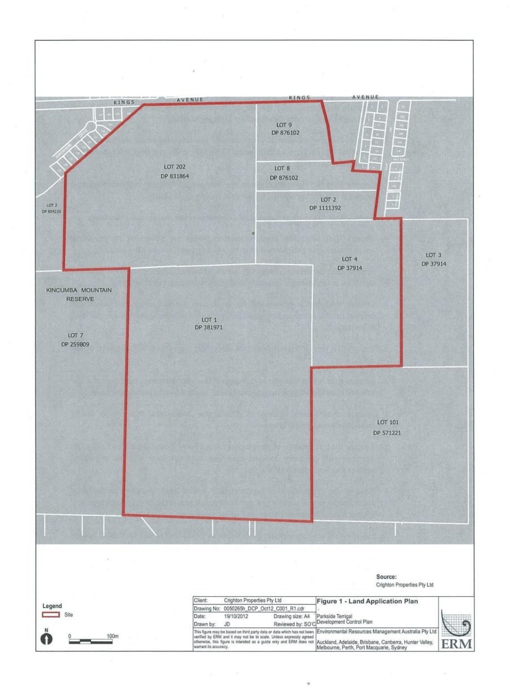

#### 5.12.1 WHERE THIS CHAPTER APPLIES

This chapter applies to land Lot 2 DP 111392, Lots 8 and 9 DP 87102, Lot 202 DP 831864, Lot 4 DP 37914 and Lot 1 DP 381971 at Kings Ave, Terrigal as indicated on the map below.

> [Picture on page 1: a picture, saved as a picture (images/ch-05-12-terrigal-parkside-kings-ave-page-1-4.gif, 150 dpi).]

#### Figure 1 – Land to which this chapter applies
