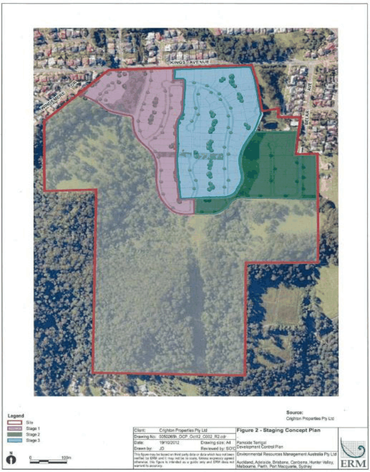
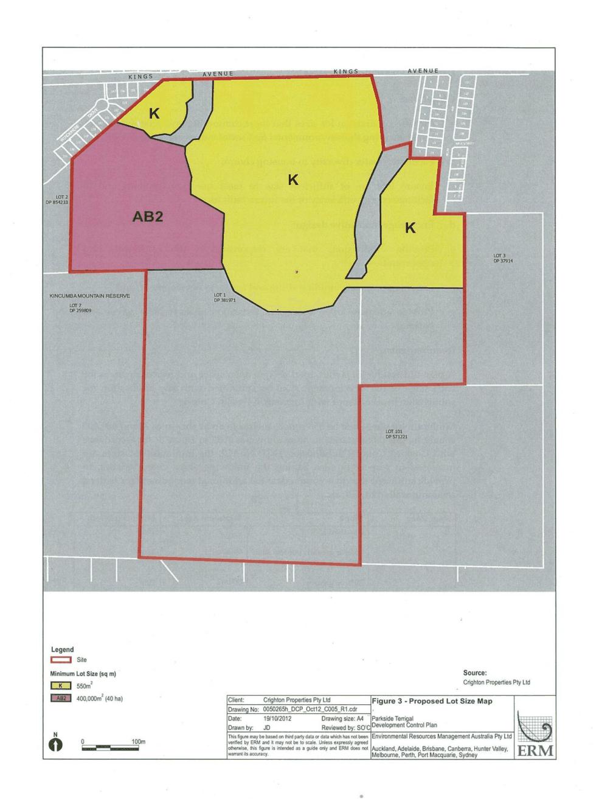
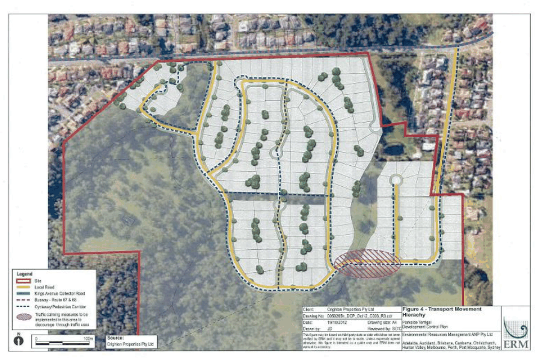
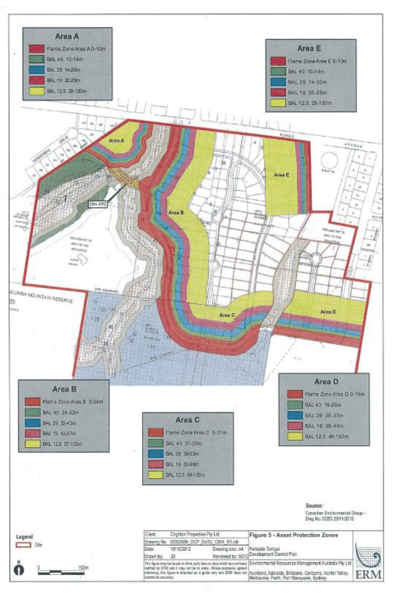

#### 5.12.4 GENERAL SUBDIVISION REQUIREMENTS

#### 5.12.4.1 Staging Plan

#### OBJECTIVE

▪ To enable sustainable development consistent with the objectives of the R2, RE1, RE2, and C2 zones that enhances the existing low density residential character and protects the natural setting of Kincumber Mountain Reserve and Terrigal.

#### REQUIREMENTS

a Any application for subdivision shall prepare a staging plan. Figure 2 illustrates the potential future development pattern and staging for the estate and should be considered in conjunction with the following document Parkside@Terrigal October 2012 and associated annexures (GCC Doc No 12538387), and other relevant chapters of this DCP.

> [Picture on page 3: a picture, saved as a picture (images/ch-05-12-terrigal-parkside-kings-ave-page-3-12.gif, 150 dpi).]

#### Figure 2 – Staging Plan

#### 5.12.4.2. Density and Subdivision Design

#### OBJECTIVES

▪ Provide subdivision lot sizes that meet community and economic needs, whilst ensuring that environmental and social values are safeguarded;

▪ Facilitate greater diversity in housing choice;

▪ Ensure lots are of sufficient size to meet user requirements and to facilitate energy efficiency of the future built form;

▪ Encourage innovative design;

▪ Provide subdivisions that are responsive to the site constraints and opportunities;

▪ Ensure appropriate building siting and access to development; and

▪ Provide adequate open space and recreation areas, vehicle access and parking.

#### REQUIREMENTS

a A plan illustrating lot layout, road design, open space and recreation areas for each stage of the development shall be submitted with any application in accordance with Appendix B in Terrigal@Parkside October 2012 (IR 12538387) Design Criteria.

b Minimum lot sizes shall be 550 square metres in areas shown as K and 400,000 square metres (40 hectares) in areas shown as AB2 in Figure 3. In accordance with the Residential Subdivision chapter of this DCP, the minimum lot sizes are to be increased in respect to sites having the following slope characteristics, to provide sufficient area to accommodate the additional requirement for batters, retaining walls, cut/fill, etc.

| Slope Zone | Slope | Minimum Area | Minimum Width |
|---|---|---|---|
| K | Less than 15% 15% or greater, but less than 20% 20% or greater | 550m2 650m2 800m2 | 15m 18m 20m |

#### Table 1 – Slope Considerations

> [Picture on page 5: a picture, saved as a picture (images/ch-05-12-terrigal-parkside-kings-ave-page-5-1.gif, 150 dpi).]

#### Figure 3 – Minimum Lot size

#### 5.12.4.3. Street Network

#### OBJECTIVES

▪ To provide safe, legible and efficient vehicle access to and within the site;

▪ To provide a through road system for emergency vehicles, particularly for bushfire protection

▪ To discourage through traffic from using Belar Ave;

▪ To create a high quality safe environment for walking and cycling and to link in with the existing network; and

▪ To serve all existing land parcels with a local street that provides connection to the remainder of the site;

#### REQUIREMENTS

a Transport networks are to be designed in accordance with the Transport Networks section of the Residential Subdivisions chapter of this DCP.

b A road link is to be provided between the site and the property immediately to the east of the site;

c Traffic calming devices are to be installed on all through roads that lead to Belar Ave;

d Vehicular access to the site shall be provided in the locations indicated on the transport movement hierarchy plan in Figure 4; and

e The Kings Avenue intersection is to be designed to accommodate the expected traffic flows from the estate in a safe and efficient manner.

#### 5.12.4.4. Pedestrian Network

#### OBJECTIVE

To create a pedestrian pathway network that provides safe access to dwellings, open space areas and locations external to the site.

#### REQUIREMENTS

A pedestrian and cycleway network strategy, generally in accordance with Figure 4 and the Riparian and Buffer Zone Management Plan (see Appendix A Terrigal@Parkside October 2012, GCC Doc No 12538387) prepared by the Conacher Environmental Group dated October 2008 shall be submitted with any subdivision application detailing the following:

a A network of pedestrian pathways to be constructed generally within the riparian buffer zones in the western portion of the site;

b A network of pedestrian pathways and cycleways around and within the estate;

c All structures, bridges, raised platforms and signage, associated with the implementation of the strategy, and

d A pathway/trail is to be provided or dedicated to Council as part of the Kincumba Mountain Reserve so that access into the Reserve is available from the site consistent with the Gosford City Council Bike Strategy 2011.

> [Picture on page 7: a picture, saved as a picture (images/ch-05-12-terrigal-parkside-kings-ave-page-7-1.gif, 150 dpi).]

#### Figure 4 – Transport Movement Hierarchy

#### 5.12.4.5 Services

#### OBJECTIVE

To set out Council requirements for the provision of infrastructure to the site.

#### REQUIREMENTS

a All new services are to be placed underground;

b A water cycle management plan is to be prepared for the site;

c The stormwater system is to be designed having regard to Water Sensitive Urban Design (WSUD) principles and the Water Cycle Management provisions of Councils Civil Works Specification.

d Post development stormwater flows off site are not to exceed the pre development flows up to and including the one in one hundred year storm event;

e A sewer strategy is to be prepared which deals with staging and required augmentation, along with funding and delivery of such augmentation. The sewer strategy is to be signed off by Council prior to development consent being issued for the site;

f Sewer services to the satisfaction of Council (whether they be downstream upgrades or wastewater treatment and reticulation facilities) must be provided to service the development in accordance with the sewer strategy referred to above;

g Augmentation of existing mains and pump stations, if required by the sewer strategy, shall be carried out by the developer at the developer's expense;

h Payment of the current water and sewer headworks and augmentation contributions, in accordance with Council's policy;

i The Developer is to be responsible for the design and construction of water supply and sewerage works as per the sewer strategy;

j The Developer is to be responsible for the full cost of connection to the existing water supply and sewerage systems;

k The Developer is to be responsible for the design and full cost of any augmentation works to the existing water supply and sewerage systems that are required as a result of any extra loading from the proposed development. Augmentation works (if any) may need to be completed before Council could allow the connection to the water supply and sewerage systems.

#### 5.12.4.6 Integrated Water Management

#### OBJECTIVES

▪ To provide integrated water management infrastructure to the estate in a sustainable and efficient manner;

▪ Reduce nuisance and high level flooding in urban areas and the cost of providing and maintaining flood mitigation infrastructure whilst improving water quality in streams and groundwater;

▪ Make efficient use of water resources and increase awareness of water conservation;

▪ Reduce the erosion of waterways, slopes and embankments and protect the scenic landscape and recreational values of watercourses; and

▪ Protect and restore aquatic and riparian ecosystems and habitats.

#### REQUIREMENTS

a An integrated water management strategy shall be prepared and submitted with any application for subdivision over the site. The strategy shall demonstrate compliance best management practices and with the water management cycle objectives detailed in the following documents:

▪ Water Cycle Plan prepared by Cardno Pty Ltd dated June 2005 (GCC Doc No 1750336)

b The strategy shall demonstrate compliance with the Councils Civil Works Specification.

c The strategy shall demonstrate that the implementation of both lot and community based stormwater quality measures in a "treatment train" approach to limit post-developed pollutant loads to appropriate levels.

#### 5.12.4.7 Threatened Species and Endangered Ecological Communities

#### OBJECTIVES

▪ To provide habitat for a number of Threatened Fauna Species including the Powerful Owl, Sooty Owl, Eastern Bentwing-bat, Eastern False Pipistrelle, Greater Broad-nosed Bat, Grey headed Flying-fox, Little Bentwing Bat, Yellow bellied Glider, Yellow-bellied Sheathtail-bat and Eastern Freetail-bat.

Note: One Endangered Ecological Community (EEC), the Lowland Rainforest, is also present on the site. Care therefore needs to be taken to ensure that any proposed development mitigates any potential detrimental impacts to these Threatened Species and the EEC.

#### REQUIREMENTS

a An Ecological Site Management Plan must be prepared for the site and its recommendations implemented in any development proposed for the site;

b An area of approximately 27.2 hectares adjoining the Kincumba Mountain Reserve is to be dedicated to Council, consistent with the terms of the Voluntary Planning Agreement (VPA) and in conjunction with the issue of development consent for subdivision of the land; and

c The potential impacts on the rainforest community in the western portion of the site are to be considered in any development application lodged for works on land within 50m of this community.

#### 5.12.4.8 Rehabilitation of Riparian Areas

#### OBJECTIVE

To improve the quality of watercourses, riparian and buffer areas.

#### REQUIREMENTS

a The recommendations of the Riparian and Buffer Zone Management Plan prepared by the Conacher Environmental Group 2008 dated October 2008 must be adopted in any development proposed for the site (see Appendix A in Terrigal@Parkside October 2012 GCC Doc No 12538387).

b The riparian buffers provided in accordance with the Management Plan referred to above must be exclusive of any asset protection zones required for bush fire management purposes.

#### 5.12.4.9 Mitigation of Bushfire Risk

#### OBJECTIVE

To provide the necessary protection for people and property from the risk of bushfire.

#### REQUIREMENTS

a Asset protection zones (APZ) (see Figure 5) and other requirements specified in the publication Planning for Bushfire Protection 2019 (or as amended) prepared by the New South Wales Rural Fire Service must be incorporated into any development proposals for the site;

b As a minimum the APZ's as shown on Figure 5 must be provided for in any development application;

c Applicants are to ensure that any bushfire protection measures (i.e. Asset Protection Zones) do not encroach upon any adjoining land zoned for environmental protection purposes or any land intended to be dedicated for public use; and

d Selection of materials and methods of construction must have regard to AS3959-2009 and Planning for Bushfire Protection 2019 (or as amended).

> [Picture on page 10: a picture, saved as a picture (images/ch-05-12-terrigal-parkside-kings-ave-page-10-1.gif, 150 dpi).]

#### Figure 5 – Asset Protection Zones

#### 5.12.4.10  Building and Landscape Design

#### OBJECTIVE

To identify principles for sustainable building and landscape design so that cut and fill of house sites and public areas is minimised.

#### REQUIREMENTS

a With any application for subdivision, a landscaping strategy shall be submitted in accordance with the design criteria outlined in Appendix B in Terrigal at Parkside October 2012(GCC Doc No

12538387\) and the Architectural and Landscape Guidelines; and

b Dwellings shall be sited and designed with regard to the controls of the Architectural and Landscape Guidelines and the principles contained in Appendix B in Terrigal at Parkside October 2012(GCC Doc No 12538387) Design Criteria.

#### 5.12.4.11  Geotechnical Hazards

#### OBJECTIVES

▪ To prevent slope instability due to inappropriate land management practices; and

▪ To ensure that cut and fill is minimised in steeply sloping areas of the site to reduce the potential for land slip to occur.

#### REQUIREMENTS

a Any development application submitted to Council must be accompanied by the information required in the Geotechnical Requirements chapter of this DCP which specifies Geotechnical Requirements for Development Applications and generally adopt the guidelines set out in this chapter;

b Any development application submitted to Council must consider the recommendations contained within the geotechnical analysis carried out for the site by Coffey Geotechnics dated February 2008 (see Appendix C in Terrigal at Parkside October 2012 GCC Doc No 12538387); and

c The provisions of the Cut and Fill Restrictions in the Single Dwellings and Ancillary Structures section of this DCP shall be considered in the preparation of any development applications involving earthworks on the site.

#### 5.12.4.12  Development of Flood Prone Land

#### OBJECTIVE

To identify flood liable land and manage development in flood liable areas.

#### REQUIREMENTS

a Land inundated by the one percent probability flood is to be contained within the riparian buffer area. No residential development is to be permitted within the riparian buffer area;

b Any development proposed on flood liable land must be compatible with the potential for this land to be inundated or otherwise acceptable mitigation measures must be implemented to ensure that significant damage to buildings and works and/or the obstruction of flood waters does not occur; and

c The requirements contained in the Floodplain Management section of this DCP must be considered when preparing any development application over flood liable land.
