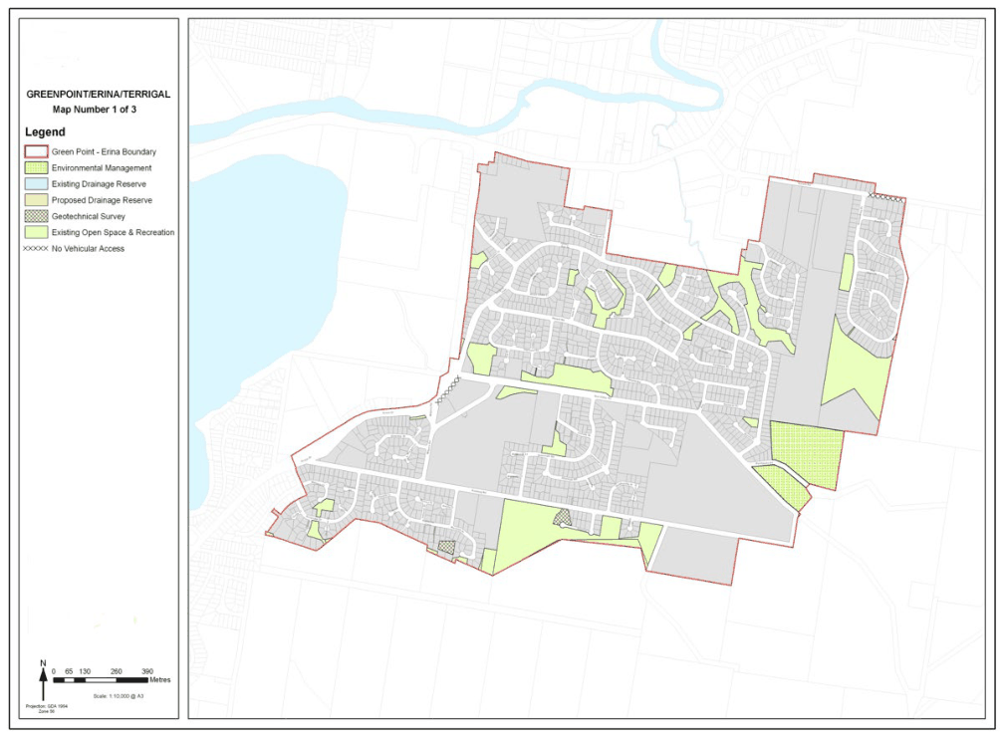
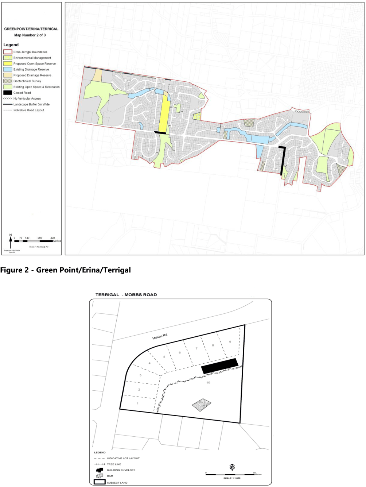
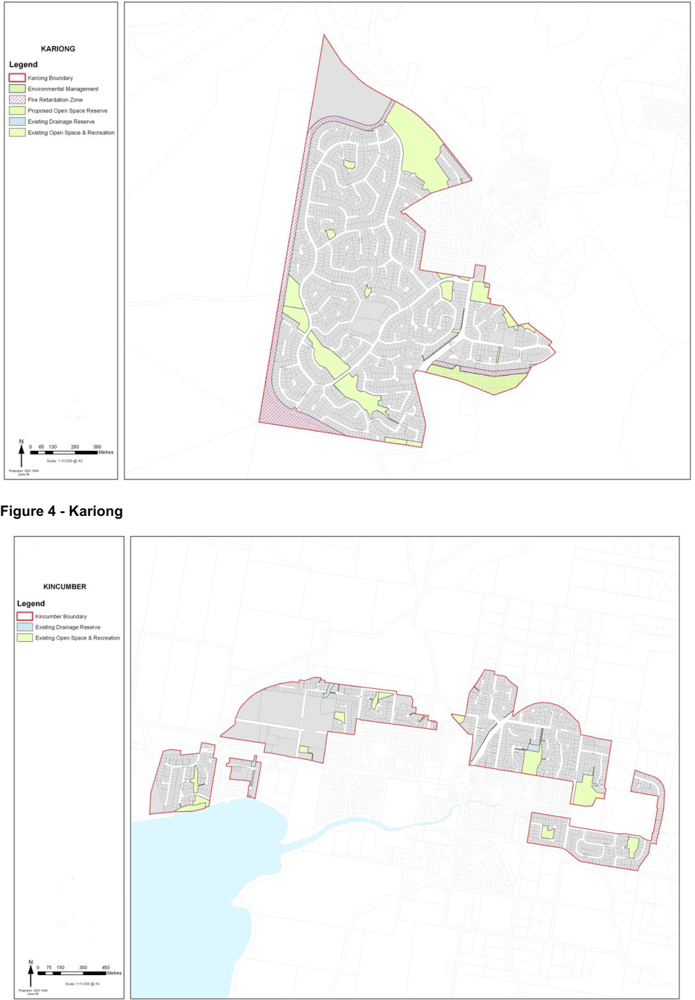
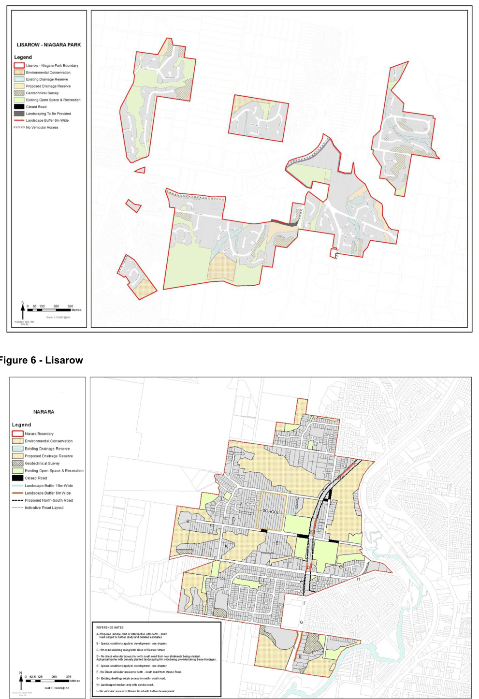

# Central Coast Development Control Plan 2022 - Chapter 5.14 Various Suburbs

> This chapter is split into 6 section file(s), one per numbered heading, in the order they appear in the PDF.

Source PDF: [5.14-various-suburbs.pdf](5.14-various-suburbs.pdf)

CHAPTER 5.14 VARIOUS SUBURBS: ERINA, GREENPOINT,

TERRIGAL, KARIONG, KINCUMBER,

### LISAROW, NIAGARA PARK, NARARA, AND

### SPRINGFIELD

### 5.14.1

### WHERE THIS CHAPTER APPLIES

This Chapter applies to land as identified on the accompanying maps.

> [Picture on page 1: a picture, saved as a picture (images/ch-05-14-various-suburbs-page-1-8.gif, 150 dpi).]

#### Figure 1 - Green Point/Erina/Terrigal

> [Picture on page 2: a picture, saved as a picture (images/ch-05-14-various-suburbs-page-2-1.gif, 150 dpi).]

#### Figure 2 - Green Point/Erina/Terrigal

#### Figure 3 - Terrigal Mobbs Road

> [Picture on page 3: a picture, saved as a picture (images/ch-05-14-various-suburbs-page-3-1.gif, 150 dpi).]

#### Figure 4 - Kariong

#### Figure 5 - Kincumber

> [Picture on page 4: a picture, saved as a picture (images/ch-05-14-various-suburbs-page-4-1.gif, 150 dpi).]

#### Figure 6 - Lisarow

#### Figure 7 - Narara

<!-- sections -->
## Sections

1. [5.14.2 OBJECTIVES](01-5-14-2-objectives.md)
2. [5.14.3 ENVIRONMENTAL PROTECTION](02-5-14-3-environmental-protection.md)
3. [5.14.4 SUBDIVISION](03-5-14-4-subdivision.md)
4. [5.14.5 ROADS](04-5-14-5-roads.md)
5. [5.14.6 GREEN POINT/ERINA/TERRIGAL](05-5-14-6-green-point-erina-terrigal.md)
6. [5.14.7 NARARA](06-5-14-7-narara.md)
