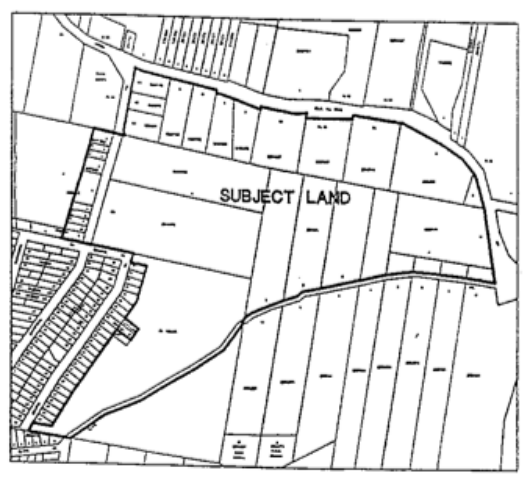

#### 5.16.1 LAND TO WHICH THIS CHAPTER APPLIES

This chapter applies to land bounded by and adjoining Avoca Drive, Elvys Avenue and Davistown Road as shown on the map below.

> [Picture on page 1: a picture, saved as a picture (images/ch-05-16-yattalunga-page-1-4.gif, 150 dpi).]

#### Figure 1 – Land to which this chapter applies
