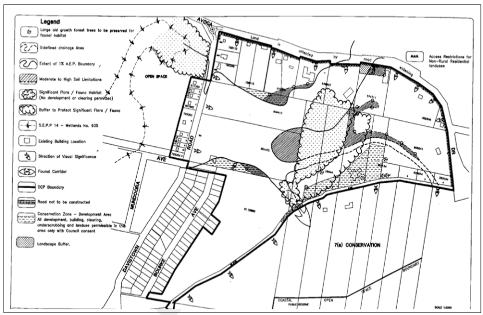

#### 5.16.5 EXPLANATORY NOTES TO PROVISIONS OF THIS CHAPTER

Studies completed as part of the determination of the appropriate zones for Yattalunga have highlighted a number of issues that need to be included in a Development Control Plan (DCP) Chapter to ensure that any new development will have minimal impact on the existing character of the area. Issues highlighted in the studies and included in this chapter relate to the protection of existing stands of vegetation, flood characteristics, site constraints due to waterlogging and bushfire hazard. Each of these issues is discussed below and the specific requirements relating to these issues are provided in this chapter.

#### 5.16.5.1 Protection of Existing Stands of Vegetation

Large areas of the Yattalunga site have been cleared of the native vegetation, the remaining vegetation consists of the swamp palm and swamp mahogany forests, blackbutt forests and low closed forests. The swamp mahogany forest is a very important vegetation community on the Central Coast being the only consistent winter flowering canopy tree and which produces copious amounts of nectar and pollen. The swamp palm forest is part of a contiguous vegetation unit which connects with the Yattalunga Ridge. It serves as a faunal movement corridor between the different habitats. As indicated on the accompanying plan (Figure 2), these areas are to be preserved. Both these forests are susceptible to exposure if the surrounding forest is removed. A 50 metre buffer forest is to be kept immediately surrounding this area.

#### 5.16.5.2 Flooding Characteristics and Urban Capability

It has been identified that a large area of the Yattalunga Investigation Zone is affected by the 1% AEP floodplain. No filling or development is permitted within the identified 1% AEP floodplain. However, within the R2 zone adjoining Davistown Road, filling is prohibited but development is permitted to a minimum floor level on piers so as to allow for overland runoff. Floor levels within the area covered by this chapter must be set at a minimum of 500mm above the 1% design flood level. Lot 2 DP 703303 contains flood prone land which may be required for the future conveyance of water for a second culvert under Davistown Road. There are also major limitations to development in this area due to prolonged water logging and high water tables. On-site effluent disposal is also unsuitable due to the soil conditions in this area.

#### 5.16.5.3 Treatment of Non-Residential Development

The C3 Environmental Management zone permits a range of non-residential uses such as nurseries, educational establishments and convalescent hospitals. The properties that front Avoca Drive are the most attractive for these types of uses due to their high exposure to passing traffic. It is important that such uses respect the rural area in which they are located. Building design should be of a low scale with significant areas being provided for landscaping. Buildings should be of a type that blends in with the rural landscape and signage should also be of materials and scale which are in keeping with the rural landscape.

> [Picture on page 4: a picture, saved as a picture (images/ch-05-16-yattalunga-page-4-1.gif, 150 dpi).]

#### Figure 2 – Development Restrictions
