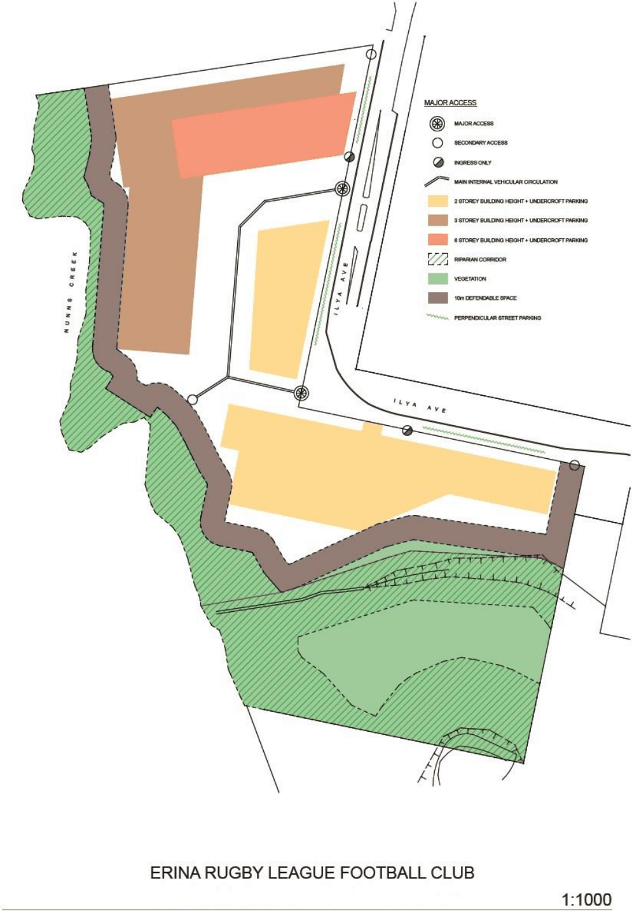
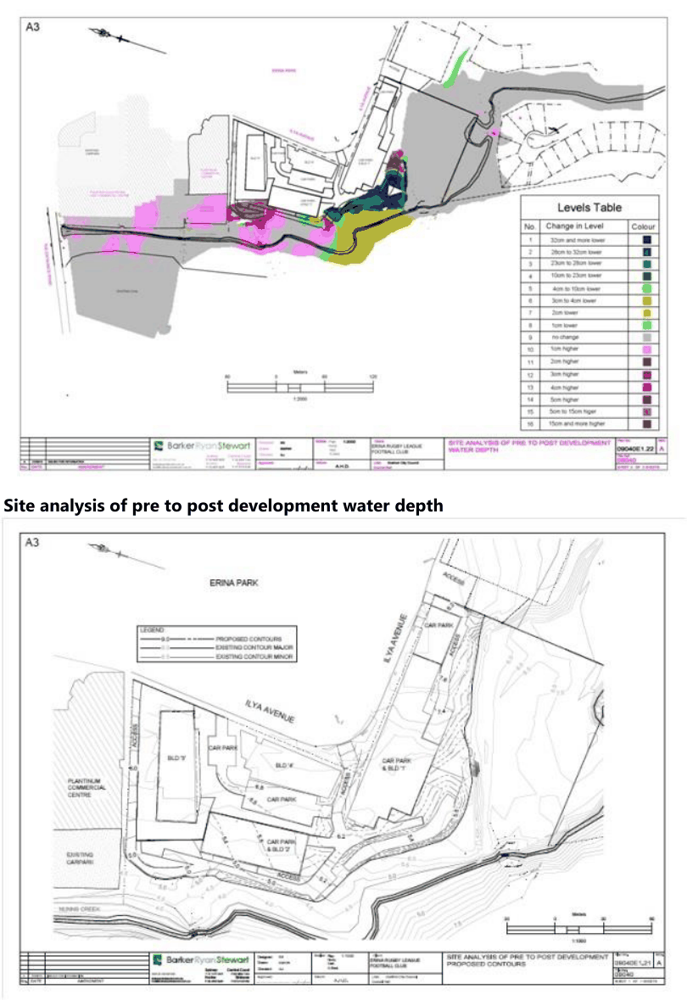

#### 5.18.5 OTHER CONTROLS APPLYING TO THE SITE

In addition to the provisions of this chapter of the DCP, the provisions of the more general chapters of Council’s DCP will also apply.

> [Picture on page 6: a picture, saved as a picture (images/ch-05-18-erina-18-ilya-avenue-erina-leagues-club-page-6-1.gif, 150 dpi).]

#### Figure 2 – Development Plan

> [Picture on page 7: a picture, saved as a picture (images/ch-05-18-erina-18-ilya-avenue-erina-leagues-club-page-7-1.gif, 150 dpi).]

#### Figure 3 – Site analysis of pre to post development water depth

#### Figure 4 – Site analysis of pre to post development proposed contours
