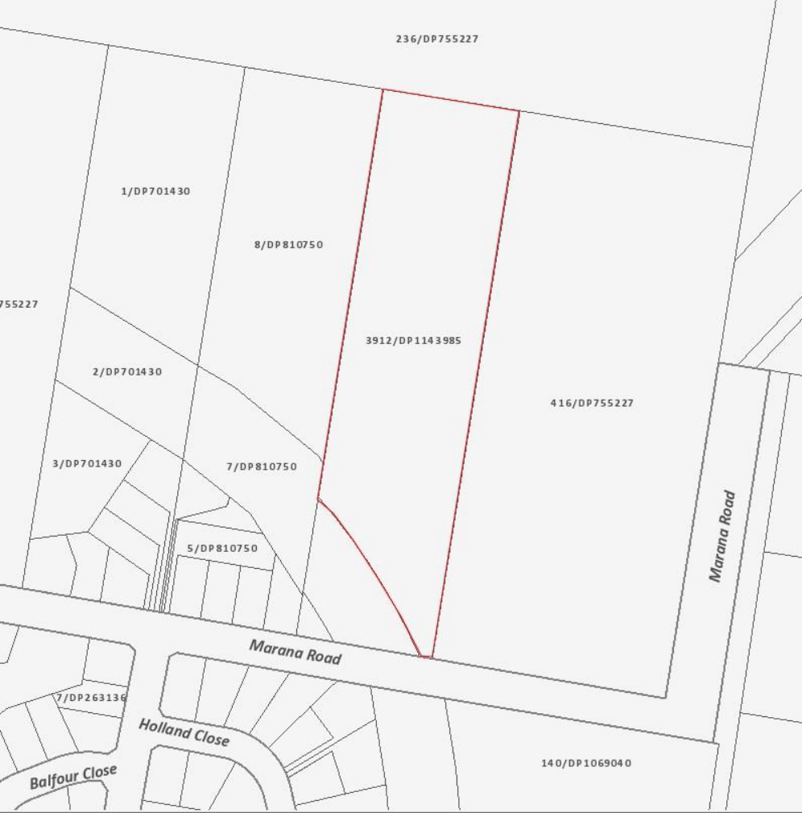

#### 5.19.1 LAND TO WHICH THIS CHAPTER APPLIES

This chapter applies to part of Lot 3912 DP 1143985 Marana Road, Springfield as shown in Figure 1.

> [Picture on page 1: a picture, saved as a picture (images/ch-05-19-marana-rd-springfield-page-1-4.gif, 150 dpi).]

#### Figure 1 Land to which this chapter applies
