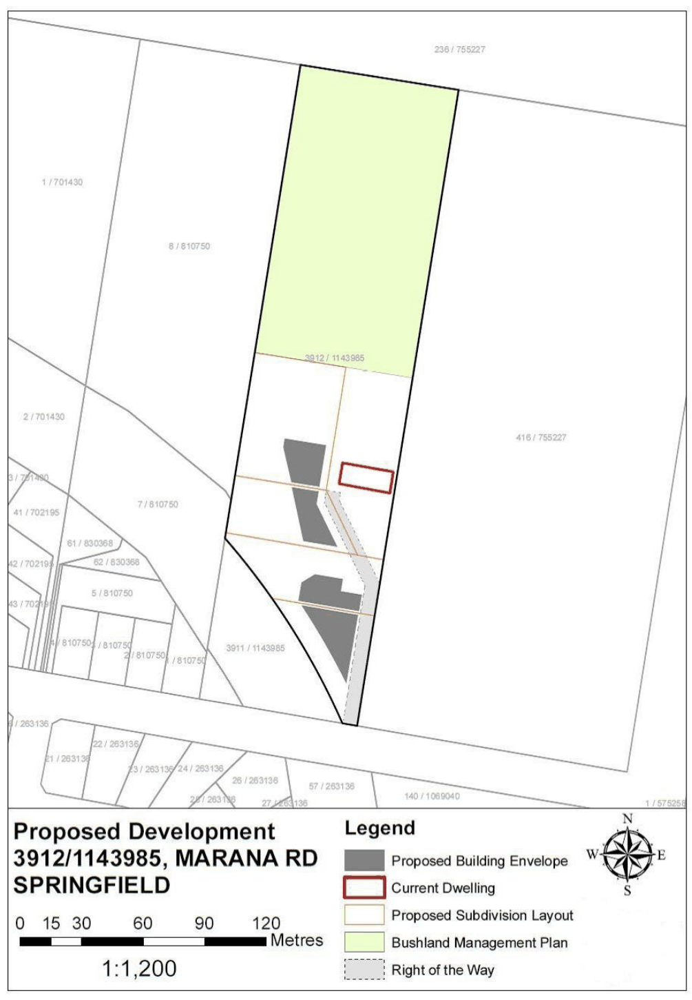

#### 5.19.4 SPECIFIC REQUIREMENTS

#### 5.19.4.1 Lot Layout

#### OBJECTIVES

▪ To enable development to proceed in a manner that is sensitive to the environmental characteristics of the site and surrounding land

▪ To locate the additional lots and associated building envelopes in the generally cleared areas at the southern part of the land

#### DEVELOPMENT CONTROL

a The lot layout and associated building envelopes are to be generally in accordance with those indicated in Figure 2.

#### 5.19.4.2 Environment

#### OBJECTIVES

▪ To enable development to proceed in a manner that is sensitive to the environmental characteristics of the site and surrounding land

▪ To protect the bushland in the northern part of the land from any adverse effects of development

#### DEVELOPMENT CONTROLS

a The bushland on the northern part of the subject land is to be placed under a section 88B restriction pursuant to the Conveyancing Act 1919 as to use and managed under a Bushland Management Plan that would be enforced under Section 88E of the Conveyancing Act 1919.

b A Bushland Management Plan is to be prepared for the bushland at the northern part of the subject land, as indicated in Figure 2, and be submitted with the development application for subdivision.

c The Bushland Management Plan is to be based on a detailed flora and fauna assessment of the area. It is to include how the area will be managed from the impact of the edge effects.

d The Bushland Management Plan is to be in force for a period of ten (10) years from the date of the registration of the subdivision.

#### 5.19.4.3 Servicing

#### OBJECTIVE

To ensure the land is adequately serviced

#### DEVELOPMENT CONTROLS

a Connection to the reticulated water supply system would be subject to the following conditions at a future subdivision stage:

i The developer shall be responsible for provision of individual water services to each of the proposed lots from Marana Road frontage and for determining the size of such services, as well as provision of any additional infrastructure (private internal pump systems) necessary to ensure sufficient pressure to operate internal fixtures within proposed dwellings. All works shall be carried out in compliance with AS/NZS 3500;

Note: Council’s minimum level of service (pressure) is only available at the road frontage to the development

site. The developer shall be responsible for determining whether additional infrastructure is required to service each lot.

ii Payment of the current water headworks and augmentation contributions, in accordance with Council’s policy;

iii The developer shall be responsible for the full cost of the design and construction of all works necessary to service the proposed subdivision in accordance with Council Policy.

b As a consequence, any further development (subdivision / additional dwellings) of Lot 3912 DP 1143985 Marana Road will require the developer to install sewer mains which comply with WSAA Sewer Design Code standards. The following conditions would apply:

i The developer shall be responsible for the full cost of the design and construction of sewer mains to service the proposed subdivision;

ii Payment of the current sewer augmentation contributions, in accordance with Council’s policy.

c Any of the above servicing requirements are not to be contrary to the Deed of Release and Indemnity executed in 2010 under the Land Acquisition (Just Terms Compensation) Act 1991.

#### 5.19.4.4 Land Contamination

#### OBJECTIVE

To ensure the land is not contaminated from past agricultural uses

#### DEVELOPMENT CONTROL

a Intrusive contamination investigation and testing is to be undertaken as part of the subdivision assessment to confirm the site’s contamination status. This investigation is to be based on and take into account the recommendations of the “Report on Preliminary Site Investigation for Contamination”, Douglas Partners, May 2014.

#### 5.19.4.5 Bushfire

#### OBJECTIVE

To ensure the proposed development satisfies the acceptable solutions for access in Planning for Bushfire Protection 2019

#### DEVELOPMENT CONTROLS

a Provide a 6.5 metre wide sealed driveway to allow for two way traffic to the point where access is only to two dwellings.

b A turning circle with a minimum 12m outside radius is to be provided on site.

> [Picture on page 5: a picture, saved as a picture (images/ch-05-19-marana-rd-springfield-page-5-1.gif, 150 dpi).]

#### Figure 2 Development Plan
