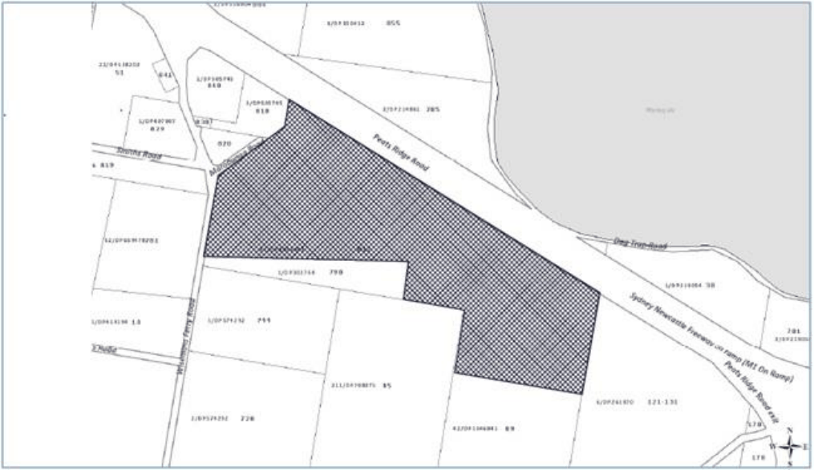

#### 5.20.1 LAND TO WHICH THIS CHAPTER APPLIES

This DCP chapter applies to Lot 41 DP 1046841 Wisemans Ferry Road/Peats Ridge Road Somersby as shown on the map below.

> [Picture on page 1: a picture, saved as a picture (images/ch-05-20-somersby-wisemans-ferry-road-peats-ridge-road-some-page-1-7.gif, 150 dpi).]

#### Figure 1 – Land to which this chapter applies
