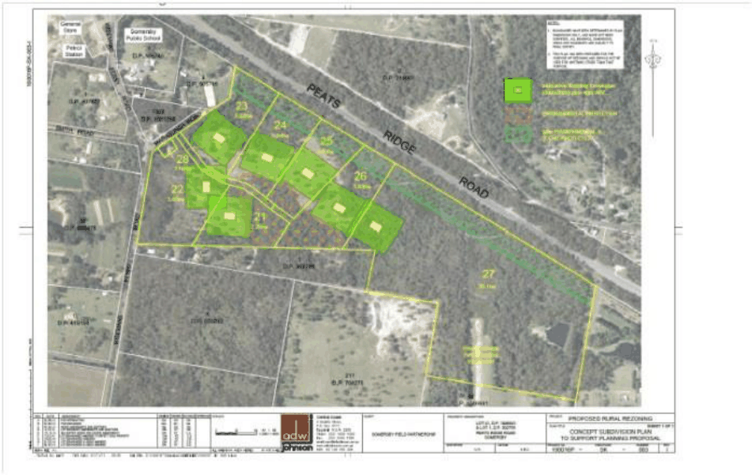

#### 5.20.4.9 Conceptual Development

a Development is to generally occur in accordance with the provisions of these DCP provisions and the attached conceptual subdivision plan in relation to the location of dwelling envelopes, areas of environmental protection and the like;.

b The road shown dissecting the area (see plan below) in the central part of the site (orange spots) which contains significant environmental habitat is not to be constructed, with alternative access arrangements being considered at the time of subdivision through the creation of roadways, rights of carriageway, etc as may be appropriate.

c Council will give consideration to variations to these provisions only where it can be clearly demonstrated that improved environmental outcomes can be achieved through detailed site assessment and development planning having regard to threatened species, remnant bushland, visual and scenic quality, access arrangements, bushfire considerations, dwelling house locations, effluent disposal areas and other matters as may be relevant. Such amendments would need to be supported by relevant assessments as required under the Biodiversity Conservation Act 2016 or other detailed studies as may be relevant.

d The development application for the subdivision is to be supported by an appropriate Plan of Management for On-site Vegetation to encapsulate the provisions of this DCP, including off-sets areas, compensatory revegetation/plantings on the site having particular regard to threatened species and their habitats, and other bushland areas, more detailed design and siting issues associated with dwelling houses, access (including emergency access), bushfire radiation zones, effluent disposal areas, potential aboriginal archaeological sites and the like but only where no practical alternative exists and appropriate approvals/permits are obtained. This Plan of Management is to be prepared in consultation with Council and to have regard to issues raised by government agencies. Once finalised, the Plan of Management is to inform final details to be specified in the covenant binding the existing/future owner(s) and Council under the appropriate legislation and to be registered prior to the release of the Subdivision Certificate.

Note: location of Proposed Lot 28 (containing the existing transmission tower/possible future tower), may be at variance to the LEP as made due to the scale of mapping. Reliance should be made on the LEP plan, rather than this DCP plan. Full construction of the length of the centralised access road is not supported as contained in these DCP provisions).is not supported as contained in these DCP provisions).

\+

> [Picture on page 8: a picture, saved as a picture (images/ch-05-20-somersby-wisemans-ferry-road-peats-ridge-road-some-page-8-2.gif, 150 dpi).]

#### Figure 2 – Concept subdivision plan
