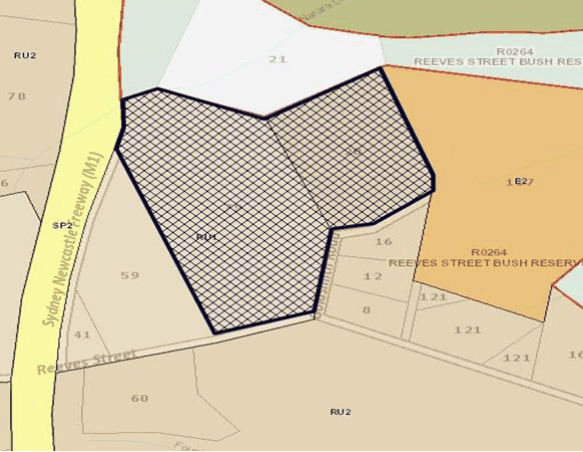
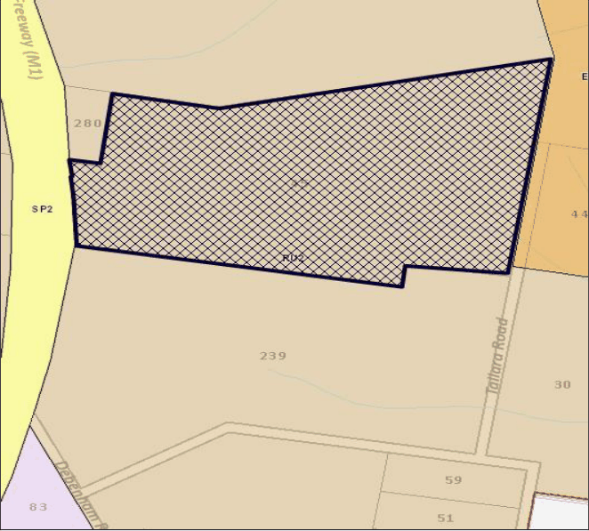

#### 5.21.2 LAND TO WHICH THIS CHAPTER APPLIES

This DCP Chapter applies to both the northern and southern precincts of land to the east of the M1 Motorway at Somersby, which has been the subject of an amending Local Environmental Plan (LEP) for three

lots. The LEP provisions rezoned the land from RU1 and RU2 to C2 Environmental Conservation and C3 Environmental Management, to better reflect its environmental values and to allow for low key “environmental” and “lifestyle” subdivision in appropriate locations as a result of listing in Schedule 1 of Gosford LEP 2014 (and subsequently Central Coast LEP 2022) to allow land subdivision into a specified number of allotments.

The northern precinct is zoned C2 Environmental Conservation and C3 Environmental Management. It is located off the Somersby end of Reeves Street and comprises Lot 12 DP 263427 (the rear section of which is to be zoned C2) and C3 Environmental Management over the remainder of Lot 12, and also for the whole of Lot 41 DP 771535 (see Figure 1 and Figure 2 below).

> [Picture on page 1: a picture, saved as a picture (images/ch-05-21-east-somersby-page-1-25.gif, 150 dpi).]

#### Figure 1 Northern Precinct

Note: Different scale to figure 2

The southern precinct is generally located off Debenham Road at Somersby and is zoned C2 Environmental Conservation under Central Coast LEP 2022. It comprises of land on the eastern side of the M1 Motorway, off Debenham Road, and as a consequence of Council’s Resolution of 24 November 2015, now consists of one lot only, being Lot 4 DP 261507 Debenham Road North. Two other lots that were subject of the original planning proposal (being Lot 3 DP 260507 and Lot 2051 DP 559231 Debenham Road) were removed at the request of the owners or their representatives, after the public exhibition period.

> [Picture on page 2: a picture, saved as a picture (images/ch-05-21-east-somersby-page-2-7.gif, 150 dpi).]

#### Figure 2 Southern Precinct

Note: Different scale to figure 1
