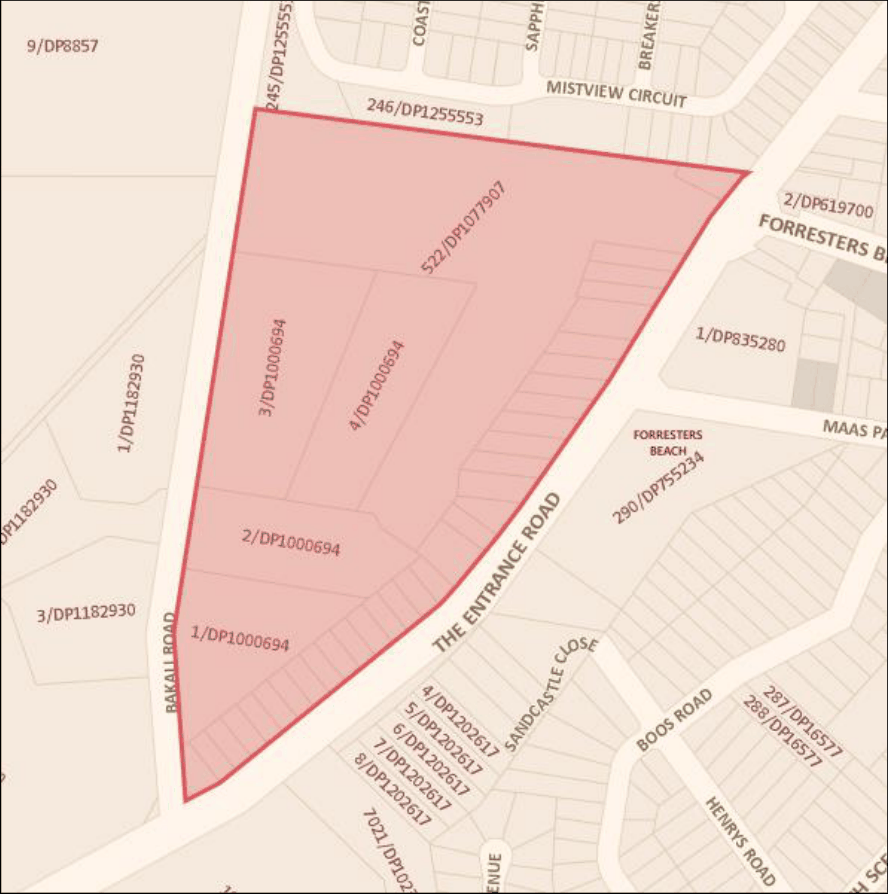

#### 5.23.1 INTRODUCTION

#### 5.23.1.1 Land to which this Chapter applies

This chapter applies to Lots 1-4 DP 1000694 Bakali Road and Lot 522 DP 1077907, Lot 51 DP 1028301, Lot 62 DP 838562, Lot 1 DP 405510, Lots 1-3 DP 101649, Lots 1-8 DP 24187, Lots 155-156 DP 531710, Lots 1-14, 18 & 19 DP 23283 The Entrance Road (Central Coast Highway), Forresters Beach as shown on the map below.

> [Picture on page 1: a picture, saved as a picture (images/ch-05-23-forresters-beach-bakali-road-page-1-8.gif, 150 dpi).]

Figure 1 – Land subject to this Chapter

#### OBJECTIVES

• To ensure development is not adversely impacted by stormwater flows.

• To ensure that stormwater flows do not adversely impact properties outside the subject land.

• To ensure the safety of residents in, and around, the stormwater drainage works.

• To enable development to proceed in a manner which is sensitive to the environmental characteristics of the site and its environs.

• To protect the environment of Wamberal Lagoon from any adverse effects of development.

• To ensure development is designed in accordance with water sensitive urban design guidelines.

• To enable development to proceed in a manner which is sensitive to the ecological characteristics of the site and surrounding land.

• To protect the endangered ecological community on the western part of the land and other significant vegetation on the land from any adverse effects of development.

• To ensure any fill containing asbestos is satisfactorily removed from the site.

• To facilitate safe vehicular access to and from the site.

• To ensure development does not have an adverse impact on the safety and efficiency of the road network.

• To ensure that the character of Bakali Road is retained.

• To ensure an orderly subdivision occurs on the subject land.

• To ensure that the land to be dedicated as open space is safe and usable for the public.
