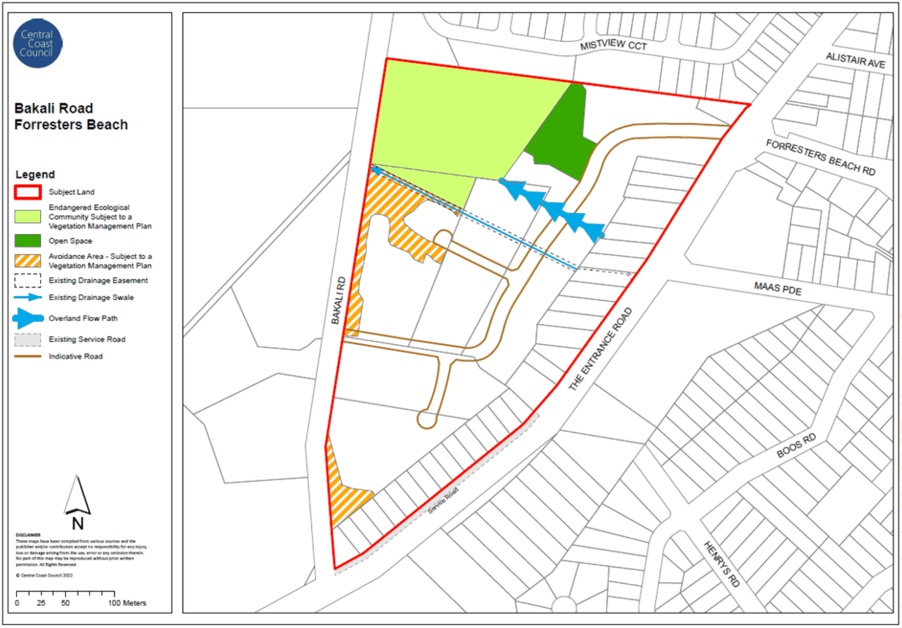
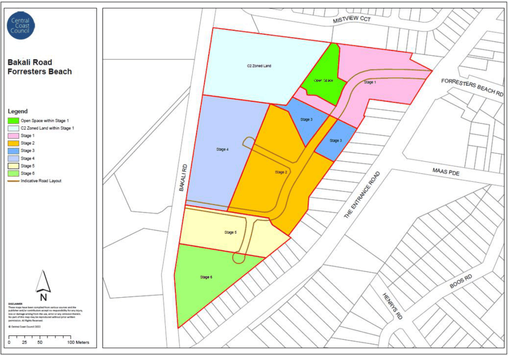

#### 5.23.2.6 Public Open Space

#### OBJECTIVE

▪ To ensure that the land to be dedicated as open space is safe and usable for the public.

#### REQUIREMENTS

a The land identified as Open Space is to be flood free.

b If the open space is ultimately located adjacent to a drainage reserve, suitable safety fencing is to be provided between the open space and the drainage reserve.

c A Soil Contamination Report is to be submitted to Council and approved prior to the dedication of the Open Space to Council.

d The land to be dedicated to Council for Open Space is to be free of noxious weeds and vermin to Council’s satisfaction.

#### Figure 1 – Site Plan

> [Picture on page 9: a picture, saved as a picture (images/ch-05-23-forresters-beach-bakali-road-page-9-2.gif, 150 dpi).]

#### Figure 2 – Staging Plan

> [Picture on page 10: a picture, saved as a picture (images/ch-05-23-forresters-beach-bakali-road-page-10-2.gif, 150 dpi).]
